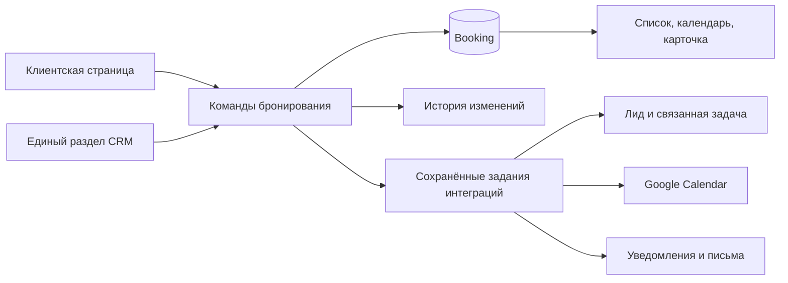

# Единый раздел «Встречи и запись»

Дата: 2026-10-24, Asia/Baku.
Статус: архитектурное предложение; приложение ещё не изменено.
База исследования: `origin/main`, `64356065f3878a547bdd5fa87cbf9f789f1f92a2`.

## 1. Задача и граница решения

Пользователь хочет видеть и обрабатывать записи клиентов в одном месте, без
переходов между настройками онлайн-записи, задачами, лидами и календарём.
Основной результат: после подтверждения клиентом встреча сразу доступна
сотруднику в журнале, даже если Google Calendar или отправка письма не работают.

Предлагаемый сценарий: координатор работает со встречами доступной ему команды,
принимающий сотрудник — со своими. Это проектное допущение, вопрос пользователю
задан; ответ может уточнить права, но не меняет единый источник данных.

Объём: клиентские встречи по публичной ссылке и записи, созданные сотрудником.
Полевые маршруты MTM, HRM, маркетинговые мероприятия и все задачи CRM остаются
своими доменами. Это не попытка объединить их в универсальный календарь.

## 2. Что существует сейчас и почему пользователь теряет запись

| Факт в текущем коде | Следствие |
| --- | --- |
| `BookingPage` задаёт публичную страницу; `Booking` хранит саму бронь | Основа журнала уже есть; новую сущность Meeting создавать не нужно |
| `afterBooking` отдельно создаёт лид, задачу, Google-событие и уведомления | Подтверждённая бронь может существовать без задачи и лида |
| `/settings/booking` показывает страницы и число предстоящих встреч | Здесь нельзя увидеть, кто записался, или обработать запись |
| `/tasks` убран из меню; доска фильтрует по `divisionId` | Задача бронирования без подразделения не получает очевидного входа |
| Пункт меню относится к Sales, API страниц требует `settings` | Видимость пункта не означает доступ обычного сотрудника к данным |
| Бронь имеет только `confirmed/cancelled`, нет истории переносов | Нельзя надёжно вести полный рабочий цикл встречи |
| Google при ошибке считается свободным, задача CRM не участвует в занятости | Нельзя обещать отсутствие конфликтов со всеми календарями |

Источники: `src/lib/booking/book.ts`, `src/lib/booking/availability.ts`,
`src/app/(dashboard)/settings/booking/page.tsx`, `src/lib/nav-items.ts`,
`src/app/(dashboard)/boards/[divisionId]/page.tsx`,
`src/app/api/v1/booking-pages/route.ts`,
`prisma/migrations/20261101090000_online_booking/migration.sql`.
Это выводы по коду, а не аудит конкретных записей production.

## 3. Один вход и один рабочий сценарий

Пункт меню: **Продажи → Встречи и запись**, рядом с основными действиями отдела
продаж. Адрес: `/meetings`. Название и положение предлагаются к согласованию.
Поиск меню должен находить «встречи», «запись», «онлайн-запись» и переводы.

| Часть раздела | Что делает пользователь |
| --- | --- |
| Встречи — основная вкладка | Видит предстоящие записи, ищет клиента, переключает список/календарь |
| Карточка встречи внутри раздела | Видит контакты и историю; переносит, отменяет, отмечает результат |
| Страницы записи | Создаёт и редактирует публичные ссылки, участников, часы и длительность |

Список и календарь — два вида одной вкладки, одного фильтра и одного API.
Отдельной вкладки с дублирующими данными «Все заявки» не требуется.
Рабочие часы в первой версии остаются настройкой конкретной страницы.
Отдельный конструктор расписаний, ресурсов и переговорных не входит в неё.

Начальный вид: предстоящие встречи, начиная с сегодняшнего дня, по времени.
Переключатели: сегодня / 7 дней / период / история; мои / доступная команда;
статус, сотрудник, страница записи, поиск по разрешённым контактным данным.
Название выбранной области видно рядом с фильтрами; «нет записей» не должно
маскировать включённый фильтр «мои».

Строка: дата и время, клиент, тема встречи, ответственный, формат/место, статус.
При сбое интеграции — отдельная понятная пометка; статус встречи остаётся своим.
Нажатие открывает панель с подробностями, не сбрасывая фильтры и прокрутку.
На телефоне та же карточка открывается на весь экран с возвратом в тот же список.

Основные действия в панели:

- Перенести время и при необходимости выбрать другого принимающего сотрудника.
- Отменить с причиной; отдельно показать, какие уведомления будут отправлены.
- Отметить «Состоялась» или «Не пришёл», записать результат встречи.
- Посмотреть контакт, комментарий клиента, историю и состояние уведомлений.
- Создать последующую задачу в компактной форме здесь же, если она нужна.
- Открыть полную карточку лида/контакта как дополнительное действие.

Создать встречу вручную можно в этом же разделе, с выбором страницы, свободного
времени и принимающего сотрудника. Проверки занятости те же, что для клиента.
Свободное назначение вне расписания и обход занятости не входят в первую версию.
Любая отправка клиенту при ручной записи/изменении явно обозначена до сохранения.

Уведомление о записи открывает `/meetings?booking=<id>`, а не задачу.
Прямой вход по ID не зависит от периода списка: разрешённая запись открывается
и вне текущего фильтра. Отсутствие доступа возвращает нейтральное «не найдена».

## 4. Центральная запись и связанные данные

**Booking остаётся источником истины для времени, ответственного, состояния
и результата встречи.** Task, Lead и Google Calendar не определяют, существует
ли встреча, и не используются как запасной источник списка.

Схема показывает логические связи. Booking, событие изменения, квитанция команды
и намерения интеграций сохраняются в одной PostgreSQL-транзакции. Локальные
CRM-проекции восстанавливаются транзакционно и идемпотентно; внешние вызовы
выполняются после commit. HTTP-ответ о брони не ждёт внешних провайдеров.

### Изменения модели

| Объект | Решение |
| --- | --- |
| Booking | Сохранить ID, `organizationId`, страницу, время и прежние ссылки |
| Версия | Добавить `version`; каждое изменение состояния требует ожидаемую версию |
| Исторические данные | Сохранять снимок названия, места, формата, часового пояса, длительности и перерывов |
| Источник | `public_link` или `staff`; создатель, причина изменения, время изменения |
| Результат | `confirmed`, `completed`, `no_show`, `cancelled`; результат и причина отдельно |
| Связи с CRM | Необязательные `leadId`, `contactId`, `taskId`; доступ проверяется отдельно |
| Интеграции | Отдельное состояние каждой связи: ожидает, применена, ошибка, требует проверки; desired/applied version |
| История | Append-only события через существующую event-platform, с автором и версией, без дублирования вторая таблица истории |
| Команды | Идемпотентная квитанция с областью действия, ключом запроса и хешем значимых параметров |

Связи на пользователя, страницу, лид, контакт и задачу обязаны принадлежать той
же организации. Новые ограничения строятся через составные tenant-ключи там,
где позволяет схема; оставшиеся связи проверяются сервером внутри транзакции.
До добавления FK — отчёт о существующих неверных/осиротевших связях, без удаления.

Архивирование страницы закрывает новые записи и сохраняет старые встречи.
Новый API не предлагает hard delete страницы; текущий `ON DELETE CASCADE`
между страницей и бронями меняется на запрет удаления при наличии истории.
Политика удаления самой организации остаётся отдельным существующим процессом.

### Состояния и история

- `confirmed → completed | no_show | cancelled` — явные действия с правами.
- Перенос меняет время/ответственного и увеличивает версию той же записи.
  «Перенесена» — событие истории, не постоянный статус.
- Истечение времени само не означает «Состоялась». Прошедшая запись без
  результата показывается как «Нужен результат», с сохранением `confirmed`.
- До окончания встречи нельзя отметить её состоявшейся или неявку.
- Исправить ошибочный итог может координатор отдельной командой с причиной.
  Исправление не должно резервировать новый слот или тайно возобновлять отмену.
- Отменённую встречу в первой версии не восстанавливаем: новая запись с новым
  ID и ссылкой на предшественника проходит обычную проверку занятости.
- Перенос и изменение принимающего сотрудника доступны только будущей
  подтверждённой записи. Исторические исправления не меняют фактическое время.

Снимки у старых записей заполняются только доступными текущими значениями с
меткой `legacy_derived`; невозможно выдать их за исходные исторические данные.
Отсутствующие оригинальные значения остаются «не сохранено».

## 5. Команды, повторы и сохранность записи

Один серверный сервис обслуживает публичную страницу, внутреннюю ручную запись,
перенос, смену сотрудника, отмену и фиксацию результата. Контроллеры проверяют
входные данные и вызывают сервис, не копируют бизнес-правила.

Порядок команды:

1. Определить организацию, principal, разрешённую область и доступ к записи.
2. Проверить идемпотентный ключ: такой же запрос возвращает сохранённый результат;
   тот же ключ с другими параметрами — `409 IDEMPOTENCY_CONFLICT`.
3. Для изменения захватить блокировку записи и необходимые блокировки принимающих
   сотрудников в стабильном порядке. Проверить версию, статус, активность
   сотрудника, страницу и актуальные правила внутри транзакции.
4. Проверить слот; создать/изменить Booking, увеличить версию, записать событие,
   квитанцию и задания интеграций в одной транзакции.
5. Вернуть подтверждённую встречу. Worker применяет связанные изменения отдельно.

Ключ публичного запроса генерируется перед первой отправкой и сохраняется при
сетевом повторе; область — организация + страница + тип команды. Он не является
правом чтения произвольной записи. Публичный lookup квитанции требует отдельный
непредсказуемый секрет восстановления; ID/хеш формы не дают доступ к данным.
Два разных клиента с одним временем конкурируют за слот обычным способом.

Существующий токен отмены хранится только хешем. Для повторного ответа и отправки
письма нужен защищённый механизм: краткоживущий зашифрованный ответ/секрет доставки
в отдельном хранилище с TTL, а в outbox — только ссылка на него. Открытые токены,
телефоны, тексты клиента и адреса не записываются в логи или неизменяемые события.
Старые ссылки отмены продолжают работать. По истечении TTL нельзя создавать новую
бронь при повторе старого ключа: квитанция сообщает «уже сохранено», восстановление
подтверждения идёт отдельным защищённым сценарием. Срок хранения дедупликационной
записи должен покрывать поддерживаемое окно повторов и быть документирован.

Перенос сохраняет старый слот до успешного commit нового. При смене сотрудника
проверяются и блокируются оба; неудача не оставляет клиента без встречи.
Повтор отмены возвращает текущее состояние; незавершённые задания отмены worker
продолжает обрабатывать независимо от повторного HTTP-запроса.

## 6. Занятость и время

- В PostgreSQL время трактуется как UTC; API принимает ISO timestamp с offset.
  Пользователь видит явный часовой пояс записи; по умолчанию — пояс организации.
  Запись хранит IANA timezone отдельно от UTC, браузерный пояс не подменяет его.
- Внутренняя занятость = все действующие Booking этого сотрудника в организации,
  независимо от страницы и способа создания. Обычная задача без длительности
  не считается встречей и не блокирует слот.
- Перерывы сохраняются у каждой записи. Между соседними встречами требуется
  минимум `max(перерыв после предыдущей, перерыв перед следующей)`; правила новой
  страницы не стирают ранее обещанный перерыв. Проверяются обе стороны интервала.
- Пересечение реальных интервалов дополнительно запрещается DB exclusion
  constraint для действующих броней по организации и сотруднику. Конкретный
  операторный класс/расширение проверяется миграционным gate; тип диапазона
  соответствует текущим UTC `TIMESTAMP(3)`. Это не заменяет проверку перерывов.
- При наличии подключённого Google Calendar его недоступность означает
  «не удалось проверить календарь»: автоматическое создание/перенос такого
  сотрудника блокируется до успешной проверки. У неподключённого календаря
  такой ошибки нет. Различие этих состояний нужно добавить в адаптер.
- При переносе из free/busy исключается собственное синхронизированное событие.
- Внешний календарь может измениться между проверкой и записью: общей транзакции
  с Google нет. Обещать абсолютное отсутствие внешних гонок нельзя. Обнаруженный
  конфликт требует действия сотрудника, не автоматической отмены клиента.
- Изменения в Google не переносят CRM-встречу автоматически. В первой версии
  синхронизация управляется из CRM; изменение снаружи показывается как конфликт.

Проверки обязаны покрывать разные длительности, соприкасающиеся интервалы,
переход суток, разные timezone/DST, перенос на свой текущий слот, отключение
сотрудника и закрытие страницы одновременно с публичной записью.

## 7. Надёжные интеграции и защита от дублей

В репозитории уже есть `EffectOutbox`, `enqueueEffect`, версии агрегатов,
квитанции команд и lease-механизмы. Booking к ним ещё не подключён, готового
worker для его эффектов нет. Применить существующий контракт и добавить
ограниченный booking-worker; не заводить вторую универсальную очередь.
Работа раздела не должна зависеть от Kafka или его ввода в эксплуатацию.

События Booking добавляются в контракт Sales с отдельным aggregate type;
нужны регистрация схем, миграционные и tenant-проверки event-platform.
Это использование её PostgreSQL-примитивов, а не обещание полного восстановления
всех персональных данных из событий: рабочая Booking и резервные копии остаются
необходимы. История содержит структурные изменения и защищённые ссылки.

Worker берёт ограниченную пачку по lease/CAS, с лимитом времени, попыток и
повтором после рестарта. Он восстанавливает tenant-context для каждой записи.
Ключ работы включает организацию, Booking, версию и вид эффекта. После проверки
актуальной версии устаревшая работа не должна вернуть отменённую встречу или
перезаписать более новый перенос. Состояние каждого ресурса сверяется отдельно.

Локальные CRM-проекции создаются по стабильной связи с Booking и уникальному
ключу; создание записи и сохранение её связи происходят в одной транзакции.
Повтор не создаёт второй лид/задачу. Для уже существующих неоднозначных связей
автоматическое «создать ещё раз» запрещено: сначала сверка.

Для внешних вызовов использовать имеющийся контракт эффектов:

- `pending` можно повторять до отправки; известный отказ — только по явной
  политике. Потеря ответа после возможной отправки = `reconciliation_required`.
- Provider idempotency использовать только после проверки реальной поддержки
  адаптером. Одного уникального ключа в нашей таблице недостаточно для exactly-once.
- При неизвестном результате письма не посылать его автоматически ещё раз.
  Пользователь видит «Доставку не удалось подтвердить», а не ложное «не отправлено».
- Отмена/перенос должны довести Google до последнего желаемого состояния,
  включая позднее завершившийся create старой версии. Нужна сверка provider ID
  и порядка выполнения по одному календарному ресурсу.
- Повторная сборка списка или истории не отправляет сообщения; replay/shadow
  используют существующий запрет эффектов.

Состояния интеграций видны в карточке простыми словами. Технические логи,
ручная сверка неизвестных отправок и массовые повторные попытки доступны только
уполномоченному оператору, не каждому принимающему сотруднику.

## 8. Лиды, контакты и задачи

Первый выпуск сохраняет совместимость с текущей автоматической задачей и лидом.
Их наличие не требуется для работы со встречей. Не нужно возвращать общий список
задач в меню или искусственно назначать брони подразделение для попадания на доску.

Для задачи-зеркала Booking владеет датой, ответственным и состоянием. Изменение
этих полей из задач должно перенаправляться в команду Booking либо предлагать
открыть встречу. Ограничение обязательно на сервере, включая bulk/API/автоматизации,
а не только отключённые поля формы. Обычные задачи остаются обычными задачами.
Новая последующая задача после встречи — отдельная самостоятельная сущность.

Клиентские имя, телефон, email и комментарий сохраняются в Booking независимо
от связи с CRM. Ручной выбор существующего контакта возможен только с правом
просмотра этого контакта. Публичный телефон/email не являются доказательством
личности и не дают автоматического доступа к чужой карточке или её объединения.

Повторный технический запрос не создаёт дубль лида. Две самостоятельные встречи
одного человека пока могут иметь разные лиды — это сохранённая бизнес-политика,
а не решённая дедупликация клиентов. Дальнейшее сопоставление предлагается
координатору в панели и требует отдельного правила, не скрытого merge.

## 9. Доступ: один контракт для меню, API и данных

Добавить scope `bookings` с привязкой к продуктовому модулю Sales и отдельными
операционными разрешениями. Не выдавать доступ к настройкам всей организации
ради просмотра собственной встречи. Старое `settings` остаётся настройками.

| Возможность | Принимающий сотрудник | Координатор с доступом команды | Администратор |
| --- | --- | --- | --- |
| Просмотр списка/карточки | Свои встречи | Разрешённая команда | Организация |
| Результат, перенос, отмена | Свои при разрешённом действии | В своей области | Организация |
| Назначение другого сотрудника | Только если отдельно разрешено | В своей области | Организация |
| Страницы и рабочие часы | По отдельному разрешению | По отдельному разрешению | Да |
| Сверка внешних эффектов | Нет | По отдельному разрешению | По отдельному разрешению |

Это продуктовые роли; слово «координатор» не означает автоматически текущий
системный `manager`. Использовать существующий серверный источник членства
в командах после проверки его пригодности; до этого безопасный минимум —
свои встречи и явно разрешённый администратору доступ всей организации.
Нельзя считать текущий клиентский фильтр host/team границей авторизации.

Одинаковые predicate и phone-privacy правила применяются к списку, календарю,
итогам, поиску, подбору сотрудников, деталям, истории и командам. Просмотр
встречи не даёт автоматически читать связанный лид или заметки контакта.
Комментарий клиента и внутренний результат — разные поля с разными аудиториями.
RLS обеспечивает tenant-границу; own/team ограничения добавляются сервером.
Viewer/reviewer и API-key principals не получают новые права по умолчанию.

## 10. API и структура реализации

Предлагаемые контракты (не существующие endpoints):

| Endpoint | Назначение |
| --- | --- |
| `GET /api/v1/bookings` | Пагинированный список и доступные фильтры |
| `GET /api/v1/bookings/calendar` | Интервалы и счётчики дней в заданном окне |
| `GET /api/v1/bookings/:id` | Карточка, доступные действия, защищённые связи |
| `GET /api/v1/bookings/:id/history` | Пагинированная история |
| `POST /api/v1/bookings` | Ручное создание через тот же доменный сервис |
| `POST /api/v1/bookings/:id/reschedule` | Перенос и смена принимающего, с version |
| `POST /api/v1/bookings/:id/cancel` | Отмена с причиной |
| `POST /api/v1/bookings/:id/outcome` | Результат и его отдельное исправление |
| `GET /api/v1/bookings/availability` | Разрешённые слоты и явное состояние календаря |
| `/api/v1/booking-pages` | Сохранить API страниц, согласовать с новой моделью прав |

Публичные `/book/:slug` и `/api/v1/public/booking/:slug` сохраняются; внутри
переходят на общий сервис. Старый `/settings/booking` остаётся совместимым
входом во вкладку страниц, после контролируемого переноса навигации.

Модули в `src/lib/booking/`: `queries`, `access`, `commands`, `availability`,
`projections`, `effects`. HTTP handlers тонкие. UI-компоненты общего workspace
не зависят от внутренних компонентов страниц задач и не загружают все задачи.

Список: keyset cursor по `(startsAt,id)`, серверные фильтры, 50 строк по умолчанию,
максимум 100. Индексы: `(organizationId,startsAt,id)` и
`(organizationId,hostUserId,startsAt,id)`, дальнейшие — по query plan.
Поиск по телефону учитывает маскирование и не раскрывает скрытый номер фактом
совпадения. Текст поиска не отправляется в логи/метрики.

Календарь: ограниченное окно до 42 дней, точные доступные пользователю счётчики
по дням; максимум показываемых событий дня явный. «Ещё N» открывает полностью
пагинированный день. Нельзя молча показать первые 200 встреч как весь календарь.
На изменениях — повторное чтение списка, карточки и счётчиков; polling только
видимой вкладки. Realtime transport не нужен для первого выпуска.

## 11. UX-бриф и состояния

Аудитория: принимающий сотрудник и координатор, которые ежедневно ищут ближайшую
встречу и обрабатывают изменение клиента. Главная задача — понять, кто, к кому
и когда придёт, и выполнить следующее действие без потери контекста.

Направление: спокойный рабочий экран внутри существующей оболочки LeadDrive,
чёткая типографика, умеренная плотность, существующие тема и акцент. Контекст
`.impeccable.md` используется для оболочки; специфичные для social/MTM решения
из других брифов сюда не переносятся. Новый бренд или шрифтовая система не нужны.

| Состояние | Поведение |
| --- | --- |
| Нет страниц и встреч | Объяснение и действие создать страницу, если есть право |
| Страница есть, записей нет | Скопировать ссылку; показать, кто принимает |
| Фильтр ничего не нашёл | Видимые фильтры и сброс; не предлагать заново настраивать сервис |
| Загрузка/обновление | Скелет при первом входе, сохранение данных при обновлении |
| Ошибка списка | Сообщение и повтор; не выдавать ошибку за пустой список |
| Конфликт времени/версии | Сохранённый ввод, актуальные данные и выбор нового слота |
| Сетевая неопределённость команды | Проверить квитанцию по тому же ключу, не создавать новую запись |
| Бронь есть, интеграция отстаёт | Встреча видна; отдельное сообщение о календаре/письме |
| Нет прав | Скрытые запрещённые действия и объяснение в контексте разрешённой записи |
| Удалён/отключён принимающий | Историческое имя сохраняется; будущая встреча требует назначения |
| Неизвестная история старой записи | Прямо обозначить отсутствие исходных данных |

Тексты и форматы — AZ/RU/EN. Статусы не различаются одним цветом; клавиатурный
фокус, подписи кнопок, возврат фокуса из панели, сенсорные цели и 200% масштаб
входят в приёмку. На телефоне — список по дням; календарь не сжимается в
нечитаемую сетку. В интерфейсе не показываются слова outbox, CAS и aggregate.

Рекомендации для реализации: impeccable `reference/interaction-design.md`,
`reference/responsive-design.md`, `reference/spatial-design.md`,
`reference/ux-writing.md`. Этот бриф пока предложен, а не подтверждён владельцем.

## 12. Этапы внедрения и проверка

| Этап | Результат | Обязательное доказательство |
| --- | --- | --- |
| A. Журнал и карточка | Прямое чтение Booking, фильтры, новый единый вход, страницы в том же разделе | Запись видна без Task/Lead/Google; own/tenant тесты; мобильный и desktop сценарий |
| B. Надёжная запись | Version/idempotency, события, worker, восстановление проекций, корректная отмена | Crash/retry, потеря ответа, неизвестная доставка, повторы после рестарта |
| C. Управление встречей | Перенос, ответственный, результат, ручная запись, связанные задачи | Гонки, интервалы, роли, все обходные пути задачи-зеркала |
| D. Календарь и доведение | Представление тех же данных, уведомления в карточку, оперативные метрики | >200 записей, DST, фильтры/счётчики, восстановление старых ссылок |

Этап A закрывает главную боль без ожидания большой переработки интеграций.
До B/C новые кнопки управления не обещают надёжность, которой ещё нет.
Перенос текущих настроек во вкладку сохраняет все существующие функции;
новая навигация требует согласованного пользователем конкретного вида.

Миграции: сначала добавление nullable полей/индексов и нового кода чтения,
затем dry-run сверка старых ссылок, снимков, конфликтов и дублей; после неё
ограниченный возобновляемый backfill. Ничего не удалять и не переносить время
автоматически. Backfill не рассылает письма и не создаёт Google-события.
Повреждённые связи и исторические совпадения выделять в отчёт для разбора.

До новых writers все публичные и внутренние пути включаются в один протокол
блокировок/версий; смешанная работа старого и нового writer не допускается.
Предусмотреть короткую остановку новых команд при переключении, сохранив чтение.
Новые статусы включать лишь после подготовки совместимого rollback-артефакта:
возврат на код, понимающий только confirmed/cancelled, после C недопустим.
Rollback приложения не должен откатывать таблицы, бронирования и историю.

Приёмочные сценарии:

1. Клиент записался — сотрудник находит запись в одном разделе и открывает её.
2. Задача, лид и Google не созданы из-за сбоя — встреча всё равно видна.
3. Потеря ответа и retry с несколькими принимающими дают ровно одну Booking.
4. Два клиента, разные страницы, пересекающееся время — один допустимый слот.
5. Перенос одновременно с отменой/другим переносом — один результат, другой `409`.
6. Сбой после отправки в Google, затем отмена — поздний ответ не воскрешает встречу.
7. Сбой email после возможной доставки — нет автоматического повторного письма.
8. Другой tenant/сотрудник не читает данные через ID, поиск, totals или календарь.
9. Старый публичный URL и токен отмены действуют после переноса интерфейса.
10. Больше 200 записей, разные timezone, телефон и клавиатура — записи не скрываются.
11. Смена страницы/часового пояса не переписывает историю уже созданных встреч.
12. Обычная задача и задача-зеркало проходят разные правила редактирования.

На реализации: unit для правил, PostgreSQL integration для RLS/гонок/ограничений,
fault-injection для worker, целевой browser сценарий и AZ/RU/EN проверка.
Тяжёлые проверки и сборка — GitHub CI/разрешённый ephemeral worker, не Contabo.
Метрики: задержка видимости Booking, возраст очереди по виду эффекта, ошибки и
неопределённые доставки, конфликты слотов, отсутствующие связи. Без PII.

## 13. Решения, которые остаются продуктовым выбором

- Название «Встречи и запись», расположение в Sales и основной сценарий команды.
- Кто получает роль координатора; до подтверждения нет расширения прав.
- Политика повторных клиентов/лидов: в первом выпуске сохраняется текущая.
- Двусторонний Google sync, reminders, переговорные и свободные встречи вне
  страниц — за пределами первой версии; не закладывать их как обязательный объём.

После подготовки документа проводится отдельный критический аудит. Результат,
исправления и остающиеся ограничения фиксируются в
`booking-workspace-critical-audit.md`; журнал — `booking-workspace-session-log.md`.
