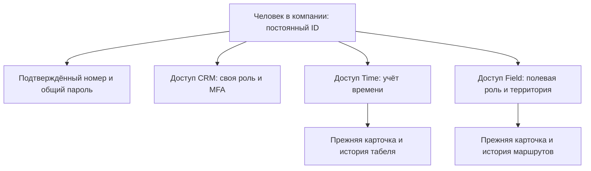

# Один человек — отдельные доступы к модулям

Статус на 25 октября 2026: целевая архитектура, частично реализованная в изолированной ветке `codex/person-identity`. PR #1028 — черновик. Рабочая регистрация и действующие номера пользователей на новую схему не переключены.

## Что меняется

Внутри одной компании у человека будет одна учётная запись, один подтверждённый номер и один авторитетный пароль. Доступы к CRM, Time и Field назначаются отдельно. Номер — изменяемый контакт для подтверждения входа; постоянным ключом человека остаётся сочетание компании и User ID.

| Сейчас | Целевая схема |
| --- | --- |
| Номер и пароль могут жить отдельно в User и карточке агента | Одно авторитетное назначение номера и хранилище пароля |
| Занятый номер мешает добавлению ещё одной карточки | Существующему человеку назначается доступ к нужному модулю |
| Общая роль влияет на несколько продуктов | У каждого продукта свои права и версия доступа |
| Старые действия могут отключать User или общую карточку целиком | Отзыв модуля меняет его доступ; блокировка человека закрывает всё |
| Очередь мобильного приложения привязана к старой карточке | Новая область очереди включает компанию, человека и приложение, сохраняя исходную карточку и события |

CRM может сохранить существующий ввод email для входа. Это не второе хранилище пароля. Код WhatsApp подтверждает владение номером, но сам не выдаёт роль CRM и не отменяет её MFA.

Назначить доступ можно только к включённому для компании продукту. У Time и Field остаются отдельные сессии, допуски установки и очереди событий; общий номер не разрешает пересылать события одного приложения от имени другого.

## Как будет работать добавление

**Человек уже есть:** администратор выбирает его существующий профиль, проверяет принадлежность карточки и добавляет Time или Field. Второй номер и копия человека не нужны. Исходные карточки, события и история сохраняют свои ID.

**Новый человек:** создаётся единая запись, подтверждается номер, задаётся общий пароль и назначаются разрешённые модули. Для человека только с мобильными доступами право CRM не появляется; CRM-место учитывается отдельно.

**Один номер у разных людей:** это конфликт для проверки владельца. Совпадение номера или email не разрешает присвоить чужую карточку, историю либо очередь. Уникальность действует внутри компании; одинаковый номер в разных компаниях не объединяет учётные записи.

## Что уже проверено, а что ещё требуется

Для исходников `6f323d8f3b19f6f3cac3c77c9934f00bbed39b68` прошли 674 целевых теста, 82 сценария основания identity на PostgreSQL, отдельные реальные снимки БД, пять проверок Auth.js cookie в Chromium, сборка и проверка типов относительно существующего списка ошибок. Браузерный набор Time: 65 PASS, 0 FAIL, 5 NOT RUN. Это синтетические компании и отдельные базы; проверка физического Android, внешней доставки и суточной работы здесь не подменяется браузером. Общий набор тестов CI ещё завершает проверку существующего списка ошибок.

Подготовленная защита установки пароля проверяет подтверждённый номер повторно после изменения контакта. Для полного перехода ещё обязательны привязка OTP к исходному человеку и монотонной версии контакта, включая смену номера обратно; готовые регистрация и интерфейсы назначения доступов; адаптация старых действий блокировки и создания; разделение рабочих дней и проверенная миграция мобильных очередей; проверка совместимости отката сервера. Текущий отказ «номер занят» в рабочем CRM пока остаётся прежним.

Изменение авторизации нельзя назвать безрисковым. По текущему ограничению владельца разрешены изолированная разработка и проверки ветки. Слияние identity, миграция реальных людей, включение новой схемы и выпуск в рабочую систему в этот этап не входят.

Подробный проект и известные ограничения: [person-identity-architecture.md](person-identity-architecture.md). Проверки и решения сохраняются в [person-identity-session-log.md](person-identity-session-log.md).
