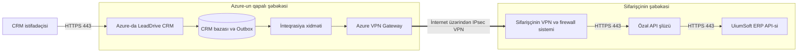
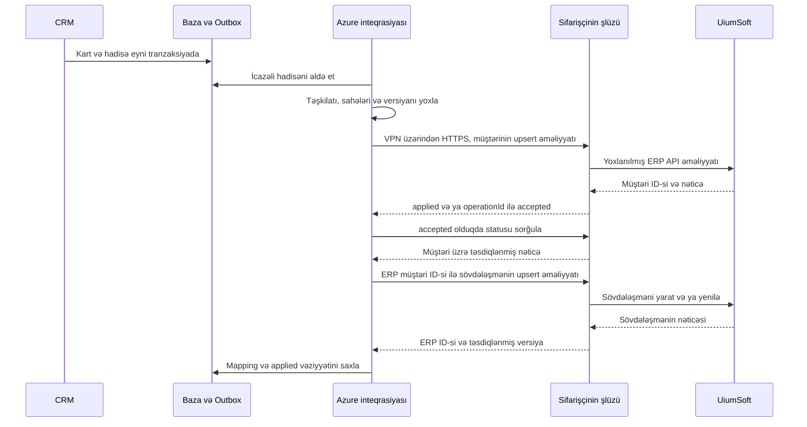

# LeadDrive CRM və UiumSoft ERP inteqrasiyasının API axını və informasiya təhlükəsizliyi

Versiya 1.0 • 13 oktyabr 2026-cı il • Sifarişçinin informasiya təhlükəsizliyi və İT bölmələri ilə razılaşdırılmaq üçün layihə

**Məqsəd:** girişə, məlumatların tərkibinə və emal nəticəsinə nəzarət etməklə müştəri kartlarını, əlaqə şəxslərini və əlaqəli sövdələşmələri qorunan kanal vasitəsilə LeadDrive CRM-dən UiumSoft ERP-yə ötürmək.

**İlkin şərtlər:** istismar mühitindəki CRM-in Microsoft Azure-da yerləşdirilməsi planlaşdırılır; ERP sifarişçinin daxili şəbəkəsində yerləşir. Bu inteqrasiya üçün Azure infrastrukturu hələ yaradılmayıb və IP ünvanları təyin edilməyib. Hazırkı test serveri gələcək istismar bağlantısının ünvanı deyil.

**Hədəf sxem:** ayrıca CRM inteqrasiya xidməti Site-to-Site VPN vasitəsilə sifarişçinin özəl API şlüzünə HTTPS sorğuları göndərir. ERP API-si internetdə açıq yayımlanmır. Əsas tətbiq portu **TCP 443**-dür; perimetrdə VPN üçün **UDP 500 və UDP 4500**, UDP inkapsulyasiyası olmayan rejim seçildikdə isə ESP 50 IP protokolu ayrıca razılaşdırılır.

Aşağıdakı bütün tədbirlər, komponentlər və rəqəmlə göstərilən parametrlər, açıq şəkildə başqa cür qeyd edilmədikdə, layihələndirilən bağlantıya qoyulan tələblərdir. Bu sənəd hazır UiumSoft adapterinin və işlək VPN-in mövcudluğunu təsdiqləmir. Məhsulun dəqiq adı, buraxılışı, versiyası, API lisenziyası və quraşdırılmış ERP-nin metodları sifarişçi tərəfindən təsdiqlənməlidir; burada sifarişçinin bildirdiyi UiumSoft adı saxlanılıb. Konkret IP ünvanları, domenlər və URL-lər fərziyyələrlə əvəz edilmir.

## 1 İnteqrasiyanın əhatə dairəsi

İlkin əhatə dairəsinə müştərinin, razılaşdırılmış əlaqə şəxslərinin və sövdələşmənin yaradılması və ya yenilənməsi, həmçinin texniki nəticənin alınması daxildir: qəbul edilib, emal edilib və ya rədd edilib, ERP identifikatoru və xətanın səbəbi.

Kommersiya təklifi və ya sifariş tərkibində məhsulların, müqavilə rekvizitlərinin ötürülməsinə və icra statuslarının alınmasına müvafiq sahələr və API metodları razılaşdırıldıqdan sonra icazə verilir. Yazışmaların, faylların, səs yazılarının, daxili qeydlərin və bütövlükdə CRM bazasının kütləvi ixracı ilkin əhatə dairəsinə daxil deyil.

Layihədə tətbiq bağlantılarını başladan bir tərəf nəzərdə tutulur — Azure-dakı inteqrasiya xidməti. ERP-nin cavabı artıq qurulmuş bağlantı ilə geri qaytarılır. ERP sorğunu asinxron emal edirsə, CRM özü həmin qapalı marşrutla statusu sorğulayır. ERP-dən CRM-ə ayrıca daxil olan webhook tələb olunmur.

Bu axın məhz bu inteqrasiyanı əhatə edir. Sifarişçinin quraşdırmasında CRM-in e-poçt, telefoniya, messencerlər, analitika və AI xidmətləri ilə bağlantıları aktivləşdirilərsə, onların ayrıca inventarlaşdırılması tələb olunur. İnteqrasiya məlumatları çevrilmə və ya təhlil üçün bu xidmətlərə göndərilmir.

## 2 Yerləşdirmə və şəbəkə marşrutu

### 2.1 Komponentlər

| Komponent | Yerləşmə və təyinat |
| --- | --- |
| CRM və onun istifadəçi giriş nöqtəsi | Azure; məlumatların daxil edilməsi və dəyişdirilməsi. İstifadəçilər razılaşdırılmış CRM domeninə HTTPS ilə qoşulur |
| CRM məlumat bazası və Outbox göndəriş jurnalı | Azure-un qapalı alt şəbəkəsi; kartların, göndəriş hadisələrinin və nəticələrin saxlanması |
| CRM inteqrasiya xidməti | Azure-un qapalı alt şəbəkəsində ayrıca hesablama xidməti; icazə verilən hadisələri seçir, sorğunu formalaşdırır və identifikatorları uyğunlaşdırır |
| Azure VPN Gateway | Azure tərəfində şifrələnmiş tuneli sonlandırır; VPN üçün ayrıca ictimai ünvanlar |
| Sifarişçinin VPN şlüzü və şəbəkələrarası ekranı | Tuneli sonlandırır və API şlüzünə yalnız icazə verilmiş trafiki buraxır |
| Sifarişçinin özəl API şlüzü | Şəbəkənin ayrıca inteqrasiya zonası; sertifikat və səlahiyyət yoxlaması, sorğu limitləri, əməliyyat jurnalı və lazım gəldikdə ERP-yə uyğunlaşdırma |
| UiumSoft tətbiq API-si | Sifarişçinin daxili şəbəkəsi; əməliyyatları ERP-nin standart biznes məntiqi vasitəsilə yerinə yetirir |
| Məxfi məlumatlar anbarı və monitorinq | Azure Key Vault və razılaşdırılmış monitorinq sistemləri; ERP şəbəkəsinə yalnız nəzərdə tutulmuş biznes sorğuları ötürülür |

API şlüzü sifarişçinin və ya onun inteqratorunun idarə etdiyi layihə komponentidir. Tələb olunan yoxlamaları təmin edirsə, onu ERP-nin dəstəklənən inteqrasiya modulu ilə birləşdirmək olar. Əlavə modul və ya lisenziya tələb olunarsa, bu, işlənib hazırlanma başlamazdan əvvəl təsdiqlənir.

### 2.2 Ötürmə sxemi



Tətbiqin HTTPS sessiyası VPN daxilində inteqrasiya xidmətindən API şlüzünə qədər uzanır. TLS şlüzdə sonlandırılır; ERP-yə qədər sertifikatın yoxlanması ilə ikinci TLS sessiyası qurulur. Beləliklə, hər iki hissədə şifrələmə təmin olunur, lakin bu, şlüzdən keçən vahid ucdan-uca TLS sessiyası deyil. Ayrıca şlüz olmadan birbaşa ERP-yə qoşulmaq üçün onun bütün yoxlamalarını ERP və ya onun inteqrasiya modulu yerinə yetirməlidir.

Site-to-Site VPN şifrələnmiş trafiki **ictimai internet üzərindən** ötürür; özəl ünvanlar və API-yə qapalı giriş fiziki olaraq ayrılmış kanal demək deyil. Azure VPN Gateway bu topologiyanı dəstəkləyir. [Microsoft Learn — VPN topology and design](https://learn.microsoft.com/en-us/azure/vpn-gateway/design)

### 2.3 Sifarişçi hansı ünvanları görəcək

| Müşahidə nöqtəsi | Mənbə ünvanı |
| --- | --- |
| Sifarişçinin VPN-inin xarici perimetri | Azure VPN Gateway-in ictimai IP ünvanı; ehtiyat şlüzlər olduqda bütün razılaşdırılmış şlüz IP-ləri |
| Özəl API şlüzünün qarşısındakı firewall | İnteqrasiya xidmətinin özəl IP ünvanı və ya VPN/NVA NAT-dan sonra razılaşdırılmış ünvan |
| API şlüzünün arxasındakı ERP | API şlüzünün daxili IP ünvanı; inteqrasiyanın kimliyi əlavə olaraq onun xidməti hesabı ilə müəyyən edilir |

CRM-in istifadəçi girişinin ictimai IP-si, VPN-in ictimai IP-si və inteqrasiya xidmətinin daxili ünvanı fərqli funksiyalar daşıyır. VPN üzərindən HTTPS girişi üçün faktiki müşahidə olunan **daxili** mənbəyə icazə verilir; CRM veb-saytının ictimai IP-si avtomatik olaraq icazəli mənbə sayılmır.

İnteqrasiya xidməti üçün statik özəl ünvan, miqyas artırıldıqda isə dəqiq müəyyən edilmiş kiçik ünvan hovuzu ayrılır. Tərəflərin alt şəbəkələrinin ünvan aralıqları üst-üstə düşməməlidir. Üst-üstə düşmə qaçılmazdırsa, dəstəklənən NAT rejimi, çevrilmiş şəbəkələr və geri dönüş marşrutları ayrıca razılaşdırılır; üst-üstə düşən şəbəkələr üçün Azure VPN NAT internetə çıxış verən NAT şlüzü deyil. [Microsoft Learn — VPN Gateway NAT](https://learn.microsoft.com/en-us/azure/vpn-gateway/nat-overview)

## 3 Bağlantı və portlar matrisi

Cədvəllərdəki işarələr real ünvanlar deyil, hələ doldurulmamış parametrlərdir. Bütün icazələr üçün mənbə, təyinat, TEST/PROD mühiti, məsul şəxs, jurnallaşdırma və yenidən baxılma tarixi göstərilir. Standart siyasət qadağandır.

### 3.1 Sifarişçinin perimetri və şəbəkəsi

| ID | Bağlantını başladan tərəf → təyinat | Protokol və təyinat portu | Məqsəd və məhdudiyyət |
| --- | --- | --- | --- |
| N01 | AZURE_VPN_PUBLIC_IPS ↔ CLIENT_VPN_PUBLIC_IPS | UDP 500 | IKE; yalnız konkret VPN tərəfləri |
| N02 | Eyni VPN tərəfləri | UDP 4500 | IPsec NAT-T; yalnız razılaşdırılmış tərəflər |
| N03 | Eyni VPN tərəfləri | ESP, IP protocol 50 | Yalnız native ESP seçildikdə; bu, TCP/UDP portu deyil, IP protokolunun nömrəsidir. Razılaşdırılmış UDP inkapsulyasiyalı rejimdə ayrıca tələb olunmur |
| N04 | AZURE_INTEGRATION_SOURCE → CLIENT_API_PRIVATE_IP | TCP 443 | VPN daxilində əsas HTTPS axını; yalnız inteqrasiya API-si |
| N05 | CLIENT_API_GATEWAY_IP → ERP_API_PRIVATE_IP | TCP 443 | ERP-yə daxili çağırış; yalnız razılaşdırılmış metodlar |
| N06 | AZURE_INTEGRATION_SOURCE → CLIENT_AUTH_PRIVATE_IP | TCP 443 | Sifarişçinin OAuth tokenlərini verən serverinin ayrıca ünvanı olduqda; şlüzlə eyni ünvandadırsa — N04 |
| N07 | AZURE_DNS_FORWARDER → CLIENT_DNS_IPS | UDP/TCP 53 | Yalnız API adının sifarişçinin DNS-i vasitəsilə həll edilməsi tələb olunduqda; yalnız lazım olan zona yönləndirilir |

N01–N03 tuneli, N04 isə tətbiq məlumatlarının mübadiləsini təmin edir. VPN tərəflərinə tuneli hər iki tərəfdən qurmağa və bərpa etməyə icazə verilir. NAT-T/ESP rejimi və VPN qurğusunun uyğunluğu qaydalar aktivləşdirilməzdən əvvəl şəbəkə administratorları tərəfindən qeydə alınır. [Microsoft Learn — VPN devices and IPsec parameters](https://learn.microsoft.com/en-us/azure/vpn-gateway/vpn-gateway-about-vpn-devices), [Microsoft Learn — VPN tunnel troubleshooting](https://learn.microsoft.com/en-us/troubleshoot/azure/vpn-gateway/troubleshoot-vpn-tunnel-cannot-connect)

N04–N07 üzrə cavablar qurulmuş bağlantının vəziyyətinə əsasən buraxılır; ERP → Azure istiqamətində yeni sessiyalar üçün ayrıca icazə yaradılmır. Mənbə TCP portunu əməliyyat sistemi seçir, API-nin təyinat portu isə 443-dür. Vəziyyəti izləməyən stateless ACL üçün seçilmiş əməliyyat sisteminə uyğun cavab portu aralıqları ayrıca göstərilir; bu, yeni xidmətin açılması demək deyil.

Azure xidmətinin ERP məlumat bazasına və onun xidməti portlarına, SMB 445, SSH 22 və RDP 3389-a birbaşa girişi tələb olunmur. Biznes sorğuları üçün 80 portu istifadə edilmir. ERP-nin standart API-si başqa portda işləyirsə, yoxlamadan sonra N05 dəqiq qayda ilə əvəz olunur; ayrı-ayrı qovşaqlar arasında şifrələnməmiş HTTP bu sxemin qəbul edilmiş variantı deyil.

Əsas layihədə statik olaraq razılaşdırılmış marşrutlardan istifadə edilir. BGP və onun TCP 179 portu tələb olunmur; BGP seçilərsə, yalnız BGP tərəflərinin dəqiq ünvanları arasında ayrıca qayda əlavə edilir. İnzibati VPN və texniki dəstək girişi məlumat mübadiləsi kanalından ayrıca rəsmiləşdirilir.

### 3.2 Azure daxilində bağlantılar və xidməti asılılıqlar

| Bağlantını başladan tərəf → təyinat | Port | Şərt |
| --- | --- | --- |
| İstifadəçilər → CRM giriş nöqtəsi | TCP 443 | İstifadəçilər üçün ayrıca giriş siyasəti; WAF/reverse proxy və TLS |
| CRM giriş nöqtəsi → tətbiq | TCP 443 | Tətbiqin daxili TLS proksisi; tətbiqin lokal portu xaricə açılmır |
| Tətbiq və inteqrasiya → CRM PostgreSQL bazası | TLS ilə TCP 5432 | Yalnız özəl şəbəkə və ayrı məlumat bazası rolları; ERP bu portdan istifadə etmir |
| İnteqrasiya xidməti → Azure Key Vault | TCP 443 | Üstünlük private endpoint-ə verilir; yalnız öz inteqrasiyasının məxfi məlumatlarına giriş |
| İnteqrasiya xidməti → razılaşdırılmış OAuth issuer | TCP 443 | Buludda yerləşən issuer istifadə olunduqda; dəqiq FQDN və audience qeydə alınır |
| Komponentlər → razılaşdırılmış DNS | UDP/TCP 53 | Yalnız etibarlı DNS həllediciləri |
| Komponentlər → monitorinq | TCP 443 | Metrikalar və həssas məlumatlardan təmizlənmiş jurnallar; ünvanlar seçilmiş xidmətdən asılıdır |
| Komponentlər → vaxt mənbəyi | Ayrıca NTP tələb olunarsa UDP 123 | Yalnız təsdiqlənmiş mənbə; platformanın sinxronizasiya mexanizmindən istifadə oluna bilər |
| TLS komponentləri → PKI tələb edərsə CRL/OCSP | CA-nın dəqiq ünvanlarına TCP 80/443 | Yalnız sertifikatların ləğv statusunun yoxlanması, biznes məlumatlarını daşıyan sorğu gövdələri olmadan; daxili CA olduqda VPN marşrutu mümkündür |

Bu cədvəl bütün Azure platformasının idarəetmə bağlantılarının tam siyahısını deyil, inteqrasiyanın asılılıqlarını təsvir edir. VM/App Service/konteyner xidməti seçildikdən sonra infrastruktur komandası tələb olunan platforma endpoint-lərini, ehtiyat nüsxələmə və yeniləmələri çıxış bağlantıları reyestrinə əlavə edir. Bunları bütün internetə daimi giriş icazəsi ilə əvəz etmək olmaz. İlkin layihənin növbəsi məlumat bazasında Outbox kimi saxlanılır; ayrıca mesaj brokeri və onun portları tələb olunmur.

## 4 Müştəri və hadisələrin seçilməsi qaydaları

1. Yeni müraciət əvvəlcə CRM-də lid kimi yaradılır. Yoxlanılmamış, spam xarakterli və sifarişçiyə aid olmayan lidlər ERP-yə avtomatik göndərilmir.
2. Razılaşdırılmış kvalifikasiya mərhələsinə çatdıqda və ya ilk uyğun sövdələşmə yaradıldıqda `erpSyncEligible` əlaməti təyin olunur. Dəqiq mərhələni sifarişçi seçir. Bu, inteqrasiya üçün layihə qaydasıdır, CRM-də artıq mövcud olan sahənin adı deyil.
3. Kvalifikasiyadan keçmiş potensial müştəri üçün, ERP bu növü dəstəkləyirsə, «potensial kontragent» tipli kart yaradılır. Əks halda sifarişçi məlumat kitabçasında icazə verilən tipi təsdiqləyir; kartın yaradılması avtomatik olaraq maliyyə öhdəliyi demək olmamalıdır.
4. Kontragent və seçilmiş əlaqə şəxsləri göndərilir. Onların ERP identifikatorları təsdiqləndikdən sonra kontragentə istinad edən sövdələşmə göndərilir.
5. Razılaşdırılmış sahələrdə sonrakı dəyişikliklər hadisələrin yeni versiyalarını yaradır. Daxili qeydlərdə və ötürülmədən çıxarılmış digər sahələrdəki dəyişikliklər bu məlumatların göndərilməsini başlatmır.
6. Sövdələşmənin uğurla bağlanması yalnız ayrıca təsdiqlənmiş qayda əsasında və sifarişin məcburi sətirləri mövcud olduqda sifarişin **qaralamasının** yaradılmasını başlada bilər. Mərhələnin dəyişməsi öz-özlüyündə satışın, hesabın və ya ödənişin mühasibat uçotuna işlənməsini həyata keçirmir.
7. Bağlanmış və ya itirilmiş sövdələşmə status dəyişikliyi kimi ötürülür. CRM kartının silinməsi ERP-də uçot sənədlərini avtomatik silmir; qeyri-aktiv status və ya ayrıca razılaşdırılmış prosedur tətbiq olunur.

Biznesə kvalifikasiyadan əvvəl hər yeni lid lazımdırsa, 2-ci bənddəki meyar istismara verilməzdən əvvəl dəyişdirilir. Bu variant üçün ERP-də potensial müştərilərin dəstəklənməsi və fərdi məlumatların erkən mərhələdə ötürülməsinə ehtiyac ayrıca yoxlanılır.

## 5 Məlumatların tərkibi və sahələr üzrə məsuliyyət

Yekun sahə uyğunlaşdırmasında (mapping) hər sahə üçün CRM mənbəyi, ERP API-sindəki yol, tip, uzunluq, məcburilik, məlumat kitabçası, dəyişikliklər üzrə məsul tərəf və boş dəyər qaydası göstərilir. Bütöv CRM obyekti deyil, icazə verilmiş sahələr toplusu göndərilir.

| Obyekt | Ötürüləcək məlumatlar | Rejim |
| --- | --- | --- |
| Kontragent | CRM-in xarici ID-si; fiziki/hüquqi şəxs tipi; ad; lazım olduqda vergi nömrəsi/VÖEN; ölkə; razılaşdırılmış hüquqi və/və ya çatdırılma ünvanı; iş əlaqə məlumatları | Əsas əhatə dairəsi; rekvizitlərə tələbləri ERP müəyyən edir |
| Əlaqə şəxsi | CRM ID-si; kontragentlə əlaqə; ad; lazım olduqda vəzifə; iş telefonu və e-poçtu | Yalnız sövdələşmə üçün zəruri olan seçilmiş şəxslər |
| Sövdələşmə | CRM ID-si; kontragentə istinad; ad; mərhələ; məbləğ və valyuta; gözlənilən bağlanma tarixi; məsul şəxsin/bölmənin kodu; dəyişiklik versiyası | Əsas əhatə dairəsi; CRM mərhələsi konkret ERP statusuna uyğunlaşdırılır |
| Kommersiya təklifi və sifariş sətirləri | Sənədin və sətrin ID-si; ERP məhsul kodu; miqdar; vahid; qiymət; endirim; razılaşdırılmış vergi kodu; yekun məbləğ; valyuta | Mənbə və düsturlar təsdiqləndikdən sonra əlavə əhatə dairəsi |
| Müqavilə rekvizitləri | Nömrə, tarixlər, sövdələşməyə istinad, razılaşdırılmış məlumat kitabçalarından ödəniş və çatdırılma şərtləri | Əlavə əhatə dairəsi; müqavilənin mətni və əlavələri ayrıca |
| ERP-nin emal nəticəsi | Əməliyyatın, müştərinin, sövdələşmənin/sifarişin ID-si; biznes statusu; xəta kodu; versiya | Məcburi texniki cavab ERP → CRM |
| Sifariş, göndəriş və ödəniş statusları | Nömrə, status, tarixlər, razılaşdırılmış məbləğlər/qalıq | CRM-in eyni marşrutla ERP-dən əlavə məlumat oxuması |
| Nomenklatura, vahidlər, valyutalar, dərəcələr və anbarlar | Kod, göstərilməsinə icazə verilən ad və məlumat kitabçasının atributları | Düzgün mapping üçün ERP → CRM istiqamətində seçimli oxuma |

Müştəri münasibətləri və satış mərhələləri üzrə əsas məlumat mənbəyi CRM-dir. Uçot kodları, mühasibat uçotuna işlənmiş sənədlər, qalıqlar, faktiki göndərişlər və ödənişlər üzrə əsas mənbə ERP-dir. Müştəri rekvizitləri üçün sahələr üzrə məsuliyyət matrisi açıq şəkildə müəyyən edilir: rekvizitlər mühasibatlıq tərəfindən yoxlandıqdan sonra CRM onları razılaşdırılmış proses olmadan yenidən yazmır.

Sövdələşmənin məbləğini mühasibat uçotuna işlənmiş hesabın məbləği ilə eyniləşdirmək olmaz. Hazırkı CRM-də «sövdələşmədə məhsul» əlaqəsi sənədi avtomatik olaraq miqdarı, vahidləri və vergiləri olan tam sifariş saymaq üçün kifayət etmir. Sifariş üçün təsdiqlənmiş sətir mənbəyi, məsələn, təsdiqlənmiş kommersiya təklifi seçilir və hesablamalar ayrıca yoxlanılır.

Parollar, tokenlər, açarlar, digər təşkilatların məlumatları, ödəniş kartı rekvizitləri, yazışma tarixçəsi, zəng yazıları, şəxsiyyət sənədləri, fərdi məlumatların xüsusi kateqoriyaları və ixtiyari daxili şərhlər ötürülmür. Ayrıca proses həqiqətən belə bir sahə tələb edirsə, məqsəd və giriş səlahiyyətləri göstərilməklə müstəqil razılaşdırmadan keçir.

## 6 Bir müştəri və sövdələşmənin emalı ardıcıllığı



Əhəmiyyətli dəyişiklik saxlanıldıqda CRM Outbox qeydini **eyni məlumat bazası tranzaksiyasında** yaradır. Tranzaksiya tamamlanmayıbsa, hadisə göndərilmir. Qeyd təşkilatı, obyekt tipini, xarici ID-ni, versiyanı, vaxtı və emal üçün zəruri məlumatları ehtiva edir. Emal xidməti yalnız sifarişçinin təşkilatına aid hadisələri oxuyur.

Göndərilməzdən əvvəl məcburi sahələr, əlaqə məlumatlarının formatı, sətir uzunluqları, məlumat kitabçalarının icazəli dəyərləri, rəqəm diapazonları, valyuta və əməliyyat səlahiyyətləri yoxlanılır. Validasiyadan keçmək üçün vergi və əlaqə rekvizitləri uydurma dəyərlərlə tamamlanmır.

Sifarişçi tərəfində API şlüzü TLS/mTLS-i, autentifikasiyanı, xidməti hesabın ERP təşkilatı ilə əlaqəsini, icazəli metodları, sorğu gövdəsinin sxemini, ölçüsünü və tezliyini yoxlayır. Sonra ERP-nin standart API-sini çağırır. Azure-dan birbaşa SQL girişi istifadə edilmir.

`200/201` yalnız təsdiq cavabının gövdəsi düzgün olduqda uğurlu biznes əməliyyatı deməkdir. `202` emala qəbul edilmə deməkdir: CRM `operationId`-ni saxlayır və yekun nəticəyə qədər statusu sorğulayır. Bəzi API/SOAP sistemlərində mümkün olan, biznes xətası ehtiva edən HTTP 200 xəta kimi qəbul edilir. Sövdələşmənin dəyişdirilməsi kontragentin təsdiqini gözləyir; sövdələşmə xətası artıq yaradılmış müştərinin silinməsi ilə geri qaytarılmır.

CRM-də vəziyyətlər: «Gözləyir», «Emal olunur», «Ötürülüb», «Düzəliş tələb olunur», «Nəticə dəqiqləşdirilir». Menecerə tokenlər və texniki izləmə məlumatları olmadan anlaşılan səbəb və dəstək müraciətinin ID-si göstərilir.

## 7 API üzrə layihə kontraktı

**Aşağıda inteqrasiya şlüzü üçün təklif olunan kontrakt verilir; bu, UiumSoft-un təsdiqlənmiş metodlarının siyahısı deyil.** OpenAPI/WSDL və ya quraşdırılmış ERP-nin sənədləri alındıqdan sonra inteqrator əməliyyatları onun standart REST/SOAP metodlarına uyğunlaşdırır. ERP tələb olunan obyekt növünü dəstəkləmirsə, bu, reallaşdırmadan əvvəl məhdudiyyət kimi qeydə alınır.

| Metod və şərti yol | Təyinat |
| --- | --- |
| `PUT /integration/v1/customers/{externalId}` | Hesaba təhkim edilmiş təşkilatda kontragent yaratmaq və ya yeniləmək |
| `PUT /integration/v1/contacts/{externalId}` | Razılaşdırılmış əlaqə şəxsi yaratmaq və ya yeniləmək |
| `PUT /integration/v1/deals/{externalId}` | Sövdələşmə və ya ERP-də onun razılaşdırılmış analoqunu yaratmaq və ya yeniləmək |
| `PUT /integration/v1/orders/{externalId}` | Seçimli olaraq icazə verilən sifariş qaralamasını yaratmaq/yeniləmək |
| `GET /integration/v1/operations/{operationId}` | Asinxron əməliyyatın yekun nəticəsini öyrənmək |
| `GET /integration/v1/operations?eventId=...` | İlk cavab itdikdə və operationId məlum olmadıqda öz təşkilatı daxilində nəticəni tapmaq |
| `GET /integration/v1/customers/{externalId}` | Öz kontragentinin mövcudluğunu və versiyasını yoxlamaq; sövdələşmələr və inteqrasiyaya daxil edilmiş sifarişlər üçün də analoji məhdud axtarış nəzərdə tutulur |
| `GET /integration/v1/receipts?cursor=...` | Üzləşdirmə üçün məhdud ölçülü nəticə səhifəsi almaq |
| `GET /integration/v1/reference-data/{type}?cursor=...` | Seçimli olaraq icazəli məlumat kitabçalarını oxumaq |

Token endpoint ünvanını seçilmiş OAuth issuer təyin edir; `/oauth/token` yolu əvvəlcədən UiumSoft-a aid edilmir. Bütün URL-lər konfiqurasiyada sabitlənir; müştəri məlumatları təyinat serverini seçə bilməz. API-də ixtiyari SQL sorğularına, ixtiyari URL-lərə, icra əmrlərinə və razılaşdırılmamış obyektlərin kütləvi ixracına icazə verilmir.

Əsas başlıqlar: `Content-Type: application/json`, `Authorization: Bearer <access_token>`, `X-Correlation-ID`, `Idempotency-Key`. Token dəyərləri URL-lərə və jurnallara düşmür. Təşkilatın kimliyi yoxlanılmış xidməti hesabdan götürülür; JSON-dakı təşkilat sahəsi təşkilatı dəyişmək hüququ vermir.

Nümunədəki məlumatlar tamamilə sünidir. Faktiki ötürmə kontraktında yalnız mapping-də razılaşdırılmış sahələr göndərilir.

```json
{
  "schemaVersion": "1.0",
  "eventId": "10000000-0000-4000-8000-000000000001",
  "sourceSystem": "LeadDrive",
  "externalId": "crm-customer-demo-001",
  "entityVersion": 3,
  "occurredAt": "2026-10-13T08:00:00Z",
  "customer": {
    "type": "legal_entity",
    "name": "DEMO CUSTOMER",
    "countryCode": "AZ",
    "email": "contact@example.invalid"
  }
}
```

Bu nümunəyə məcburi vergi və ya ünvan sahələri ERP qaydalarına əsasən əlavə edilir; məcburi sahənin olmaması yoxlanıla bilən xəta yaradır. Müştəri təsdiqləndikdən sonra ayrıca sövdələşmə obyekti göndərilir:

```json
{
  "schemaVersion": "1.0",
  "eventId": "10000000-0000-4000-8000-000000000002",
  "externalId": "crm-deal-demo-001",
  "entityVersion": 1,
  "occurredAt": "2026-10-13T08:00:01Z",
  "customerErpId": "ERP-CUSTOMER-DEMO-001",
  "deal": {
    "name": "DEMO DEAL",
    "stageCode": "QUALIFIED",
    "amount": "1500.00",
    "currency": "AZN",
    "expectedCloseDate": "2026-11-01"
  }
}
```

`QUALIFIED`, `AZN` kodları və nümunənin strukturu yalnız təsdiqlənmiş mapping olduqda istifadə edilir. Pul dəyərləri razılaşdırılmış dəqiqliklə onluq ədədləri ifadə edən mətn sətirləri şəklində ötürülür; hadisə tarixləri ISO 8601 UTC formatında, təqvim tarixləri isə süni saat qurşağı əlavə edilmədən verilir. Vergi kodları, yuvarlaqlaşdırma, vahidlər və valyuta formatı spesifikasiyada qeydə alınır.

Yekun təsdiq nümunəsi:

```json
{
  "operationId": "op-demo-002",
  "eventId": "10000000-0000-4000-8000-000000000002",
  "externalId": "crm-deal-demo-001",
  "erpId": "ERP-DEAL-DEMO-001",
  "status": "applied",
  "appliedVersion": 1,
  "processedAt": "2026-10-13T08:00:02Z"
}
```

Kontrakt sxeminin versiyası obyektin versiyasından ayrıca idarə olunur. Uyğunluğu pozan dəyişikliklər yeni API versiyası, sınaq və keçid tarixi tələb edir. Sahə yoxdursa, dəyər dəyişməz saxlanılır; `null` yalnız həmin sahə üçün açıq icazə verildikdə dəyəri təmizləyir; boş sətir universal təmizləmə əmri deyil.

## 8 Dublikatlar, hadisələrin ardıcıllığı və nasazlıqlar

Çatdırılma modeli **at least once**, yəni ən azı bir dəfə çatdırılmadır: eyni hadisə təkrar gələ bilər. Dublikatların yaranmaması şəbəkə üzərindən yalnız bir göndəriş vədi ilə deyil, idempotent emalla təmin olunur.

Obyektin açarına inteqrasiya, təşkilat, obyekt tipi və CRM-in xarici ID-si daxildir. `Idempotency-Key` hadisə üçün sabitlənir və təkrar göndəriş zamanı dəyişmir. Eyni açar və eyni məzmunla təkrar sorğu əvvəlki nəticəni qaytarır; eyni açarın fərqli məzmunla istifadəsi konflikt yaradır. ERP və ya onun adapteri tərəfində xarici ID ilə ERP obyekti arasında unikal əlaqə tələb olunur. ERP əməliyyatı yerinə yetirdikdən sonra şlüz nəticəni saxlamadan sıradan çıxarsa, yalnız şlüz jurnalındakı qeyd kifayət etmir.

Standart API idempotentliyi təmin etmirsə, adapter unikal xarici ID üzrə nəticəni bərpa etməlidir. İlk cavabın itməsi səbəbindən operationId məlum deyilsə, əvvəl eventId üzrə axtarış, sonra isə xarici ID üzrə obyekt yoxlaması aparılır. İlk yoxlamada nəticənin tapılmaması ERP-nin heç nə yazmadığını sübut etmir: əməliyyat hələ icra oluna bilər. Nə unikallığı təmin etmək, nə də nəticəni etibarlı yoxlamaq mümkündürsə, nəticəsi qeyri-müəyyən əməliyyatlar əl ilə üzləşdirmə üçün dayandırılır. Bu rejimdə yaratma əməliyyatının avtomatik təkrarına icazə verilmir.

Hər obyektin monoton artan versiyası olur; köhnə versiya yenisini əvəz etmir. Eyni obyektin əməliyyatları ardıcıl icra olunur. Kontragent və sövdələşmə üçün asılılıq nəzərə alınır: kontragent təsdiqlənmədən sövdələşmə yaradılmır.

| Vəziyyət | Tədbir |
| --- | --- |
| Yanlış məlumatlar, HTTP 400/422 | Hadisəni dayandırmaq; məsul şəxsə sahələri düzəltmək imkanı vermək; düzəlişdən sonra yeni versiyanı göndərmək |
| HTTP 401 | İcazəli tokeni bir dəfə yeniləmək; təkrar rədd cavabı inteqrasiyanı dayandırır və bildiriş yaradır |
| HTTP 403 | Avtomatik təkrar etməmək; səlahiyyətləri və təşkilata uyğunluğu yoxlamaq |
| HTTP 404 | Mapping-i, asılılığı və API versiyasını yoxlamaq; yoxlamadan yeni obyekt yaratmamaq |
| HTTP 409 | Versiya, xarici ID və ya açar konfliktini araşdırmaq; nəticəni üzləşdirmək |
| HTTP 429 | `Retry-After`-ı nəzərə almaq, tezliyi azaltmaq və hadisəni saxlamaq |
| HTTP 5xx, bağlantının kəsilməsi və ya vaxt aşımı | operationId/xarici ID-ni yoxlamaq; yalnız idempotentlik təsdiqləndikdə eyni açarla təkrar etmək |
| ERP-də yazıldıqdan sonra cavab itirilib | «Nəticə dəqiqləşdirilir» statusu; yeni açar yaratmaq əvəzinə nəticəni sorğulamaq |
| VPN və ya ERP əlçatan deyil | Hadisələri davamlı yaddaşda toplamaq; yükü məhdudlaşdırmaq və bildiriş yaratmaq |
| Xidmətin yenidən başladılması | Outbox-dan davam etmək; davam etməzdən əvvəl tamamlanmamış əməliyyatları üzləşdirmək |

Razılaşdırılmaq üçün təklif olunan ilkin limitlər: faylsız hər mesaj üçün 1 MiB-a qədər; hər inteqrasiya üzrə saniyədə maksimum 5 sorğu və eyni vaxtda 2 sorğu; bağlantının qurulması üçün 5 saniyəyə, tam sorğu üçün 30 saniyəyə qədər. Kiçik təsadüfi vaxt fərqi ilə təkrar cəhdlər: 1, 5, 15 və 60 dəqiqədən sonra, daha sonra 24 saatlıq müddət daxilində hər saat. Bu müddət bitdikdən sonra hadisə yoxa çıxmır, xətaların araşdırılması növbəsində qalır. Parametrlər ERP məhdudiyyətlərinə və qəbul sınaqlarının nəticələrinə əsasən dəqiqləşdirilir.

Sistemlər əlçatan olduqda adi hadisələrin 95%-i üçün hədəf çatdırılma müddəti 60 saniyəyə qədərdir. Bu, qüvvədə olan SLA deyil, layihə göstəricisidir. Ən köhnə hadisənin yaşı, növbənin uzunluğu, nəticəsi məlum olmayan əməliyyatların sayı və ERP təsdiqinin alınma müddəti izlənilir. Saxlama tutumu dolduqda xəbərdarlıq və qəbulun/dəyişikliklərin razılaşdırılmış məhdudlaşdırılması aktivləşdirilir; hadisələri xəbərdarlıq etmədən atmaq olmaz.

## 9 Autentifikasiya və səlahiyyətlər

Hədəf profil: TLS 1.2 və ya daha yuxarı, uyğunluq olduqda TLS 1.3-ə üstünlük verilir; API şlüzündə mTLS ilə sertifikatların qarşılıqlı yoxlanması və xidməti tətbiq üçün OAuth 2.0 Client Credentials. Quraşdırılmış texnologiyalar toplusu hər iki mexanizmi dəstəkləmirsə, sifarişçi işlənib hazırlanma başlamazdan əvvəl dəstəklənən profili və ya yoxlamaların inteqrasiya şlüzündə yerləşdirilməsini razılaşdırır. UiumSoft-da OAuth/mTLS-in mövcudluğu əvvəlcədən fərz edilmir.

Xidməti hesab sifarişçi və mühit üçün ayrıca yaradılır. Ona yalnız müştərilər, əlaqə şəxsləri, sövdələşmələr, statuslar və lazım olduqda sifariş qaralamaları üzərində razılaşdırılmış əməliyyatlara icazə verilir. Layihədə nəzərdə tutulan scopes: `customers.write`, `contacts.write`, `deals.write`, `sync.status.read`; əlavə `orders.draft.write` və `reference.read` ayrıca aktivləşdirilir. Bunlar şlüz hüquqlarının hədəf adlarıdır, ERP-nin standart scopes adları barədə təsdiq deyil.

ERP administratoru səlahiyyətləri, istifadəçi və rolların dəyişdirilməsi, məlumat bazasına birbaşa giriş, ödəniş və mühasibat sənədlərinin uçota işlənməsi, digər təşkilatların məlumatlarının oxunması və kütləvi silinmə qadağandır. Təşkilat məhdudiyyəti hər obyektdə və hər sorğuda, o cümlədən əməliyyat statusunun oxunması zamanı yoxlanılır.

Tokenlər inteqrasiya API-sinin audience dəyəri, icazəli scopes və qısa etibarlılıq müddəti ilə məhdudlaşdırılır; issuer dəstəkləyirsə, təklif olunan maksimum müddət 15 dəqiqədir. İmza və icazəli alqoritm, issuer, audience, etibarlılıq müddəti və xidməti tətbiqə bağlılıq yoxlanılır. Yalnız təşkilat ID-sini ehtiva edən bir başlıq autentifikasiya sayılmır. HTTPS, səlahiyyət və giriş məlumatlarının yoxlanması prinsipləri [OWASP REST Security](https://cheatsheetseries.owasp.org/cheatsheets/REST_Security_Cheat_Sheet.html) tövsiyələrinə uyğundur.

İstismara verilməzdən əvvəl sertifikatların, tokenlərin və VPN açarlarının məsul şəxsləri və rotasiya müddətləri rəsmiləşdirilir. Sertifikatın müddətinin bitməsinə 30, 14 və 7 gün qalmış bildiriş, dəyişmə zamanı köhnə və yeni sertifikatın nəzarətli birgə etibarlılıq müddəti və komprometasiya zamanı dərhal ləğv təklif olunur. Etibar zənciri, server adı və sertifikatların ləğv siyasəti yoxlanılır; sertifikat yoxlamasının söndürülməsinə icazə verilmir.

## 10 Məxfi məlumatlar, seqmentləşdirmə və tətbiqlərin qorunması

Açarlar, client secret-lər və sertifikatların gizli açarları Azure Key Vault-da və ya sifarişçinin razılaşdırılmış məxfi məlumatlar anbarında saxlanılır. Azure xidməti Key Vault-a minimum səlahiyyətli managed identity vasitəsilə müraciət edir; bu, ERP-nin həmin identity-ni avtomatik qəbul etməsi demək deyil. ERP-yə giriş üçün məxfi məlumatlar lazım gəldikdə anbardan alınır və yalnız server prosesində istifadə olunur. [Microsoft Learn — Secure your Azure Key Vault](https://learn.microsoft.com/en-us/azure/key-vault/general/secure-key-vault)

Məxfi məlumatlar brauzerdə, Git-də, sənədlərdə, URL-lərdə, dəstək sorğularında, ekran görüntülərində və adi jurnallarda olmur. İlkin məxfi məlumatların ötürülməsi razılaşdırılmış qorunan kanal vasitəsilə həyata keçirilir. TEST və PROD fərqli məxfi məlumatlardan, sertifikatlardan və hesablardan istifadə edir.

Marşrutlar və firewall girişi ayrıca inteqrasiya alt şəbəkəsi və sifarişçinin konkret ünvanları ilə məhdudlaşdırır. VPN bütün Azure VNet-ə müştərinin bütün şəbəkəsinə giriş vermir. CRM-in sifarişçinin domeninə üzv olması və domen kontrollerlərinə girişi tələb olunmur. İnteqrasiya xidmətinin çıxış bağlantıları API, avtorizasiya, DNS və razılaşdırılmış xidməti asılılıqlarla məhdudlaşdırılır.

Özəl API üçün icazəli FQDN/IP/port ilə işləyən, yönləndirmələri və DNS-i yoxlayan ayrıca etibarlı konnektor hazırlanır. CRM istifadəçisi ixtiyari təyinat ünvanı göstərə bilməz. İxtiyari daxili ünvanlara və metadata endpoint-ə giriş qadağası da daxil olmaqla ümumi SSRF qorunması VPN inteqrasiyası naminə söndürülmür.

API metodları, sahə uzunluqlarını, JSON ölçüsünü və iç-içə yerləşmə dərinliyini, səhifə həcmini və sorğu tezliyini məhdudlaşdırır. SOAP/XML istifadə edilirsə, xarici entity-lər və DTD söndürülür, sənədin ölçü və dərinlik limitləri müəyyən olunur. Əsas axında əlavə fayllar yoxdur; faylların əlavə edilməsi tip və ölçü məhdudiyyətləri, antivirus yoxlaması, saxlama qaydaları və ayrıca razılaşdırma tələb edir.

Administratorlar fərdi hesablardan, MFA-dan, ayrılmış rollardan və jurnallaşdırılan, vaxtla məhdudlaşdırılmış girişdən istifadə edir. Endpoint, scopes, mapping və ixrac qaydalarındakı dəyişikliklər dəyişikliklərə nəzarət prosesindən keçir. Toplanmış hadisələri silmədən xidməti girişin ləğvi, emal xidmətinin dayandırılması və N04-ün bloklanması ilə təcili söndürmə mümkündür.

## 11 Saxlama, məxfilik və jurnallaşdırma

| Yer | Saxlanılan məlumatlar | Tələb |
| --- | --- | --- |
| Azure-dakı CRM məlumat bazası | İcazəli kartlar, sövdələşmələr və ERP ilə əlaqələr | Saxlanılan məlumatların və ehtiyat nüsxələrin şifrələnməsi; minimum rollar; təsdiqlənmiş Azure regionu |
| Outbox və xəta növbəsi | Minimum payload, versiya və çatdırılma vəziyyəti | CRM-dəki fərdi məlumatlarla eyni qoruma tədbirləri |
| Sifarişçinin ERP-si | Qəbul edilmiş rekvizitlər və sənədlər | Sifarişçinin saxlama siyasətləri, rolları və ehtiyat nüsxələməsi |
| Jurnallar | Vaxt, correlation/event ID, obyekt tipi, əməliyyat, xidməti identity, nəticə, xəta kodu və müddət | Sorğu gövdələri, tokenlər, telefon/e-poçt və digər artıq fərdi məlumatlar olmadan |
| İdempotentlik reyestri | Açar, məzmunun digest-i, ERP ID-si, versiya və nəticə | Təşkilatların təcridi və dəyişiklikdən qorunma; ID-lər də dolayı fərdi məlumat sayıla bilər |

Razılaşdırılmaq üçün təklif olunan inteqrasiya məlumatlarının saxlanma müddətləri: uğurlu hadisələrin payload-u — təsdiqdən sonra 7 gün; xətalı hadisələrin payload-u — 30 günə qədər; texniki audit və idempotentlik açarları — 90 gün; ehtiyat nüsxələr — 30 gün. Bu müddətlər CRM-in əsas məlumatları və ERP-nin uçot sənədləri üçün saxlama siyasətini əvəz etmir.

25-ci günədək həll edilməmiş xəta məsul şəxsə eskalasiya edilir: 30 gün tamamlanmazdan əvvəl hadisə emal olunmalı, audit qeydi ilə açıq şəkildə ləğv edilməli və ya təsdiqlənmiş istisna əsasında müddəti uzadılmalıdır. Araşdırılmamış xətanın tapşırığın itirilməsi ilə avtomatik silinməsinə yol verilmir. Xarici ID ilə ERP obyekti arasındakı daimi unikal əlaqə konkret çatdırılma açarından daha uzun saxlanılır; deduplikasiya müddəti bitdikdən sonra köhnə hadisələrin təkrarı yalnız üzləşdirmədən sonra həyata keçirilir. Yalnız 90 günlük keş hesabına dublikatlardan qorunma vəd etmək olmaz.

Jurnallar inteqrasiya operatorlarının dəyişiklik etməsindən qorunur və razılaşdırılmış monitorinq/SIEM sisteminə ötürülür. Tam payload bildirişlərə daxil edilmir. Diaqnostik məqsədlə məlumatların qeydə alınmasına yalnız məhdud müddət və giriş çərçivəsində, maskalanma və ayrıca silinmə müddəti ilə icazə verilir.

Real məlumatlar ötürülməzdən əvvəl Azure regionu, ehtiyat nüsxələrin və monitorinqin regionları, abunəliyin sahibi, emalda iştirak edən tərəflər, ötürülmənin məqsədi, dəstək girişi və transsərhəd emal tələbləri qeydə alınır. Yalnız Azure seçildiyinə əsasən bütün məlumatların harada yerləşəcəyini müəyyən etmək və ya konkret qanunvericiliyə/sertifikasiyaya uyğunluq bəyan etmək olmaz. Müqavilə tələbləri istismara verilməzdən əvvəl məsul tərəflər tərəfindən təsdiqlənir.

## 12 Üzləşdirmə, ehtiyat təminatı və insidentlər

Ən azı gündə bir dəfə icazəli xarici ID-lər, son versiyalar və nəticələr üzləşdirilir; kütləvi bərpa zamanı təkrar cəhdlər bərpa edilməzdən əvvəl ayrıca üzləşdirmə aparılır. Yalnız ümumi məbləğ və ya HTTP statusları deyil, saylar və konkret uyğunsuzluqlar müqayisə edilir. Üzləşdirmə reyestri digər təşkilatların ERP məlumatlarına giriş açmamalıdır.

Təsdiqlənmiş CRM tranzaksiyası davamlı hadisə yaradır, lakin bu fakt məlumat bazası və ya region itirildikdə öz-özlüyündə RPO=0-a zəmanət vermir. RPO, RTO, xidmətin/VPN-in/məlumat bazasının ehtiyat təminatı və ehtiyat nüsxələmə tezliyi müqaviləyə əsasən seçilir. İstismar üçün qəbuldan əvvəl ehtiyat nüsxədən bərpa aparılır və təkrar emalın ERP-də dublikat yaratmadığı yoxlanılır.

İnsident zamanı məsul şəxs göndərişi dayandırır, təsirə məruz qalmış açarları ləğv edir, şəbəkə girişini məhdudlaşdırır, həssas məlumatlardan təmizlənmiş audit qeydlərini saxlayır və razılaşdırılmış qaydaya əsasən tərəflərin informasiya təhlükəsizliyi əlaqələndiricilərini məlumatlandırır. Sonra təsirə məruz qalmış event ID-lər və ERP qeydləri müəyyən edilir. İş səbəb aradan qaldırıldıqdan və qeyri-müəyyən nəticələr üzləşdirildikdən sonra bərpa olunur. Bildiriş müddətləri və dəstəyin sutka boyu işləməsi ayrıca razılaşdırılır; bu layihə onların artıq müəyyən edildiyini bəyan etmir.

Kod dəyişikliyini geri qaytarmaq mümkündür, lakin CRM geri qaytarıldıqda artıq yaradılmış ERP qeydləri yox olmur. Biznes məlumatları cədvəlləri silməklə və ya bütün bazanı yenidən yükləməklə deyil, auditlə müşayiət olunan ERP-nin standart düzəliş proseduru ilə dəyişdirilir.

## 13 Test mühiti və istismara verilmə

TEST-in ayrıca endpoint-ləri, ERP təşkilatı/şirkəti, hesabları, məxfi məlumatları, sertifikatları, jurnalı və şəbəkə qaydaları olur. TEST-dən PROD ERP-yə giriş bağlıdır. Qəbul sınaqları üçün süni və ya razılaşdırılmış qaydada anonimləşdirilmiş qeydlər istifadə edilir. Hazırkı test serveri istismar mühitinin icazəli ünvanlar siyahısına avtomatik daxil edilmir.

İstismara verilmə ardıcıllığı:

1. Sifarişçi quraşdırılmış API-nin sənədlərini, məhdudiyyətləri və test ERP-ni təqdim edir; tərəflər mapping-i və ixrac meyarını təsdiqləyir.
2. Azure regionu, məsul tərəflər, ünvan məkanları, statik ünvanlar, API-nin özəl FQDN-i və VPN/TLS profili müəyyən olunur.
3. Konnektor, davamlı Outbox, identifikatorların emalı və şlüzün zəruri funksiyaları reallaşdırılır; səlahiyyətlər və jurnallaşdırma qurulur.
4. TEST-də 14-cü bölmədəki funksional, şəbəkə və mənfi ssenari yoxlamaları aparılır.
5. Faktiki bağlantılar matrisi, məlumatların icazəli tərkibi, qəbul nəticələri və istismar qaydaları imzalanır.
6. İstismar mühitində məhdud pilot məlumat qrupu aktivləşdirilir. Real mənbə IP-ləri, sənədlərin düzgünlüyü və monitorinq təsdiqlənir.
7. Pilotun üzləşdirilməsindən sonra əsas axına icazə verilir. Tarixi məlumatların yüklənməsi checkpoint, dublikat nəzarəti və razılaşdırılmış yüklə, məhdud paketlər şəklində ayrıca başladılır.

Tarixi məlumatlar yüklənərkən məlumat kəsiyinin götürüldüyü an qeydə alınır və ixrac zamanı baş vermiş dəyişikliklər nəzərə alınır ki, köhnə kəsik yeni versiyanı əvəz etməsin. ERP-də mövcud müştərilərin deduplikasiyası təsdiqlənmiş biznes açarlarına əsasən aparılır; yalnız adın və ya telefonun uyğun gəlməsi hüquqi şəxsləri avtomatik birləşdirməyə icazə vermir.

## 14 İnformasiya təhlükəsizliyi və İT üzrə qəbul meyarları

| Yoxlama | Gözlənilən nəticə |
| --- | --- |
| ERP API-sinin ictimai əlçatanlığı | API internetdən əlçatan deyil; yalnız razılaşdırılmış VPN marşrutu mövcuddur |
| Şəbəkə mənbəyi | Jurnallarda təsdiqlənmiş özəl/NAT mənbə görünür; təsdiqlənməmiş ünvan bloklanır |
| Minimum səlahiyyətlər | Xidməti hesab icazəli əməliyyatları yerinə yetirir, lakin inzibati idarəetmə və sənədləri uçota işləmə səlahiyyətinə malik deyil |
| Digər təşkilat/obyekt | Gövdədə, URL-də və ya status sorğusunda ID-nin dəyişdirilməsi başqasının məlumatlarını açıqlamır və dəyişmir |
| TLS və avtorizasiya | Müddəti bitmiş/etibarsız sertifikat, yanlış audience və ləğv edilmiş giriş rədd edilir |
| İcazəli sahələr | ERP-nin aldığı payload təsdiqlənmiş mapping-ə uyğundur; artıq sahələr yoxdur |
| Təkrar və paralel göndəriş | Bir ERP obyekti, sabit nəticə; eyni açar fərqli gövdə ilə göndərildikdə rədd edilir |
| İtirilmiş cavab və ERP-də yazıldıqdan sonra şlüzün nasazlığı | Nəticə təkrar yaratma olmadan bərpa edilir |
| Yanlış ardıcıllıq və köhnə versiya | Sövdələşmə müştərini gözləyir; köhnə versiya yenisini əvəz etmir |
| 202 və 200 cavabında biznes xətası | CRM yekun nəticəni gözləyir və yanlış uğur statusu göstərmir |
| VPN/ERP nasazlığı və yenidən başlatma | Hadisələr saxlanılır, növbə itkilər və dublikatlar olmadan davam edir |
| 429, limitlər və böyük gövdə | Yük məhdudlaşdırılır; qəbuledilməz gövdə nəzarətli şəkildə rədd edilir |
| Jurnallar və məxfi məlumatlar | Jurnallarda və bildirişlərdə tokenlər və fərdi məlumatları tam ehtiva edən payload yoxdur |
| Rotasiya və təcili dayandırma | Köhnə giriş ləğv edilir; göndəriş idarə olunan şəkildə dayandırılır və bərpa olunur |
| Bərpa və üzləşdirmə | Ehtiyat nüsxədən bərpadan sonra CRM və ERP nəticələri uyğundur |

Hər yoxlama üçün tarix, mühit, tətbiq versiyası, anonimləşdirilmiş event/correlation ID-lər, faktiki nəticə və məsul şəxs saxlanılır. Yoxlamalar qəbul planı kimi sadalanır; bu sənəd onların yerinə yetirildiyini təsdiqləmir.

## 15 Tərəflərin məsuliyyəti

| Sahə | Məsul tərəf |
| --- | --- |
| Kvalifikasiya qaydaları, məlumatların tərkibi, sahələr üzrə məsuliyyət | LeadDrive ilə birgə sifarişçinin biznes üzrə məsul şəxsi |
| Konnektor, Outbox, CRM mapping-i, göndəriş statusları | LeadDrive |
| Azure abunəliyi, region, VNet, VPN və infrastruktur monitorinqi | Təyin edilmiş Azure komandası; abunəliyin kimə məxsus olduğu istismara verilməzdən əvvəl qeydə alınır |
| Sifarişçinin şəbəkəsində firewall, VPN və DNS | Sifarişçinin İT və informasiya təhlükəsizliyi bölmələri |
| UiumSoft API-si, lisenziya, şlüz/adapter və ERP-nin xidməti rolu | Sifarişçinin ERP administratoru və UiumSoft inteqratoru |
| PKI, sertifikatların və girişlərin verilməsi/rotasiyası/ləğvi | Hər tərəfin təyin edilmiş məsul şəxsləri |
| Girişin və fərdi məlumatların təsdiqi | Sifarişçinin informasiya təhlükəsizliyi bölməsi və səlahiyyətli şəxsləri |
| Xətaların üzləşdirilməsi və biznes məlumatlarının dəyişdirilməsi | İnteqrasiya üzrə məsul şəxs və müvafiq məlumatların sahibi |

## 16 İstismara verilməzdən əvvəl doldurulacaq bağlantı pasportu

`TBD` «istismara verilməzdən əvvəl təyin ediləcək/təsdiqlənəcək» deməkdir. Azure yaradıldıqdan sonra IP ünvanları pasportun ayrıca yenilənməsi ilə təqdim olunur; istismar mühitinin firewall icazəsində TBD qalmamalıdır.

| Parametr | Hazırkı dəyər | Təqdim edən tərəf |
| --- | --- | --- |
| Müştəri, hüquqi şəxs və ERP company ID | TBD | Sifarişçi |
| UiumSoft məhsulu, buraxılışı və versiyası, API lisenziyası | TBD | Sifarişçi / ERP inteqratoru |
| OpenAPI/WSDL sənədləri və mövcud əməliyyatlar | TBD | ERP inteqratoru |
| Azure tenant/subscription və sahibi | TBD | Azure komandası |
| Azure region, DR/backup/log regions | TBD | Azure komandası və informasiya təhlükəsizliyi |
| Ehtiyat ünvanlar daxil olmaqla Azure VPN-in ictimai IP-ləri | Yaradıldıqdan sonra TBD | Azure komandası |
| Sifarişçinin VPN-inin ictimai IP-ləri | TBD | Sifarişçinin İT bölməsi |
| Azure VNet və inteqrasiya alt şəbəkəsi | TBD | Azure komandası |
| Özəl mənbə IP-ləri/ünvan hovuzu və NAT-dan sonrakı ünvan | TBD | Hər iki şəbəkə komandası |
| Sifarişçinin şəbəkələri, API-nin özəl IP/FQDN-i, TLS SNI | TBD | Sifarişçinin İT bölməsi |
| Şlüz → ERP hissəsinin IP/portu | Hədəf TCP 443; ünvan TBD | ERP administratoru |
| Özəl DNS və şərti yönləndirmə qaydaları | TBD | Hər iki şəbəkə komandası |
| IKEv2/IPsec: suites, DH/PFS, lifetime, DPD, NAT-T/ESP | Uyğunluq və informasiya təhlükəsizliyi siyasətinə əsasən TBD | Hər iki şəbəkə komandası |
| OAuth issuer/token endpoint/audience/scopes | TBD | Avtorizasiya üzrə məsul tərəf |
| CA, mTLS, ləğv, sertifikat adları və müddətləri | TBD | PKI / informasiya təhlükəsizliyi |
| İxrac meyarı və məcburi sahələr | 4–5-ci bölmələrdə təklif olunub; təsdiqlənməlidir | Biznes və ERP inteqratoru |
| API limitləri, həcmlər, SLO, RPO/RTO, saxlama müddətləri | Təklif olunub; təsdiqlənməlidir | İstismar komandası və biznes |
| Dəstək əlaqələri, eskalasiya və bildiriş müddəti | TBD | Hər iki tərəf |
| Qəbul tarixi, change request və istismara verilmə tarixi | TBD | Layihə rəhbərləri və informasiya təhlükəsizliyi |

Pasport doldurulduqdan sonra real mənbə/təyinat IP-ləri və FQDN-lərlə yekun ünvan matrisi hazırlanır. IP-nin dəyişdirilməsi və ya ehtiyat qovşağın əlavə edilməsi bildiriş və dəyişikliklərə nəzarət prosesindən keçir; dəqiq mənbələr əvəzinə bulud ünvan aralıqlarını geniş şəkildə əhatə edən icazə siyahısı tətbiq edilmir.

## 17 İnformasiya təhlükəsizliyi xidməti üçün qısa cavablar

| Sual | Hədəf layihəyə uyğun cavab |
| --- | --- |
| Sorğular haradan gələcək? | Azure-da ayrıca inteqrasiya xidmətindən; dəqiq özəl mənbə IP-ləri və ictimai VPN IP-ləri istismara verilməzdən əvvəl təyin edilərək təqdim olunacaq |
| Məlumatlar hara çatacaq? | Sifarişçinin özəl API şlüzünə, sonra standart API vasitəsilə sifarişçinin şəbəkəsindəki UiumSoft-a |
| Firewall-da nə açılmalıdır? | Dəqiq özəl/NAT mənbədən API-yə HTTPS TCP 443; perimetrdə ayrıca VPN 500/4500 qaydaları və seçilmiş rejim tələb edərsə ESP 50 |
| ERP-ni internetə açmaq lazımdır? | Xeyr. VPN tərəfləri ictimaidir; ERP API-si özəl qalır |
| ERP CRM-ə qoşulmalıdır? | Əsas axın üçün xeyr. Nəticələr cavablarda geri qaytarılır, asinxron statusları CRM sorğulayır |
| ERP məlumat bazasına və ya administrator səlahiyyətinə giriş lazımdır? | Xeyr. Yalnız tətbiq API-sinin məhdud xidməti hesabı |
| Hansı məlumatlar ötürülür? | Razılaşdırılmış müştəri rekvizitləri, seçilmiş əlaqə şəxsləri və sövdələşmələr; əlavə sənədlər yalnız təsdiqlənmiş mapping-ə əsasən |
| Yazışmalar və zəng yazıları ötürüləcək? | Əsas əhatə dairəsində xeyr |
| Dublikatların qarşısı necə alınır? | Unikal xarici ID, daimi mapping, hadisə açarı, versiya nəzarəti və qeyri-müəyyən nəticələrin üzləşdirilməsi ilə |
| ERP əlçatan olmadıqda nə baş verir? | Davamlı növbə, məhdud təhlükəsiz təkrar cəhdlər, bildirişlər və xətaların araşdırılması |
| Açarlar harada saxlanılır? | Qorunan anbarda; Azure xidmətinin giriş səlahiyyətləri minimumdur, məxfi məlumatlar CRM istifadəçilərinə verilmir |
| Test serveri istismar ERP-sinə yaza bilər? | Layihəyə əsasən qadağandır; TEST və PROD ünvanlar və giriş səlahiyyətləri ilə təcrid olunur |
| Mübadiləni dayandırmaq olar? | Bəli: emal xidmətini dayandırmaq, girişi ləğv etmək və/və ya N04-ü bağlamaq; toplanmış hadisələr saxlanılır |
| İstismar mübadiləsinə icazə verilməzdən əvvəl nə qalır? | ERP sənədləri, doldurulmuş ünvan pasportu, razılaşdırılmış nəzarət tədbirlərinin reallaşdırılması və uğurlu qəbul sınaqları |

## 18 Site-to-Site VPN qadağan olunduqda alternativ

Sifarişçinin siyasəti VPN-i qadağan edirsə, **sifarişçinin şəbəkəsində** quraşdırılan konnektorla ayrıca layihə mümkündür. O, Azure-dakı qorunan növbə API-sinə çıxan HTTPS TCP 443 bağlantısını başladır, yalnız öz sifarişçisinə aid hadisələri alır, ERP-yə daxili şəbəkədən müraciət edir və nəticəni yenidən Azure-a təsdiqləyir. Bu halda Azure-dan müştərinin şəbəkəsinə daxil olan API bağlantısı tələb olunmur.

Bu, növbə API-sinin hazırlanmasını, konnektorun quraşdırılmasını və müşayiətini, onun məxfi məlumatlarının idarə olunmasını və ayrıca icazələr matrisini tələb edən başqa pull rejimidir. VPN nasazlığı zamanı avtomatik aktivləşmir və ERP-nin internetdə açıq yayımlanması demək deyil. Hazırkı layihənin əsas variantı VPN və CRM-in başlatdığı push axınıdır.
