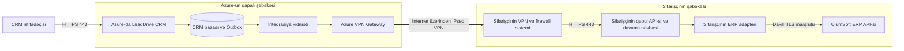
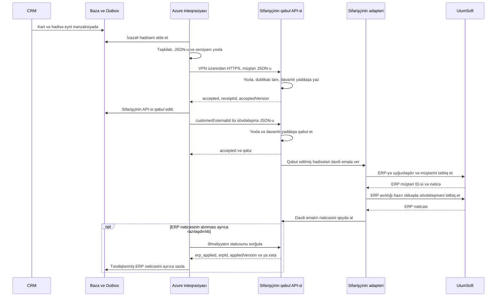

# LeadDrive CRM və UiumSoft ERP inteqrasiyasının API axını və informasiya təhlükəsizliyi

Versiya 1.1 • 13 oktyabr 2026-cı il • Sifarişçinin informasiya təhlükəsizliyi və İT bölmələri ilə razılaşdırılmaq üçün layihə

**Məqsəd:** girişə, məlumatların tərkibinə və emal nəticəsinə nəzarət etməklə müştəri kartlarını, əlaqə şəxslərini və əlaqəli sövdələşmələri qorunan kanal vasitəsilə LeadDrive CRM-dən UiumSoft ERP-yə ötürmək.

**İlkin şərtlər:** istismar mühitindəki CRM-in Microsoft Azure-da yerləşdirilməsi planlaşdırılır; ERP sifarişçinin daxili şəbəkəsində yerləşir. Bu inteqrasiya üçün Azure infrastrukturu hələ yaradılmayıb və IP ünvanları təyin edilməyib. Hazırkı test serveri gələcək istismar bağlantısının ünvanı deyil.

**Hədəf sxem:** **Azure-da LeadDrive CRM → Site-to-Site VPN → sifarişçinin qəbul API-si → sifarişçinin adapteri → UiumSoft ERP**. LeadDrive razılaşdırılmış JSON-u sifarişçinin özəl qəbul API-sinə HTTPS ilə çatdırır; sifarişçi məlumatları davamlı yaddaşa qəbul edir və öz adapteri vasitəsilə ERP-də emal edir. Qəbul API-si və ERP internetdə açıq yayımlanmır. Əsas tətbiq portu **TCP 443**-dür; perimetrdə VPN üçün **UDP 500 və UDP 4500**, UDP inkapsulyasiyası olmayan rejim seçildikdə isə ESP 50 IP protokolu ayrıca razılaşdırılır.

Aşağıdakı bütün tədbirlər, komponentlər və rəqəmlə göstərilən parametrlər, açıq şəkildə başqa cür qeyd edilmədikdə, layihələndirilən bağlantıya qoyulan tələblərdir. Bu sənəd hazır qəbul API-sinin, UiumSoft adapterinin və işlək VPN-in mövcudluğunu təsdiqləmir. Qəbul API-si və daxili ERP adapterinin sifarişçi tərəfindən təmin edilməsi hədəf məsuliyyət bölgüsüdür və sifarişçinin təsdiqini tələb edir. LeadDrive-a qəbul API-sinin kontraktı lazımdır; UiumSoft-un daxili quruluşunun öyrənilməsi və onun standart API-sinə adapter hazırlanması bizim əhatə dairəmizə daxil deyil. ERP məhsulu, versiyası, API lisenziyası və daxili metodlarla bağlı məsələləri sifarişçi və onun inteqratoru həll edir; burada sifarişçinin bildirdiyi UiumSoft adı saxlanılıb. Konkret IP ünvanları, domenlər və URL-lər fərziyyələrlə əvəz edilmir.

## 1 İnteqrasiyanın əhatə dairəsi

İlkin əhatə dairəsi CRM-dən seçilmiş müştəri kartlarının, əlaqə şəxslərinin və sövdələşmələrin razılaşdırılmış JSON formatında **sifarişçinin qəbul API-sinə birtərəfli biznes ötürülməsidir**. LeadDrive məlumatların seçilməsinə, payload-un hazırlanmasına, qorunan göndərişə, davamlı Outbox növbəsinə, təhlükəsiz təkrarlara və çatdırılma jurnalına cavabdehdir. Sifarişçi qəbul API-sinə, davamlı qəbul qeydinə, daxili çevirməyə, ERP-də yaratma/yeniləməyə və həmin emalın xətalarına cavabdehdir.

Nəticələr ayrılır: **`accepted` — sifarişçinin API-si hadisəni davamlı yaddaşa qəbul edib və sonrakı emalı öz üzərinə götürüb; `erp_applied` — sifarişçinin API-si ERP-də tətbiqi ayrıca və açıq şəkildə təsdiqləyib.** Sadəcə HTTP 200/201 və ya `accepted` ERP-yə yazılmanı sübut etmir. ERP nəticəsi qaytarılmırsa, CRM yalnız «Sifarişçinin API-si qəbul edib» statusunu göstərir.

Kommersiya təklifi, sifariş sətirləri və müqavilə rekvizitlərinin ötürülməsi ayrıca razılaşdırılır. ERP statusları və məlumat kitabçalarının oxunması əsas biznes axınına daxil deyil; lazım gələrsə, yalnız sifarişçinin qəbul API-sində ayrıca razılaşdırılmış metodlar vasitəsilə mümkündür. Yazışmaların, faylların, səs yazılarının, daxili qeydlərin və bütövlükdə CRM bazasının kütləvi ixracı ilkin əhatə dairəsinə daxil deyil.

Azure-dakı inteqrasiya xidməti tətbiq bağlantılarını başladır. Qəbul API-sinin cavabı həmin bağlantı ilə geri qaytarılır. ERP-nin yekun nəticəsini izləmək ayrıca razılaşdırıldıqda CRM eyni qapalı marşrutla sifarişçinin API-sindən statusu sorğulayır. ERP-dən CRM-ə ayrıca daxil olan webhook və Azure-dan ERP-yə birbaşa bağlantı tələb olunmur.

Bu axın məhz bu inteqrasiyanı əhatə edir. CRM-in e-poçt, telefoniya, messencerlər, analitika və AI xidmətləri aktivləşdirilərsə, onların ayrıca inventarlaşdırılması tələb olunur. İnteqrasiya məlumatları çevrilmə və ya təhlil üçün bu xidmətlərə göndərilmir.

## 2 Yerləşdirmə və şəbəkə marşrutu

### 2.1 Komponentlər

| Komponent | Yerləşmə və təyinat |
| --- | --- |
| CRM və onun istifadəçi giriş nöqtəsi | Azure; məlumatların daxil edilməsi və dəyişdirilməsi. İstifadəçilər razılaşdırılmış CRM domeninə HTTPS ilə qoşulur |
| CRM məlumat bazası və Outbox göndəriş jurnalı | Azure-un qapalı alt şəbəkəsi; kartların, göndəriş hadisələrinin və nəticələrin saxlanması |
| CRM inteqrasiya xidməti | Azure-un qapalı alt şəbəkəsində ayrıca hesablama xidməti; icazəli hadisələri seçir, razılaşdırılmış JSON-u göndərir və qəbul qəbzlərini saxlayır |
| Azure VPN Gateway | Azure tərəfində şifrələnmiş tuneli sonlandırır; VPN üçün ayrıca ictimai ünvanlar |
| Sifarişçinin VPN şlüzü və şəbəkələrarası ekranı | Tuneli sonlandırır və qəbul API-sinə yalnız icazə verilmiş trafiki buraxır |
| Sifarişçinin özəl qəbul API-si | Şəbəkənin ayrıca inteqrasiya zonası; autentifikasiya, validasiya, sorğu limitləri, dublikat nəzarəti, davamlı qəbul və qəbzin qaytarılması; sahibi sifarişçi və ya onun inteqratorudur |
| Sifarişçinin adapteri və emal növbəsi | CRM sahələrini ERP-yə uyğunlaşdırır, ERP səlahiyyətlərini idarə edir, asılılıqları və təkrarları emal edir, CRM ID ↔ ERP ID əlaqəsini saxlayır |
| UiumSoft tətbiq API-si | Sifarişçinin daxili şəbəkəsi; yalnız sifarişçinin adapteri vasitəsilə standart biznes əməliyyatlarını yerinə yetirir |
| Məxfi məlumatlar anbarı və monitorinq | Azure Key Vault və razılaşdırılmış monitorinq sistemləri; sifarişçinin qəbul API-sinə yalnız nəzərdə tutulmuş sorğular ötürülür |

Qəbul API-si və adapter sifarişçinin və ya onun inteqratorunun təmin edəcəyi layihə komponentləridir; bu öhdəlik hələ sifarişçi tərəfindən təsdiqlənməlidir. Onlar bir xidmətdə birləşdirilə bilər, lakin davamlı qəbul ilə ERP emalının nəticələri ayrı qalmalıdır. Əlavə ERP modulu və ya lisenziya lazımdırsa, bunu sifarişçi həll edir. LeadDrive konnektoru yalnız qəbul API-sinin təsdiqlənmiş kontraktına əsaslanır.

### 2.2 Ötürmə sxemi



Tətbiqin HTTPS sessiyası VPN daxilində LeadDrive inteqrasiya xidmətindən sifarişçinin qəbul API-sinə qədər uzanır və orada sonlandırılır. Qəbul API-si → adapter → ERP marşrutunu sifarişçi idarə edir; müxtəlif qovşaqlar arasında TLS və sertifikat yoxlaması tələb olunur. Daxili proseslərin portları və topologiyası sifarişçi tərəfindən müəyyən olunur. Bu, Azure-dan ERP-yə vahid TLS sessiyası və ya LeadDrive üçün ERP-yə birbaşa giriş deyil.

Site-to-Site VPN şifrələnmiş trafiki **ictimai internet üzərindən** ötürür; özəl ünvanlar və API-yə qapalı giriş fiziki olaraq ayrılmış kanal demək deyil. Azure VPN Gateway bu topologiyanı dəstəkləyir. [Microsoft Learn — VPN topology and design](https://learn.microsoft.com/en-us/azure/vpn-gateway/design)

### 2.3 Sifarişçi hansı ünvanları görəcək

| Müşahidə nöqtəsi | Mənbə ünvanı |
| --- | --- |
| Sifarişçinin VPN-inin xarici perimetri | Azure VPN Gateway-in ictimai IP ünvanı; ehtiyat şlüzlər olduqda bütün razılaşdırılmış şlüz IP-ləri |
| Özəl qəbul API-sinin qarşısındakı firewall | İnteqrasiya xidmətinin özəl IP ünvanı və ya VPN/NVA NAT-dan sonra razılaşdırılmış ünvan |
| Sifarişçinin adapterinin arxasındakı ERP | Sifarişçinin adapterinin daxili IP-si və sifarişçinin idarə etdiyi ERP xidməti hesabı; LeadDrive-ın ERP hesabı yoxdur |

CRM-in istifadəçi girişinin ictimai IP-si, VPN-in ictimai IP-si və inteqrasiya xidmətinin daxili ünvanı fərqli funksiyalar daşıyır. VPN üzərindən HTTPS girişi üçün faktiki müşahidə olunan **daxili** mənbəyə icazə verilir; CRM veb-saytının ictimai IP-si avtomatik olaraq icazəli mənbə sayılmır.

İnteqrasiya xidməti üçün statik özəl ünvan, miqyas artırıldıqda isə dəqiq müəyyən edilmiş kiçik ünvan hovuzu ayrılır. Tərəflərin alt şəbəkələrinin ünvan aralıqları üst-üstə düşməməlidir. Üst-üstə düşmə qaçılmazdırsa, dəstəklənən NAT rejimi, çevrilmiş şəbəkələr və geri dönüş marşrutları ayrıca razılaşdırılır; üst-üstə düşən şəbəkələr üçün Azure VPN NAT internetə çıxış verən NAT şlüzü deyil. [Microsoft Learn — VPN Gateway NAT](https://learn.microsoft.com/en-us/azure/vpn-gateway/nat-overview)

## 3 Bağlantı və portlar matrisi

Cədvəllərdəki işarələr real ünvanlar deyil, hələ doldurulmamış parametrlərdir. Bütün icazələr üçün mənbə, təyinat, TEST/PROD mühiti, məsul şəxs, jurnallaşdırma və yenidən baxılma tarixi göstərilir. Standart siyasət qadağandır.

### 3.1 Sifarişçinin perimetri və şəbəkəsi

| ID | Bağlantını başladan tərəf → təyinat | Protokol və təyinat portu | Məqsəd və məhdudiyyət |
| --- | --- | --- | --- |
| N01 | AZURE_VPN_PUBLIC_IPS ↔ CLIENT_VPN_PUBLIC_IPS | UDP 500 | IKE; yalnız konkret VPN tərəfləri |
| N02 | Eyni VPN tərəfləri | UDP 4500 | IPsec NAT-T; yalnız razılaşdırılmış tərəflər |
| N03 | Eyni VPN tərəfləri | ESP, IP protocol 50 | Yalnız native ESP seçildikdə; bu, TCP/UDP portu deyil, IP protokolunun nömrəsidir. Razılaşdırılmış UDP inkapsulyasiyalı rejimdə ayrıca tələb olunmur |
| N04 | AZURE_INTEGRATION_SOURCE → CLIENT_API_PRIVATE_IP | TCP 443 | VPN daxilində əsas HTTPS axını; yalnız inteqrasiya API-si |
| N05 | CLIENT_ADAPTER_IP → ERP_API_PRIVATE_IP | Hədəf TCP 443; faktiki portu sifarişçi təsdiqləyir | Sifarişçinin daxili adapterindən ERP-yə TLS çağırışı; bu, Azure üçün giriş icazəsi deyil. Qəbul API-si və adapter ayrı qovşaqlardadırsa, aralarındakı məhdud qayda da sifarişçi tərəfindən qeydə alınır |
| N06 | AZURE_INTEGRATION_SOURCE → CLIENT_AUTH_PRIVATE_IP | TCP 443 | Sifarişçinin OAuth tokenlərini verən serverinin ayrıca ünvanı olduqda; qəbul API-si ilə eyni ünvandadırsa — N04 |
| N07 | AZURE_DNS_FORWARDER → CLIENT_DNS_IPS | UDP/TCP 53 | Yalnız API adının sifarişçinin DNS-i vasitəsilə həll edilməsi tələb olunduqda; yalnız lazım olan zona yönləndirilir |

N01–N03 tuneli, N04 isə tətbiq məlumatlarının mübadiləsini təmin edir. VPN tərəflərinə tuneli hər iki tərəfdən qurmağa və bərpa etməyə icazə verilir. NAT-T/ESP rejimi və VPN qurğusunun uyğunluğu qaydalar aktivləşdirilməzdən əvvəl şəbəkə administratorları tərəfindən qeydə alınır. [Microsoft Learn — VPN devices and IPsec parameters](https://learn.microsoft.com/en-us/azure/vpn-gateway/vpn-gateway-about-vpn-devices), [Microsoft Learn — VPN tunnel troubleshooting](https://learn.microsoft.com/en-us/troubleshoot/azure/vpn-gateway/troubleshoot-vpn-tunnel-cannot-connect)

N04–N07 üzrə cavablar qurulmuş bağlantının vəziyyətinə əsasən buraxılır; ERP → Azure istiqamətində yeni sessiyalar üçün ayrıca icazə yaradılmır. Mənbə TCP portunu əməliyyat sistemi seçir, API-nin təyinat portu isə 443-dür. Vəziyyəti izləməyən stateless ACL üçün seçilmiş əməliyyat sisteminə uyğun cavab portu aralıqları ayrıca göstərilir; bu, yeni xidmətin açılması demək deyil.

Azure xidmətinin ERP məlumat bazasına və onun xidməti portlarına, SMB 445, SSH 22 və RDP 3389-a birbaşa girişi tələb olunmur. Biznes sorğuları üçün 80 portu istifadə edilmir. ERP-nin standart API-si başqa portda işləyirsə, sifarişçinin komandası N05-i dəqiq daxili qayda ilə əvəz edir; bu dəyişiklik Azure → qəbul API-si üçün TCP 443 qaydasını dəyişmir. Ayrı-ayrı qovşaqlar arasında şifrələnməmiş HTTP bu sxemin qəbul edilmiş variantı deyil.

Əsas layihədə statik olaraq razılaşdırılmış marşrutlardan istifadə edilir. BGP və onun TCP 179 portu tələb olunmur; BGP seçilərsə, yalnız BGP tərəflərinin dəqiq ünvanları arasında ayrıca qayda əlavə edilir. İnzibati VPN və texniki dəstək girişi məlumat mübadiləsi kanalından ayrıca rəsmiləşdirilir.

### 3.2 Azure daxilində bağlantılar və xidməti asılılıqlar

| Bağlantını başladan tərəf → təyinat | Port | Şərt |
| --- | --- | --- |
| İstifadəçilər → CRM giriş nöqtəsi | TCP 443 | İstifadəçilər üçün ayrıca giriş siyasəti; WAF/reverse proxy və TLS |
| CRM giriş nöqtəsi → tətbiq | TCP 443 | Tətbiqin daxili TLS proksisi; tətbiqin lokal portu xaricə açılmır |
| Tətbiq və inteqrasiya → CRM PostgreSQL bazası | TLS ilə TCP 5432 | Yalnız özəl şəbəkə və ayrı məlumat bazası rolları; ERP bu portdan istifadə etmir |
| İnteqrasiya xidməti → Azure Key Vault | TCP 443 | Üstünlük private endpoint-ə verilir; yalnız öz inteqrasiyasının məxfi məlumatlarına giriş |
| İnteqrasiya xidməti → razılaşdırılmış OAuth issuer | TCP 443 | Buludda yerləşən issuer istifadə olunduqda; dəqiq FQDN və audience qeydə alınır |
| Komponentlər → razılaşdırılmış DNS | UDP/TCP 53 | Yalnız etibarlı DNS həllediciləri |
| Komponentlər → monitorinq | TCP 443 | Metrikalar və həssas məlumatlardan təmizlənmiş jurnallar; ünvanlar seçilmiş xidmətdən asılıdır |
| Komponentlər → vaxt mənbəyi | Ayrıca NTP tələb olunarsa UDP 123 | Yalnız təsdiqlənmiş mənbə; platformanın sinxronizasiya mexanizmindən istifadə oluna bilər |
| TLS komponentləri → PKI tələb edərsə CRL/OCSP | CA-nın dəqiq ünvanlarına TCP 80/443 | Yalnız sertifikatların ləğv statusunun yoxlanması, biznes məlumatlarını daşıyan sorğu gövdələri olmadan; daxili CA olduqda VPN marşrutu mümkündür |

Bu cədvəl bütün Azure platformasının idarəetmə bağlantılarının tam siyahısını deyil, inteqrasiyanın asılılıqlarını təsvir edir. VM/App Service/konteyner xidməti seçildikdən sonra infrastruktur komandası tələb olunan platforma endpoint-lərini, ehtiyat nüsxələmə və yeniləmələri çıxış bağlantıları reyestrinə əlavə edir. Bunları bütün internetə daimi giriş icazəsi ilə əvəz etmək olmaz. İlkin layihənin növbəsi məlumat bazasında Outbox kimi saxlanılır; ayrıca mesaj brokeri və onun portları tələb olunmur.

## 4 Müştəri və hadisələrin seçilməsi qaydaları

1. Yeni müraciət əvvəlcə CRM-də lid kimi yaradılır. Yoxlanılmamış, spam xarakterli və sifarişçiyə aid olmayan lidlər ERP-yə avtomatik göndərilmir.
2. Razılaşdırılmış kvalifikasiya mərhələsinə çatdıqda və ya ilk uyğun sövdələşmə yaradıldıqda `erpSyncEligible` əlaməti təyin olunur. Dəqiq mərhələni sifarişçi seçir. Bu, inteqrasiya üçün layihə qaydasıdır, CRM-də artıq mövcud olan sahənin adı deyil.
3. Kvalifikasiyadan keçmiş potensial müştərinin razılaşdırılmış tipi qəbul API-sinə göndərilir. Sifarişçinin adapteri onu ERP-də dəstəklənən kontragent tipinə çevirir; kartın yaradılması avtomatik maliyyə öhdəliyi yaratmamalıdır.
4. Kontragent və seçilmiş əlaqə şəxsləri göndərilir. Kontragentin davamlı qəbzi alındıqdan sonra sövdələşmə CRM müştəri ID-sinə (`customerExternalId`) istinadla göndərilə bilər. ERP ID-sini tapmaq, kontragentin ERP-də yaradılmasını gözləmək və daxili əməliyyatların ardıcıllığı sifarişçinin adapterinin vəzifəsidir.
5. Razılaşdırılmış sahələrdə sonrakı dəyişikliklər hadisələrin yeni versiyalarını yaradır. Daxili qeydlərdə və ötürülmədən çıxarılmış digər sahələrdəki dəyişikliklər bu məlumatların göndərilməsini başlatmır.
6. Sövdələşmənin uğurla bağlanması yalnız ayrıca təsdiqlənmiş qayda əsasında və sifarişin məcburi sətirləri mövcud olduqda sifarişin **qaralamasının** yaradılmasını başlada bilər. Mərhələnin dəyişməsi öz-özlüyündə satışın, hesabın və ya ödənişin mühasibat uçotuna işlənməsini həyata keçirmir.
7. Bağlanmış və ya itirilmiş sövdələşmə status dəyişikliyi kimi ötürülür. CRM kartının silinməsi ERP-də uçot sənədlərini avtomatik silmir; qeyri-aktiv status və ya ayrıca razılaşdırılmış prosedur tətbiq olunur.

Biznesə kvalifikasiyadan əvvəl hər yeni lid lazımdırsa, 2-ci bənddəki meyar istismara verilməzdən əvvəl dəyişdirilir. Bu variant üçün ERP-də potensial müştərilərin dəstəklənməsi və fərdi məlumatların erkən mərhələdə ötürülməsinə ehtiyac ayrıca yoxlanılır.

## 5 Məlumatların tərkibi və sahələr üzrə məsuliyyət

Tərəflər hər sahə üçün CRM mənbəyini, **sifarişçinin qəbul API-sindəki JSON yolunu**, tipi, uzunluğu, məcburiliyi, icazəli kodları, dəyişikliklər üzrə məsul tərəfi və boş dəyər qaydasını razılaşdırır. Qəbul edilən JSON-un UiumSoft-un daxili sahələrinə uyğunlaşdırılmasını sifarişçi hazırlayır və saxlayır. LeadDrive-a ERP-nin daxili sxemi deyil, razılaşdırılmış qəbul kontraktı lazımdır. Bütöv CRM obyekti deyil, icazə verilmiş sahələr toplusu göndərilir.

| Obyekt | Ötürüləcək məlumatlar | Rejim |
| --- | --- | --- |
| Kontragent | CRM-in xarici ID-si; fiziki/hüquqi şəxs tipi; ad; lazım olduqda vergi nömrəsi/VÖEN; ölkə; razılaşdırılmış hüquqi və/və ya çatdırılma ünvanı; iş əlaqə məlumatları | Əsas əhatə dairəsi; məcburi rekvizitləri sifarişçi qəbul kontraktında bildirir |
| Əlaqə şəxsi | CRM ID-si; kontragentlə əlaqə; ad; lazım olduqda vəzifə; iş telefonu və e-poçtu | Yalnız sövdələşmə üçün zəruri olan seçilmiş şəxslər |
| Sövdələşmə | CRM ID-si; `customerExternalId` ilə CRM kontragentinə istinad; ad; mərhələ; məbləğ və valyuta; gözlənilən bağlanma tarixi; məsul şəxsin/bölmənin kodu; dəyişiklik versiyası | Əsas əhatə dairəsi; ERP statusuna və ERP ID-lərinə uyğunlaşdırmanı sifarişçi aparır |
| Kommersiya təklifi və sifariş sətirləri | Sənədin və sətrin ID-si; ERP məhsul kodu; miqdar; vahid; qiymət; endirim; razılaşdırılmış vergi kodu; yekun məbləğ; valyuta | Mənbə və düsturlar təsdiqləndikdən sonra əlavə əhatə dairəsi |
| Müqavilə rekvizitləri | Nömrə, tarixlər, sövdələşməyə istinad, razılaşdırılmış məlumat kitabçalarından ödəniş və çatdırılma şərtləri | Əlavə əhatə dairəsi; müqavilənin mətni və əlavələri ayrıca |
| Davamlı qəbul qəbzi | `receiptId`, `operationId`, `eventId`, `externalId`, `acceptedVersion`, `acceptedAt`, `status: accepted` | Sifarişçinin qəbul API-sindən məcburi texniki cavab; ERP-yə yazılma təsdiqi deyil |
| ERP-nin emal nəticəsi | `status: erp_applied`, `erpId`, `appliedVersion`, `processedAt` və ya müəyyən edilmiş xəta | Yalnız ayrıca razılaşdırılıb sifarişçinin API-si tərəfindən təqdim edildikdə; ERP-yə birbaşa sorğu yoxdur |
| Sifariş, göndəriş və ödəniş statusları | Nömrə, status, tarixlər, razılaşdırılmış məbləğlər/qalıq | Sifarişçinin API-si vasitəsilə ayrıca razılaşdırılmış seçimli oxuma |
| Nomenklatura, vahidlər, valyutalar, dərəcələr və anbarlar | Kod, göstərilməsinə icazə verilən ad və məlumat kitabçasının atributları | Sifarişçinin API-si vasitəsilə seçimli oxuma və ya əvvəlcədən razılaşdırılmış kod siyahısı |

Müştəri münasibətləri və satış mərhələləri üzrə əsas məlumat mənbəyi CRM-dir. Uçot kodları, mühasibat uçotuna işlənmiş sənədlər, qalıqlar, faktiki göndərişlər və ödənişlər üzrə əsas mənbə ERP-dir. Müştəri rekvizitləri üçün sahələr üzrə məsuliyyət matrisi açıq şəkildə müəyyən edilir: rekvizitlər mühasibatlıq tərəfindən yoxlandıqdan sonra CRM onları razılaşdırılmış proses olmadan yenidən yazmır.

Sövdələşmənin məbləğini mühasibat uçotuna işlənmiş hesabın məbləği ilə eyniləşdirmək olmaz. Hazırkı CRM-də «sövdələşmədə məhsul» əlaqəsi sənədi avtomatik olaraq miqdarı, vahidləri və vergiləri olan tam sifariş saymaq üçün kifayət etmir. Sifariş üçün təsdiqlənmiş sətir mənbəyi, məsələn, təsdiqlənmiş kommersiya təklifi seçilir və hesablamalar ayrıca yoxlanılır.

Parollar, tokenlər, açarlar, digər təşkilatların məlumatları, ödəniş kartı rekvizitləri, yazışma tarixçəsi, zəng yazıları, şəxsiyyət sənədləri, fərdi məlumatların xüsusi kateqoriyaları və ixtiyari daxili şərhlər ötürülmür. Ayrıca proses həqiqətən belə bir sahə tələb edirsə, məqsəd və giriş səlahiyyətləri göstərilməklə müstəqil razılaşdırmadan keçir.

## 6 Bir müştəri və sövdələşmənin emalı ardıcıllığı



Əhəmiyyətli dəyişiklik saxlanıldıqda CRM Outbox qeydini **eyni məlumat bazası tranzaksiyasında** yaradır. Tranzaksiya tamamlanmayıbsa, hadisə göndərilmir. Qeyd təşkilatı, obyekt tipini, xarici ID-ni, versiyanı, vaxtı və emal üçün zəruri məlumatları ehtiva edir. Xidmət yalnız sifarişçinin təşkilatına aid hadisələri oxuyur.

Göndərilməzdən əvvəl qəbul kontraktının məcburi sahələri, formatlar, uzunluqlar, kodlar, rəqəm diapazonları, valyuta və səlahiyyətlər yoxlanılır. Validasiyadan keçmək üçün vergi və əlaqə rekvizitləri uydurma dəyərlərlə tamamlanmır.

Sifarişçinin API-si TLS/mTLS-i, autentifikasiyanı, xidməti hesabın təşkilata bağlılığını, metodları, sxemi, ölçünü və tezliyi yoxlayır. **`accepted` yalnız hadisə və deduplikasiya qeydi davamlı yaddaşa yazıldıqdan sonra qaytarılır.** Sadəcə RAM növbəsi və ya sorğunun proxy-dən keçməsi qəbul sayılmır. Davamlı qəbz və təhlükəsiz təkrar mexanizmi yoxdursa, kontrakt istismara hazır deyil.

Qəbul qəbzindən sonra daxili ERP çevirməsi, müştəri → əlaqə şəxsi → sövdələşmə asılılıqları, ERP identifikatorları və ERP xətalarının araşdırılması sifarişçinin məsuliyyətidir. Bizim sövdələşmə JSON-umuz ERP ID-si tələb etmir. Sifarişçinin daxili emalı uğursuz olsa, artıq qəbul edilmiş hadisə avtomatik olaraq yeni biznes hadisəsi kimi göndərilmir; məsələ qəbz və event ID üzrə onların komandası ilə həll edilir.

`200/201/202` cavabı öz-özlüyündə ERP uğuru demək deyil: gövdə razılaşdırılmış sxemə uyğun yoxlanılır. `accepted` davamlı qəbul deməkdir. Yalnız sifarişçinin API-sindən açıq `erp_applied` nəticəsi, uyğun versiya və ERP identifikatoru alındıqda «ERP-də tətbiq edilib» göstərilə bilər. HTTP 200 daxilində biznes xətası uğur sayılmır. ERP statusunun seçimli sorğulanması razılaşdırılmayıbsa, biz ERP nəticəsini fərz etmirik.

CRM statusları: «Göndərişi gözləyir», «Göndərilir», «Sifarişçinin API-si qəbul edib», «Qəbul nəticəsi dəqiqləşdirilir», «Düzəliş tələb olunur». «ERP-də tətbiq edilib» və «ERP emalı rədd edilib» yalnız müvafiq təsdiq kanalı olduqda ayrıca göstərilir. Menecerə məxfi məlumatlar olmadan səbəb və dəstək müraciətinin ID-si təqdim edilir.

## 7 API üzrə layihə kontraktı

**Aşağıda sifarişçinin qəbul API-si üçün təklif olunan kontrakt verilir; bu, UiumSoft-un standart metodlarının siyahısı deyil.** LeadDrive ilə sifarişçi qəbul API-sinin OpenAPI sənədini, JSON sxemini, autentifikasiyanı, davamlı qəbzi və xəta semantikasını təsdiqləyir. ERP-nin standart REST/SOAP metodlarına uyğunlaşdırmanı sifarişçinin inteqratoru hazırlayır; həmin daxili sənədlərin öyrənilməsi LeadDrive işinin şərti deyil. ERP məhdudiyyətlərini qəbul kontraktına sifarişçi daxil edir.

| Metod və şərti yol | Təyinat |
| --- | --- |
| `PUT /integration/v1/customers/{externalId}` | Kontragentin yaratma/yeniləmə hadisəsini davamlı qəbul etmək |
| `PUT /integration/v1/contacts/{externalId}` | Razılaşdırılmış əlaqə şəxsinin hadisəsini davamlı qəbul etmək |
| `PUT /integration/v1/deals/{externalId}` | `customerExternalId` ilə sövdələşmə hadisəsini davamlı qəbul etmək |
| `PUT /integration/v1/orders/{externalId}` | Ayrı razılaşdırıldıqda sifariş qaralaması hadisəsini qəbul etmək |
| `GET /integration/v1/operations/{operationId}` | Seçimli olaraq qəbulun və ayrıca razılaşdırıldıqda ERP emalının statusunu öyrənmək |
| `GET /integration/v1/operations?eventId=...` | İlk cavab itdikdə qəbul qəbzini tapmaq üçün təklif olunan mexanizm; alternativ olaraq eyni açarlı təhlükəsiz təkrar əvvəlki qəbzi qaytarır |
| `GET /integration/v1/customers/{externalId}` | Ayrıca razılaşdırıldıqda qəbul API-sində öz obyektinin qəbul edilmiş versiyasını yoxlamaq; birbaşa ERP sorğusu deyil |
| `GET /integration/v1/receipts?cursor=...` | Üzləşdirmə üçün təklif olunan məhdud qəbz siyahısı; API əvəzinə razılaşdırılmış qorunan qəbz reyestri verilə bilər |
| `GET /integration/v1/reference-data/{type}?cursor=...` | Yalnız əlavə əhatə dairəsində sifarişçinin API-sindən razılaşdırılmış kodları oxumaq |

Token endpoint ünvanını seçilmiş OAuth issuer təyin edir; `/oauth/token` yolu əvvəlcədən UiumSoft-a aid edilmir. Bütün URL-lər konfiqurasiyada sabitlənir; müştəri məlumatları təyinat serverini seçə bilməz. API-də ixtiyari SQL sorğularına, ixtiyari URL-lərə, icra əmrlərinə və razılaşdırılmamış obyektlərin kütləvi ixracına icazə verilmir.

Əsas başlıqlar: `Content-Type: application/json`, `Authorization: Bearer <access_token>`, `X-Correlation-ID`, `Idempotency-Key`. Token dəyərləri URL-lərə və jurnallara düşmür. Təşkilatın kimliyi yoxlanılmış xidməti hesabdan götürülür; JSON-dakı təşkilat sahəsi təşkilatı dəyişmək hüququ vermir.

Nümunədəki məlumatlar tamamilə sünidir. Faktiki ötürmə kontraktında yalnız mapping-də razılaşdırılmış sahələr göndərilir.

```json
{
  "schemaVersion": "1.0",
  "eventId": "10000000-0000-4000-8000-000000000001",
  "sourceSystem": "LeadDrive",
  "externalId": "crm-customer-demo-001",
  "entityVersion": 3,
  "occurredAt": "2026-10-13T08:00:00Z",
  "customer": {
    "type": "legal_entity",
    "name": "DEMO CUSTOMER",
    "countryCode": "AZ",
    "email": "contact@example.invalid"
  }
}
```

Bu nümunəyə məcburi vergi və ya ünvan sahələri sifarişçinin qəbul kontraktına əsasən əlavə edilir; məcburi sahənin olmaması yoxlanıla bilən xəta yaradır. Müştərinin davamlı qəbul qəbzi alındıqdan sonra CRM müştəri ID-si ilə ayrıca sövdələşmə göndərilir:

```json
{
  "schemaVersion": "1.0",
  "eventId": "10000000-0000-4000-8000-000000000002",
  "externalId": "crm-deal-demo-001",
  "entityVersion": 1,
  "occurredAt": "2026-10-13T08:00:01Z",
  "customerExternalId": "crm-customer-demo-001",
  "deal": {
    "name": "DEMO DEAL",
    "stageCode": "QUALIFIED",
    "amount": "1500.00",
    "currency": "AZN",
    "expectedCloseDate": "2026-11-01"
  }
}
```

`QUALIFIED`, `AZN` kodları və nümunənin strukturu yalnız təsdiqlənmiş mapping olduqda istifadə edilir. Pul dəyərləri razılaşdırılmış dəqiqliklə onluq ədədləri ifadə edən mətn sətirləri şəklində ötürülür; hadisə tarixləri ISO 8601 UTC formatında, təqvim tarixləri isə süni saat qurşağı əlavə edilmədən verilir. Vergi kodları, yuvarlaqlaşdırma, vahidlər və valyuta formatı spesifikasiyada qeydə alınır.

Davamlı qəbul təsdiqinin nümunəsi; bu cavab ERP-də yazılmanı təsdiqləmir:

```json
{
  "operationId": "op-demo-002",
  "eventId": "10000000-0000-4000-8000-000000000002",
  "externalId": "crm-deal-demo-001",
  "receiptId": "receipt-demo-002",
  "status": "accepted",
  "acceptedVersion": 1,
  "acceptedAt": "2026-10-13T08:00:02Z"
}
```

Qəbul qəbzindəki `eventId`, `externalId` və `acceptedVersion` göndərilmiş hadisə ilə uyğun olmalıdır. Sifarişçi yekun ERP statusunu təqdim etməyi ayrıca öhdəsinə götürərsə, `erp_applied` cavabı `erpId`, `appliedVersion` və `processedAt` ilə qaytarılır. Təkcə `accepted`, HTTP 200/201 və ya uğurlu şəbəkə bağlantısı bu nəticə ilə eyniləşdirilmir. ERP-də rədd edilmə qəbul faktını geriyə silmir.

Kontrakt sxeminin versiyası obyektin versiyasından ayrıca idarə olunur. Uyğunluğu pozan dəyişikliklər yeni API versiyası, sınaq və keçid tarixi tələb edir. Sahə yoxdursa, dəyər dəyişməz saxlanılır; `null` yalnız həmin sahə üçün açıq icazə verildikdə dəyəri təmizləyir; boş sətir universal təmizləmə əmri deyil.

## 8 Dublikatlar, hadisələrin ardıcıllığı və nasazlıqlar

Çatdırılma modeli **at least once**, yəni ən azı bir dəfə çatdırılmadır. LeadDrive eyni hadisəni təkrar göndərə bilər; sifarişçinin qəbuledicisi bunu yeni biznes əməliyyatı yaratmadan tanımalıdır.

Açar inteqrasiya, təşkilat, obyekt tipi və CRM-in xarici ID-si ilə əlaqələndirilir. `eventId`, `Idempotency-Key`, obyekt versiyası və payload bütün təkrarlarda dəyişməz qalır. Eyni açar və eyni məzmun əvvəlki davamlı qəbzi qaytarır; eyni açar fərqli məzmunla konflikt yaradır. Qəbuledici paralel sorğular zamanı da deduplikasiyanı atomar təmin edir. Davamlı qəbul və qəbzin bərpası yoxdursa, avtomatik təkrar təhlükəsiz deyil və inteqrasiya istismara buraxılmır.

LeadDrive qəbuletmə cavabı itdikdə eyni açarla təhlükəsiz təkrar və ya razılaşdırılmış `eventId` axtarışı ilə əvvəlki qəbzi bərpa edir. Bir dəfə nəticənin tapılmaması qəbulun baş vermədiyini sübut etmir. Etibarlı nəticə əldə olunmursa, hadisə «Qəbul nəticəsi dəqiqləşdirilir» vəziyyətində saxlanılır və eskalasiya edilir; yeni açar yaradılmır.

**İki səviyyədə dublikat nəzarəti tələb olunur:** qəbul API-si göndərişləri deduplikasiya edir; sifarişçinin adapteri isə CRM xarici ID-si ilə ERP obyekti arasında daimi unikal əlaqəni və ERP-də idempotent emalı təmin edir. ERP-yə yazıldıqdan sonra adapterin sıradan çıxması sifarişçinin bərpa ssenarisidir. Qəbul jurnalının olması təkbaşına ERP dublikatlarını aradan qaldırmır.

Hər obyektin monoton artan versiyası olur; köhnə versiya yenisini əvəz etmir. LeadDrive eyni obyektin göndərişlərini ardıcıllıqla idarə edir. Kontragentin qəbul qəbzindən sonra sövdələşmə `customerExternalId` ilə ötürülə bilər. Kontragentin ERP-də yaradılmasını gözləmək və daxili ERP əməliyyatlarının ardıcıllığı sifarişçinin adapterinə aiddir.

| Vəziyyət | Tədbir |
| --- | --- |
| Yanlış məlumatlar, HTTP 400/422 | Hadisəni dayandırmaq; düzəlişdən sonra yeni versiyanı göndərmək |
| HTTP 401 | İcazəli tokeni bir dəfə yeniləmək; təkrar rədd cavabında inteqrasiyanı dayandırmaq və bildiriş yaratmaq |
| HTTP 403 | Avtomatik təkrar etməmək; qəbul API-sinin səlahiyyətlərini və təşkilata uyğunluğu yoxlamaq |
| HTTP 404 | Qəbul kontraktını, ünvanı, asılılıq istinadını və API versiyasını yoxlamaq; yoxlamadan yeni obyekt yaratmamaq |
| HTTP 409 | Versiya, xarici ID və ya açar konfliktini araşdırmaq; nəticəni üzləşdirmək |
| HTTP 429 | `Retry-After`-ı nəzərə almaq, tezliyi azaltmaq və hadisəni saxlamaq |
| HTTP 5xx, bağlantının kəsilməsi və ya vaxt aşımı | Davamlı qəbzi bərpa etmək; yalnız müqavilədə təmin edilən deduplikasiya ilə eyni açarla təkrar etmək |
| Qəbuldan sonra cavab itib | «Qəbul nəticəsi dəqiqləşdirilir»; yeni açar yaratmadan əvvəlki qəbzi bərpa etmək |
| VPN və ya qəbul API-si əlçatan deyil | LeadDrive Outbox-da hadisələri saxlamaq, yükü məhdudlaşdırmaq və bildiriş yaratmaq |
| Qəbuldan sonra ERP əlçatan deyil | Sifarişçinin davamlı növbəsi və adapteri bərpa edir; LeadDrive qəbul edilmiş hadisəni yeni hadisə kimi göndərmir |
| ERP emalı rədd edilib | Nəticə bizə təqdim edilirsə ayrıca göstərmək; sifarişçi adapteri/ERP xətasını araşdırır; mənbə məlumatı səhvdirsə razılaşdırılmış düzəliş və yeni versiya |
| LeadDrive xidmətinin yenidən başladılması | Outbox-dan davam etmək və qeyri-müəyyən qəbul nəticələrini üzləşdirmək |

Təklif olunan ilkin limitlər: faylsız hər mesaj üçün 1 MiB-a qədər; hər inteqrasiya üzrə saniyədə maksimum 5 sorğu və eyni vaxtda 2 sorğu; bağlantı üçün 5 saniyə, tam sorğu üçün 30 saniyə. Kiçik təsadüfi vaxt fərqi ilə təkrar cəhdlər: 1, 5, 15 və 60 dəqiqədən sonra, daha sonra 24 saat ərzində hər saat. Sonra hadisə itmir, araşdırma növbəsində qalır. Bunlar qəbul API-sinə çatdırılma limitləridir; sifarişçinin daxili ERP limitləri ayrıca idarə olunur.

Sistemlər əlçatan olduqda hadisələrin 95%-nin **qəbul API-si tərəfindən davamlı qəbzi** üçün hədəf 60 saniyəyə qədərdir. Bu, qüvvədə olan SLA və ERP-də emal müddətinə zəmanət deyil. ERP emal müddəti sifarişçinin ayrıca göstəricisidir. Növbənin uzunluğu, ən köhnə hadisənin yaşı, qeyri-müəyyən qəbul sayı və qəbz gecikməsi izlənilir; ERP statusları varsa, onlar ayrıca ölçülür. Tutum dolduqda xəbərdarlıq və razılaşdırılmış məhdudlaşdırma tətbiq olunur, hadisələri səssizcə atmaq olmaz.

## 9 Autentifikasiya və səlahiyyətlər

Hədəf profil: TLS 1.2 və ya daha yuxarı, uyğunluq olduqda TLS 1.3-ə üstünlük verilir; qəbul API-sində mTLS ilə sertifikatların qarşılıqlı yoxlanması və xidməti tətbiq üçün OAuth 2.0 Client Credentials. Quraşdırılmış texnologiyalar toplusu hər iki mexanizmi dəstəkləmirsə, sifarişçi işlənib hazırlanma başlamazdan əvvəl dəstəklənən profili və ya yoxlamaların inteqrasiya şlüzündə yerləşdirilməsini razılaşdırır. Bu profil sifarişçinin qəbul API-sinə aiddir. UiumSoft-un daxili autentifikasiyasını sifarişçi seçir və idarə edir; LeadDrive-ın ERP üçün ayrıca giriş məlumatları olmur.

Qəbul API-si üçün xidməti hesab hər sifarişçi və mühitə ayrıca yaradılır. Əsas scopes: `customers.write`, `contacts.write`, `deals.write`; qəbul qəbzinin oxunması lazımdırsa və ya seçimli ERP statusları razılaşdırılıbsa `sync.status.read` əlavə edilir. `orders.draft.write` və `reference.read` ayrıca əhatə dairəsidir. Bunlar qəbul API-si üçün təklif olunan hüquqlardır, ERP-nin standart scopes adları deyil. Daxili ERP xidməti hesabını sifarişçi yaradır və onun səlahiyyətlərini öz adapterinin işi ilə məhdudlaşdırır.

ERP administratoru səlahiyyətləri, istifadəçi və rolların dəyişdirilməsi, məlumat bazasına birbaşa giriş, ödəniş və mühasibat sənədlərinin uçota işlənməsi, digər təşkilatların məlumatlarının oxunması və kütləvi silinmə qadağandır. Təşkilat məhdudiyyəti hər obyektdə və hər sorğuda, o cümlədən əməliyyat statusunun oxunması zamanı yoxlanılır.

Tokenlər inteqrasiya API-sinin audience dəyəri, icazəli scopes və qısa etibarlılıq müddəti ilə məhdudlaşdırılır; issuer dəstəkləyirsə, təklif olunan maksimum müddət 15 dəqiqədir. İmza və icazəli alqoritm, issuer, audience, etibarlılıq müddəti və xidməti tətbiqə bağlılıq yoxlanılır. Yalnız təşkilat ID-sini ehtiva edən bir başlıq autentifikasiya sayılmır. HTTPS, səlahiyyət və giriş məlumatlarının yoxlanması prinsipləri [OWASP REST Security](https://cheatsheetseries.owasp.org/cheatsheets/REST_Security_Cheat_Sheet.html) tövsiyələrinə uyğundur.

İstismara verilməzdən əvvəl sertifikatların, tokenlərin və VPN açarlarının məsul şəxsləri və rotasiya müddətləri rəsmiləşdirilir. Sertifikatın müddətinin bitməsinə 30, 14 və 7 gün qalmış bildiriş, dəyişmə zamanı köhnə və yeni sertifikatın nəzarətli birgə etibarlılıq müddəti və komprometasiya zamanı dərhal ləğv təklif olunur. Etibar zənciri, server adı və sertifikatların ləğv siyasəti yoxlanılır; sertifikat yoxlamasının söndürülməsinə icazə verilmir.

## 10 Məxfi məlumatlar, seqmentləşdirmə və tətbiqlərin qorunması

Açarlar, client secret-lər və sertifikatların gizli açarları Azure Key Vault-da və ya sifarişçinin razılaşdırılmış məxfi məlumatlar anbarında saxlanılır. Azure xidməti Key Vault-a minimum səlahiyyətli managed identity vasitəsilə müraciət edir; bu, sifarişçinin qəbul API-sinin həmin identity-ni avtomatik qəbul etməsi demək deyil. Sifarişçinin qəbul API-sinə giriş üçün məxfi məlumatlar lazım gəldikdə anbardan alınır və yalnız server prosesində istifadə olunur. ERP-nin daxili giriş məlumatlarını sifarişçi öz mühitində saxlayır; onlar LeadDrive-a verilmir. [Microsoft Learn — Secure your Azure Key Vault](https://learn.microsoft.com/en-us/azure/key-vault/general/secure-key-vault)

Məxfi məlumatlar brauzerdə, Git-də, sənədlərdə, URL-lərdə, dəstək sorğularında, ekran görüntülərində və adi jurnallarda olmur. İlkin məxfi məlumatların ötürülməsi razılaşdırılmış qorunan kanal vasitəsilə həyata keçirilir. TEST və PROD fərqli məxfi məlumatlardan, sertifikatlardan və hesablardan istifadə edir.

Marşrutlar və firewall girişi ayrıca inteqrasiya alt şəbəkəsi və sifarişçinin konkret ünvanları ilə məhdudlaşdırır. VPN bütün Azure VNet-ə müştərinin bütün şəbəkəsinə giriş vermir. CRM-in sifarişçinin domeninə üzv olması və domen kontrollerlərinə girişi tələb olunmur. İnteqrasiya xidmətinin çıxış bağlantıları API, avtorizasiya, DNS və razılaşdırılmış xidməti asılılıqlarla məhdudlaşdırılır.

Özəl API üçün icazəli FQDN/IP/port ilə işləyən, yönləndirmələri və DNS-i yoxlayan ayrıca etibarlı konnektor hazırlanır. CRM istifadəçisi ixtiyari təyinat ünvanı göstərə bilməz. İxtiyari daxili ünvanlara və metadata endpoint-ə giriş qadağası da daxil olmaqla ümumi SSRF qorunması VPN inteqrasiyası naminə söndürülmür.

API metodları, sahə uzunluqlarını, JSON ölçüsünü və iç-içə yerləşmə dərinliyini, səhifə həcmini və sorğu tezliyini məhdudlaşdırır. Bizim qəbul kontraktımız JSON-dur. Sifarişçinin daxili ERP adapteri SOAP/XML istifadə edirsə, onun komandası xarici entity-ləri və DTD-ni söndürür, sənədin ölçü və dərinlik limitlərini müəyyən edir. Əsas axında əlavə fayllar yoxdur; faylların əlavə edilməsi tip və ölçü məhdudiyyətləri, antivirus yoxlaması, saxlama qaydaları və ayrıca razılaşdırma tələb edir.

Administratorlar fərdi hesablardan, MFA-dan, ayrılmış rollardan və jurnallaşdırılan, vaxtla məhdudlaşdırılmış girişdən istifadə edir. Endpoint, scopes, mapping və ixrac qaydalarındakı dəyişikliklər dəyişikliklərə nəzarət prosesindən keçir. Toplanmış hadisələri silmədən xidməti girişin ləğvi, LeadDrive göndəriş xidmətinin dayandırılması və N04-ün bloklanması ilə təcili söndürmə mümkündür. Bu, artıq qəbul edilmiş hadisələrin sifarişçi tərəfində emalını avtomatik dayandırmır; həmin tədbiri sifarişçi ayrıca görür.

## 11 Saxlama, məxfilik və təhlükəsizlik jurnalları

### 11.1 Saxlama sərhədləri və müddətlər

| Yer | Saxlanılan məlumatlar | Tələb və məsuliyyət |
| --- | --- | --- |
| Azure-dakı CRM məlumat bazası | İcazəli kartlar, sövdələşmələr, qəbzlər və yalnız bildirildikdə ERP nəticələri | LeadDrive-ın idarə etdiyi sahədə şifrələmə, minimum rollar və təsdiqlənmiş Azure regionu |
| LeadDrive Outbox və xəta növbəsi | Minimum payload, versiya, sabit hadisə açarı və qəbul vəziyyəti | CRM fərdi məlumatları ilə eyni qoruma tədbirləri |
| Sifarişçinin qəbul API-si və davamlı növbəsi | Qəbul edilmiş JSON, deduplikasiya reyestri və qəbzlər | Davamlı qəbuldan sonra ERP emalının tamamlanmasını sifarişçi təmin edir |
| Sifarişçinin adapteri və ERP-si | CRM ID ↔ ERP ID əlaqəsi, daxili emal nəticələri və ERP sənədləri | Sifarişçinin rolları, saxlama siyasətləri, ehtiyat nüsxələri və dəyişiklikdən qorunması |
| Təhlükəsizlik jurnalları | Vaxt, mənbə, aktor, əməliyyat, nəticə və əlaqələndirmə ID-ləri | Mərkəzləşdirilmiş, girişləri ayrılmış, dəyişdirilmədən qorunan saxlanma; səlahiyyətli operatorlar qeydləri dəyişə/silə bilməməlidir |

Təklif olunan müddətlər: LeadDrive-da uğurlu çatdırılmanın payload-u davamlı qəbul qəbzindən sonra 7 gün; xəta payload-u 30 günə qədər; təhlükəsizlik/texniki audit və hadisə deduplikasiya açarları 90 gün; ehtiyat nüsxələr 30 gün. Yekun müddətlər İB ilə razılaşdırılır. Sifarişçinin qəbul edilmiş, lakin ERP-də tamamlanmamış hadisəsi bu 7 günlük qayda ilə silinmir; onu tamamlama və ya açıq auditli ləğv öhdəliyi sifarişçidədir.

25-ci günədək həll edilməmiş xəta eskalasiya edilir; 30 gün tamamlanmadan hadisə emal olunmalı, audit qeydi ilə ləğv edilməli və ya təsdiqlənmiş istisna ilə müddəti uzadılmalıdır. Araşdırılmamış hadisəni səssizcə silmək olmaz. Sifarişçinin daimi xarici ID ↔ ERP ID əlaqəsi çatdırılma açarından daha uzun saxlanılır; 90 günlük keş təkbaşına daimi deduplikasiya zəmanəti deyil. Köhnə hadisənin təkrarı üzləşdirmə tələb edir.

### 11.2 İnsident araşdırması üçün JSONL formatı

Sifarişçinin SIEM sistemi hələ məlum deyil. **Əsas ixrac formatı UTF-8 kodlaşdırmalı JSONL-dir: hər sətirdə bir müstəqil JSON obyekti; lazım olduqda `.jsonl.gz`.** JSONL ötürmə protokolu və ya SIEM-ə avtomatik qoşulma vədi deyil. Mənbələrin fərqli jurnalları razılaşdırılmış vahid sxemə normallaşdırılır, mənbə identifikatoru qorunur.

Sxemin versiyası `schema_version: 1.0`; əsas sahələr: `event_id`, `event_time`, `observed_at`, `ingested_at`, `environment`, `organization_id`, `source`, `category`, `action`, `outcome`, `severity`, `actor`, `target`, `request_id`, `correlation_id`, `integration_event_id`. `event_id` təhlükəsizlik qeydinin ID-sidir; `integration_event_id` göndərilən biznes hadisəsinin ID-si ilə əlaqə yaradır. `event_time` hadisənin başvermə, `observed_at` mənbə/kollektor tərəfindən müşahidə, `ingested_at` isə mərkəzi anbara qəbul vaxtıdır; tarixlər ISO 8601 UTC formatındadır.

Tətbiq olunmayan və ya mənbədən bilinməyən sahələr uydurulmur: sxemə əsasən `null`/buraxılmış dəyər və səbəb qaydası tətbiq edilir. Platforma hadisəsinin tenant və ya request ID-si yoxdursa, saxta dəyər yazılmır; sifarişçi üzrə ixracda yalnız ona aid olduğu təsdiqlənmiş qeydlər və zəruri ortaq infrastruktur konteksti verilir. Başqa müştərilərin məlumatları ixrac olunmur.

Əlavə kontekst yalnız mövcud və icazəli olduqda daxil edilir: mənbə/təyinat IP-si və portu, HTTP metodu, parametrsiz endpoint yolu, cavab və xəta kodu, sessiya və xidmət identifikatoru, tətbiq versiyası, `receiptId`, qəbul edilmiş versiya və ERP təsdiqi varsa onun ID/versiyası. Qəbul hadisəsi ilə ERP-nin tətbiq təsdiqi fərqli `action`/`outcome` dəyərləri ilə qeyd edilir; qəbul `erp_applied` kimi göstərilmir.

### 11.3 «Bütün security logs» üçün mənbə reyestri

«Bütün» sözü təsdiqlənmiş mənbələr reyestri və qəbul sınaqları ilə ölçülür. Hər mənbə üzrə sahibi, əhatə olunan hadisələr, toplama üsulu, əlçatan sahələr, həcm, saxlanma və aşkarlama boşluqları qeydə alınır. Toplanma seçilmiş Azure xidmətlərinin imkanları və diaqnostika konfiqurasiyası ilə reallaşdırılmalıdır; bu sənəd onların artıq aktiv olduğunu təsdiqləmir.

| Mənbə qrupu | Toplanacaq hadisələr və məsuliyyət |
| --- | --- |
| CRM autentifikasiya və giriş | Uğurlu/uğursuz giriş, MFA, bloklanma, sessiyanın ləğvi, giriş rəddi və razılaşdırılmış həssas məlumatlara çıxış |
| CRM inzibati və məlumat əməliyyatları | Rol/səlahiyyət dəyişiklikləri, administrator fəaliyyəti, eksport/import, kütləvi dəyişikliklər və audit qaydalarının dəyişməsi |
| İnteqrasiya | API girişlərinin yaradılması/ləğvi, konfiqurasiya dəyişiklikləri, göndəriş, davamlı qəbz, rədd, təkrar, konflikt və seçimli ERP təsdiqi |
| Bizim idarə etdiyimiz WAF, VPN və şəbəkə mühafizəsi | İcazə/rədd hadisələri, hücum siqnalları, tunelin və qaydaların dəyişməsi |
| Azure Activity və Entra | İdarəetmə dəyişiklikləri, inzibati və xidməti kimlik girişləri, səlahiyyət dəyişiklikləri — bizim idarə etdiyimiz və əlçatan əhatə dairəsində |
| Key Vault, məlumat bazası, OS və yerləşdirmə | Məxfi məlumatlara giriş/rotasiya, inzibati və səlahiyyət hadisələri, server girişləri, razılaşdırılmış verilənlər bazası auditi və buraxılış dəyişiklikləri; istifadə edilən idarə olunan xidmətlərin imkanları nəzərə alınır |
| Jurnal kollektorunun özü | Dayanma, çatdırılma nasazlığı, buferin dolması, məlum boşluqlar, toplamanın söndürülməsi və qeydləri silmə cəhdləri |
| Sifarişçinin qəbul API-si, adapteri, ERP-si və şəbəkəsi | Sifarişçi toplayır və təqdim edir; ortaq correlation/event/qəbz ID-ləri ilə bizim qeydlərlə əlaqələndirilir |

### 11.4 Jurnalların qorunması və təqdim edilməsi

Parollar, tokenlər, `Authorization` başlıqları, cookies, gizli açarlar, tam sorğu/cavab gövdələri, yazışmalar və zəruri olmayan fərdi məlumatlar jurnallara daxil edilmir. Giriş verilən məlumatlar allowlist ilə məhdudlaşdırılır, sətirlərdəki təhlükəli idarəetmə simvolları təhlükəsiz kodlaşdırılır. ID və IP-lərin də həssas ola biləcəyi nəzərə alınır. Jurnallar və ixrac faylları ötürülmədə və saxlanmada şifrələnir; audit oxuma/ixrac hüquqları ayrıca verilir, oxuma və ixrac da jurnallaşdırılır.

Mərkəzi anbar tətbiq və inteqrasiya operatorlarından ayrılmış, dəyişdirilmədən qorunan/immutable saxlanma ilə layihələndirilir. Kollektor çatdırılmanı davamlı buferlə qoruyur, səhvlərdə idarə olunan təkrar edir və gecikmə/boşluq/bufer tutumu üzrə xəbərdarlıq yaradır. İtki və ya toplama boşluğu varsa, ixracda açıq göstərilir; «bütün hadisələr var» iddiası gizli boşluqlarla verilmir.

İnsident ixracı **JSONL faylları + sahələrin sxemi və lüğəti + manifest** şəklində təqdim edilir. Manifestə əhatə dövrü, UTC sərhədləri, mənbələr, fayl adları, hər faylda qeyd sayı, SHA-256 nəzarət cəmləri və məlum toplama boşluqları daxil edilir. SHA-256 faylın dəyişməsini yoxlayır, təkbaşına onun müəllifliyini və həqiqiliyini sübut etmir; etibar qorunan təqdimetmə kanalı, giriş auditi və tələb olunarsa ayrıca razılaşdırılmış rəqəmsal imza ilə təmin olunur.

Əsas təqdimetmə yolu autentifikasiyalı və sifarişçi ilə məhdudlaşdırılmış **HTTPS TCP 443** üzərindən qorunan ixracdır; endpoint və giriş qaydası qəbuldan əvvəl qeydə alınır. SIEM-ə fasiləsiz axın ayrıca seçilir: qəbuledici məlum olduqda format uyğunlaşdırılması, autentifikasiya, mənbə/təyinat və port üçün ayrıca qayda təsdiqlənir. Mövcud VPN və N04 qaydası avtomatik olaraq yeni SIEM girişinə icazə vermir.

Real məlumatlardan əvvəl Azure, ehtiyat nüsxə və jurnal regionları, abunəliyin sahibi, emalda iştirak edənlər, dəstək girişi, məlumatın saxlanma/silinmə və insident zamanı qorunma qaydaları razılaşdırılır. Azure seçimi öz-özlüyündə konkret qanunvericilik və ya sertifikasiyaya uyğunluq bəyanatı deyil.

## 12 Üzləşdirmə, ehtiyat təminatı və insidentlər

Ən azı gündə bir dəfə LeadDrive-ın göndərdiyi xarici ID-lər, hadisələr və versiyalar **sifarişçinin qəbul qəbzləri** ilə üzləşdirilir. Bunun üçün razılaşdırılmış qəbz API-si və ya qorunan qəbz reyestri istifadə olunur; yalnız HTTP kodları deyil, saylar və konkret uyğunsuzluqlar müqayisə edilir. ERP-yə faktiki tətbiqin üzləşdirilməsini sifarişçi aparır. Bizə ERP nəticələri təqdim edilirsə, onlar ayrıca müqayisə olunur; təqdim edilmirsə, ERP uğuru barədə iddia edilmir.

CRM tranzaksiyasının davamlı hadisə yaratması məlumat bazası və ya region itkisində öz-özlüyündə RPO=0 zəmanəti vermir. LeadDrive Outbox-un, sifarişçinin qəbul növbəsinin və ERP-nin RPO/RTO, ehtiyat təminatı və bərpa məsuliyyətləri ayrıca razılaşdırılır. Qəbuldan əvvəl hər tərəf öz ehtiyat nüsxəsindən bərpanı yoxlayır; birgə sınaq təkrar çatdırılmanın və daxili ERP bərpasının dublikat yaratmadığını sübut etməlidir.

İnsidentdə LeadDrive öz göndərişini dayandırır, təsirlənmiş girişləri ləğv edir və öz şəbəkə/audit qeydlərini qoruyur. Sifarişçi qəbul API-sinin, adapterin və ERP-nin tədbirlərini idarə edir. Tərəflər `correlation_id`, `integration_event_id` və qəbz ID-ləri ilə hadisələri əlaqələndirir, 11-ci bölmədəki JSONL paketini razılaşdırılmış kanalla təqdim edir və məlum toplama boşluqlarını bildirir. Bildiriş müddətləri, əlaqələndiricilər və növbətçilik ayrıca müəyyən edilir. Bərpa yalnız qeyri-müəyyən nəticələr üzləşdirildikdən sonra başlanır.

CRM kodunun geri qaytarılması qəbul edilmiş hadisəni və ERP-də yaradılmış qeydi ləğv etmir. Sifarişçi daxili emalı idarə edir; biznes düzəlişləri cədvəlləri silməklə deyil, ERP-nin auditli standart prosedurları ilə aparılır.

## 13 Test mühiti və istismara verilmə

TEST-in ayrıca endpoint-ləri, ERP təşkilatı/şirkəti, hesabları, məxfi məlumatları, sertifikatları, jurnalı və şəbəkə qaydaları olur. TEST-dən PROD ERP-yə giriş bağlıdır. Qəbul sınaqları üçün süni və ya razılaşdırılmış qaydada anonimləşdirilmiş qeydlər istifadə edilir. Hazırkı test serveri istismar mühitinin icazəli ünvanlar siyahısına avtomatik daxil edilmir.

İstismara verilmə ardıcıllığı:

1. Sifarişçi qəbul API-si və daxili ERP adapterinin sahibi olmasını təsdiqləyir; tərəflər qəbul API-sinin sənədini, JSON sxemini, davamlı qəbzi, deduplikasiyanı, test endpoint-ini və ixrac meyarını təsdiqləyir. Test ERP-ni və onun daxili sənədlərini sifarişçinin inteqratoru idarə edir; LeadDrive-a birbaşa ERP girişi tələb olunmur.
2. Azure regionu, məsul tərəflər, ünvan məkanları, statik ünvanlar, API-nin özəl FQDN-i və VPN/TLS profili müəyyən olunur.
3. LeadDrive JSON konnektorunu, davamlı Outbox-u, qəbz statuslarını və öz təhlükəsizlik jurnallarını hazırlayır. Sifarişçi qəbul API-sini, davamlı növbəni, ERP adapterini, daxili ID uyğunlaşdırmasını və öz jurnallarını hazırlayır.
4. TEST-də 14-cü bölmədəki funksional, şəbəkə və mənfi ssenari yoxlamaları aparılır.
5. Faktiki bağlantılar matrisi, məlumatların tərkibi, məsuliyyət sərhədləri, security log mənbə reyestri, JSONL sxemi/ixracı, qəbul nəticələri və istismar qaydaları təsdiqlənir.
6. Məhdud pilot aktivləşdirilir. LeadDrive real mənbə IP-lərini və davamlı qəbul qəbzlərini yoxlayır; sifarişçi ERP sənədlərinin düzgünlüyünü təsdiqləyir. Hər iki tərəfdə monitorinq və JSONL hadisələrinin əlaqələndirilməsi yoxlanılır.
7. Pilotun üzləşdirilməsindən sonra əsas axına icazə verilir. Tarixi məlumatların yüklənməsi checkpoint, dublikat nəzarəti və razılaşdırılmış yüklə, məhdud paketlər şəklində ayrıca başladılır.

Tarixi məlumatlar yüklənərkən məlumat kəsiyinin götürüldüyü an qeydə alınır və ixrac zamanı baş vermiş dəyişikliklər nəzərə alınır ki, köhnə kəsik yeni versiyanı əvəz etməsin. ERP-də mövcud müştərilərin deduplikasiyasını sifarişçi təsdiqlənmiş biznes açarlarına əsasən aparır; yalnız adın və ya telefonun uyğun gəlməsi hüquqi şəxsləri avtomatik birləşdirməyə icazə vermir.

## 14 İnformasiya təhlükəsizliyi və İT üzrə qəbul meyarları

| Yoxlama | Gözlənilən nəticə |
| --- | --- |
| Qəbul API-si və ERP-nin ictimai əlçatanlığı | İnternetdən açıq deyil; Azure yalnız VPN vasitəsilə sifarişçinin qəbul API-sinə çatır |
| Şəbəkə mənbəyi | Təsdiqlənmiş özəl/NAT mənbə görünür, başqa ünvan bloklanır; Azure-dan ERP-yə birbaşa giriş yoxdur |
| Minimum səlahiyyətlər | LeadDrive hesabı yalnız qəbul kontraktını istifadə edir; daxili ERP hesabını sifarişçi idarə edir |
| Təşkilat/obyekt təcridi | Gövdədə, URL-də və status sorğusunda ID dəyişməsi başqa təşkilatın məlumatına çıxış vermir |
| TLS və avtorizasiya | Etibarsız sertifikat, yanlış audience və ləğv edilmiş giriş rədd edilir |
| İcazəli sahələr | Qəbul API-sinə çatan JSON razılaşdırılmış sxemə uyğundur; daxili ERP mapping-ini sifarişçi ayrıca yoxlayır |
| Davamlı qəbul | `accepted` yalnız hadisə və deduplikasiya qeydi davamlı saxlandıqdan sonra qaytarılır; qəbuldan dərhal sonra yenidən başlatma hadisəni itirmir |
| Təkrar və paralel göndəriş | Sabit event açarı eyni qəbzi qaytarır; fərqli gövdə ilə eyni açar rədd edilir; sifarişçinin adapteri bir ERP obyekti saxlayır |
| İtirilmiş qəbul cavabı | Eyni açarlı təkrar və ya razılaşdırılmış axtarış əvvəlki qəbzi bərpa edir; yeni biznes hadisəsi yaranmır |
| ERP-də yazıldıqdan sonra adapterin sıradan çıxması | Sifarişçi xarici ID/ERP ID əlaqəsi ilə nəticəni bərpa edir və ikinci ERP obyekti yaratmır |
| Ardıcıllıq və versiya | LeadDrive sövdələşməni qəbul qəbzindən sonra CRM müştəri ID-si ilə göndərir; sifarişçinin adapteri ERP asılılığını gözləyir; köhnə versiya yenisini əvəz etmir |
| Qəbul və ERP nəticəsinin ayrılması | `accepted` və HTTP 200/201 «ERP-də tətbiq edilib» göstərmir; bu status yalnız ayrıca `erp_applied` təsdiqi ilə yaranır |
| VPN/qəbul API-si/ERP nasazlığı | Qəbuladək hadisəni LeadDrive Outbox-u, qəbuldan sonra sifarişçinin növbəsi qoruyur; ERP nasazlığı qəbul edilmiş hadisənin yeni açarla göndərilməsinə səbəb olmur |
| Limitlər və böyük gövdə | 429, vaxt aşımı və ölçü həddi nəzarətli emal olunur |
| Security log əhatəsi | Razılaşdırılmış bütün mənbə kateqoriyalarında sınaq hadisələri yaranır; kollektor nasazlığı və məlum boşluq barədə xəbərdarlıq görünür |
| JSONL ixracı | UTF-8, hər sətirdə etibarlı JSON, razılaşdırılmış sxem, vaxtlar/ID-lər, manifestdə saylar və SHA-256 uyğun gəlir; qəbul və ERP təsdiqi ayırd edilir |
| Jurnal məxfiliyi və təcridi | Token, cookie, tam payload və digər müştərinin məlumatı yoxdur; icazəsiz oxuma/dəyişmə/silmə rədd edilir |
| Rotasiya və təcili dayandırma | Giriş ləğvi və idarə olunan dayandırma/bərpa işləyir |
| Ehtiyatdan bərpa və üzləşdirmə | LeadDrive göndərişləri qəbul reyestri ilə, sifarişçinin daxili nəticələri ERP ilə uyğun gəlir |

Hər yoxlama üçün tarix, mühit, tətbiq versiyası, həssas məlumatlardan təmizlənmiş event/correlation ID-lər, faktiki nəticə və məsul şəxs saxlanılır. Bu, qəbul planıdır; sənəd yoxlamaların artıq keçirildiyini təsdiqləmir.

## 15 Tərəflərin məsuliyyəti

Aşağıdakı bölgü razılaşdırılacaq hədəf modeldir. Sifarişçinin qəbul API-si və ERP adapterini təmin etmək öhdəliyi rəsmən təsdiqlənmədən bu imkanların mövcud olduğu hesab edilmir.

| Sahə | Məsul tərəf |
| --- | --- |
| Kvalifikasiya, JSON sahələri, məcburi dəyərlər və qəbul kontraktı | Sifarişçinin biznes/API komandası ilə birlikdə LeadDrive |
| CRM seçimi, JSON formalaşdırma, Outbox, təhlükəsiz göndəriş/təkrar və qəbz statusları | LeadDrive |
| Qəbul API-si, autentifikasiya yoxlaması, davamlı növbə/qəbz və qəbul deduplikasiyası | Sifarişçi və ya onun inteqratoru |
| UiumSoft daxili mapping-i, API/lisenziya, ERP girişləri, CRM ID ↔ ERP ID, asılılıqlar və daxili dublikat nəzarəti | Sifarişçinin ERP administratoru və inteqratoru; LeadDrive əhatəsinə daxil deyil |
| ERP emal xətaları və seçimli `erp_applied` statusunun təqdim edilməsi | Sifarişçinin adapter/API komandası; statusun təqdim edilməsi ayrıca razılaşdırılır |
| Azure abunəliyi, region, VNet, VPN və infrastruktur | Təyin edilmiş Azure komandası; abunəliyin sahibi və idarəetmə sərhədi qəbuldan əvvəl qeydə alınır |
| Sifarişçinin firewall, VPN, DNS və daxili adapter → ERP marşrutu | Sifarişçinin İT və İB komandaları |
| Bizim idarə etdiyimiz CRM/Azure təhlükəsizlik jurnalları və JSONL ixracı | LeadDrive və təyin edilmiş Azure komandası; mənbə reyestri ilə dəqiq sərhəd |
| Qəbul API-si, adapter, ERP və sifarişçi şəbəkəsinin jurnalları | Sifarişçi; insidentdə ortaq ID-lər üzrə təqdimetmə |
| PKI, girişlərin verilməsi/rotasiyası/ləğvi | Hər tərəfin öz komponentləri üçün təyin etdiyi şəxslər |
| Məxfilik, retention, SIEM/ixrac və insident bildiriş qaydalarının təsdiqi | Sifarişçinin İB və səlahiyyətli şəxsləri, müvafiq xidmət sahibləri ilə birgə |
| Çatdırılmanın üzləşdirilməsi / ERP emalının üzləşdirilməsi | Müvafiq olaraq LeadDrive / sifarişçi; uyğunsuzluqlar qəbz və event ID ilə birgə araşdırılır |

## 16 İstismara verilməzdən əvvəl doldurulacaq bağlantı pasportu

`TBD` «istismara verilməzdən əvvəl təyin ediləcək/təsdiqlənəcək» deməkdir. Azure yaradıldıqdan sonra IP ünvanları pasportun ayrıca yenilənməsi ilə təqdim olunur; istismar mühitinin firewall icazəsində TBD qalmamalıdır.

| Parametr | Hazırkı dəyər | Təqdim edən tərəf |
| --- | --- | --- |
| Müştəri, hüquqi şəxs və ERP company ID | TBD | Sifarişçi |
| Qəbul API-si və ERP adapterinin sahibi və təminetmə öhdəliyi | Sifarişçinin təsdiqi gözlənilir | Sifarişçi / inteqrator |
| Qəbul API-sinin OpenAPI/JSON kontraktı, versiyası və test endpoint-i | TBD | Sifarişçinin API komandası, LeadDrive ilə birgə |
| Davamlı qəbz, deduplikasiya və itmiş cavabın bərpa qaydası | `accepted` + qəbz; detalları TBD | Sifarişçinin API komandası |
| ERP nəticəsinin təqdim edilməsi və seçimli status sorğuları | Əsas çatdırılmadan ayrı, TBD | Sifarişçinin API komandası |
| UiumSoft versiyası/lisenziyası və daxili metodlar | Sifarişçinin daxili hazırlıq yoxlaması; LeadDrive-a native API sənədi tələb olunmur | Sifarişçi / ERP inteqratoru |
| Azure tenant/subscription və sahibi | TBD | Azure komandası |
| Azure region, DR/backup/log regions | TBD | Azure komandası və informasiya təhlükəsizliyi |
| Ehtiyat ünvanlar daxil olmaqla Azure VPN-in ictimai IP-ləri | Yaradıldıqdan sonra TBD | Azure komandası |
| Sifarişçinin VPN-inin ictimai IP-ləri | TBD | Sifarişçinin İT bölməsi |
| Azure VNet və inteqrasiya alt şəbəkəsi | TBD | Azure komandası |
| Özəl mənbə IP-ləri/ünvan hovuzu və NAT-dan sonrakı ünvan | TBD | Hər iki şəbəkə komandası |
| Sifarişçinin şəbəkələri, API-nin özəl IP/FQDN-i, TLS SNI | TBD | Sifarişçinin İT bölməsi |
| Qəbul API-si → adapter → ERP daxili marşrutu | Sifarişçinin daxili matrisi; ERP hissəsində hədəf TLS/TCP 443, faktiki dəyər TBD | Sifarişçinin İT və ERP komandası |
| Özəl DNS və şərti yönləndirmə qaydaları | TBD | Hər iki şəbəkə komandası |
| IKEv2/IPsec: suites, DH/PFS, lifetime, DPD, NAT-T/ESP | Uyğunluq və informasiya təhlükəsizliyi siyasətinə əsasən TBD | Hər iki şəbəkə komandası |
| OAuth issuer/token endpoint/audience/scopes | TBD | Avtorizasiya üzrə məsul tərəf |
| CA, mTLS, ləğv, sertifikat adları və müddətləri | TBD | PKI / informasiya təhlükəsizliyi |
| İxrac meyarı və qəbul API-sinin məcburi JSON sahələri | 4–5-ci bölmələrdə təklif olunub; təsdiqlənməlidir | Biznes, sifarişçinin API komandası və LeadDrive |
| Security log mənbə reyestri, JSONL sxemi, ixrac endpoint-i və giriş | 11-ci bölmədə təklif olunub; detalları TBD | Hər iki tərəfin İB/istismar komandası |
| SIEM adı və fasiləsiz ötürmə təyinatı | Məlum deyil; ayrıca seçimli inteqrasiya, əlavə şəbəkə qaydası tələb edir | Sifarişçinin İB komandası |
| API limitləri, həcmlər, SLO, RPO/RTO, saxlama müddətləri | Təklif olunub; təsdiqlənməlidir | İstismar komandası və biznes |
| Dəstək əlaqələri, eskalasiya və bildiriş müddəti | TBD | Hər iki tərəf |
| Qəbul tarixi, change request və istismara verilmə tarixi | TBD | Layihə rəhbərləri və informasiya təhlükəsizliyi |

Pasport doldurulduqdan sonra real mənbə/təyinat IP-ləri və FQDN-lərlə yekun ünvan matrisi hazırlanır. IP-nin dəyişdirilməsi və ya ehtiyat qovşağın əlavə edilməsi bildiriş və dəyişikliklərə nəzarət prosesindən keçir; dəqiq mənbələr əvəzinə bulud ünvan aralıqlarını geniş şəkildə əhatə edən icazə siyahısı tətbiq edilmir.

## 17 İnformasiya təhlükəsizliyi xidməti üçün qısa cavablar

| Sual | Hədəf layihəyə uyğun cavab |
| --- | --- |
| Sorğular haradan gələcək? | Azure-da ayrıca LeadDrive inteqrasiya xidmətindən; dəqiq özəl mənbə və ictimai VPN IP-ləri yaradıldıqdan sonra təqdim ediləcək |
| Məlumatlar hara çatacaq? | Sifarişçinin özəl qəbul API-sinə; sonra sifarişçinin adapteri onları UiumSoft-a tətbiq edəcək |
| Firewall-da nə açılmalıdır? | Dəqiq mənbədən qəbul API-sinə VPN daxilində TCP 443; perimetrdə UDP 500/4500 və seçilmiş rejim tələb edərsə ESP 50; daxili ERP marşrutunu sifarişçi ayrıca idarə edir |
| ERP-ni internetə açmaq lazımdır? | Xeyr. VPN tərəfləri ictimaidir, qəbul API-si və ERP özəl qalır |
| LeadDrive UiumSoft-un daxili quruluşunu öyrənməlidir? | Xeyr. Bizə qəbul API-sinin kontraktı lazımdır; daxili ERP mapping-i və adapter sifarişçinin məsuliyyətidir |
| ERP CRM-ə qoşulmalıdır? | Əsas axın üçün xeyr. Qəbul cavabı mövcud sessiyada gəlir; ERP statusunun CRM tərəfindən sorğulanması ayrıca seçimlidir |
| ERP məlumat bazasına, admin və ya ERP hesabına giriş lazımdır? | LeadDrive üçün xeyr; yalnız sifarişçinin qəbul API-sinin məhdud xidməti hesabı |
| Qəbul cavabı ERP-də yazılma deməkdir? | Xeyr. `accepted` davamlı qəbul və sifarişçinin sonrakı emal məsuliyyətidir; `erp_applied` yalnız açıq ERP nəticəsi təqdim edildikdə göstərilir |
| Hansı məlumatlar ötürülür? | Razılaşdırılmış müştəri rekvizitləri, seçilmiş əlaqə şəxsləri, CRM ID-lərinə istinad edən sövdələşmələr; əlavələr ayrıca razılaşdırılır |
| Yazışmalar və zəng yazıları ötürüləcək? | Əsas əhatə dairəsində xeyr |
| Dublikatların qarşısı necə alınır? | LeadDrive sabit açar/versiya ilə təkrar edir; qəbul API-si deduplikasiya/qəbzi, sifarişçinin adapteri daimi xarici ID ↔ ERP ID və ERP deduplikasiyasını təmin edir |
| ERP əlçatan deyilsə nə baş verir? | Qəbul edilmiş hadisəni sifarişçinin davamlı növbəsi saxlayır; qəbul API-si də əlçatan deyilsə, hadisə LeadDrive Outbox-da qalır |
| Hansı security logs veriləcək? | Təsdiqlənmiş mənbə reyestrində bizim idarə etdiyimiz CRM/Azure təhlükəsizlik hadisələri; sifarişçinin şəbəkə/API/ERP jurnallarını onun komandası verir |
| Jurnallar hansı formatda və necə veriləcək? | UTF-8 JSONL, seçimli gzip, sxem və manifest/saylar/SHA-256 ilə HTTPS 443 üzərindən qorunan ixrac; SIEM məlum olduqda fasiləsiz ötürmə ayrıca razılaşdırılır |
| Açarlar harada saxlanılır? | LeadDrive qəbul API-sinin girişlərini qorunan anbarda saxlayır; ERP açarları sifarişçidə qalır |
| Test serveri istismar ERP-sinə yaza bilər? | Qadağandır; TEST/PROD ünvanlar, hesablar və siyasətlərlə təcrid olunur |
| Mübadiləni dayandırmaq olar? | Bəli: LeadDrive göndərişi dayandırılır, giriş ləğv edilir və/və ya N04 bağlanır; artıq qəbul edilmiş hadisələrin daxili emalını sifarişçi idarə edir |
| İstismardan əvvəl nə qalır? | Sifarişçinin qəbul/adapter öhdəliyinin təsdiqi, qəbul kontraktı, doldurulmuş pasport, davamlı qəbz/deduplikasiya, JSONL log əhatəsi və uğurlu qəbul sınaqları |

## 18 Site-to-Site VPN qadağan olunduqda alternativ

Sifarişçinin siyasəti VPN-i qadağan edirsə, **sifarişçinin şəbəkəsində onun idarə etdiyi pull konnektoru** ilə ayrıca layihə mümkündür. Konnektor Azure-dakı qorunan növbə API-sinə çıxan HTTPS TCP 443 bağlantısını başladır, yalnız öz sifarişçisinə aid razılaşdırılmış JSON hadisələrini alır və davamlı qəbul etdiyini qəbzlə təsdiqləyir. Sonra sifarişçinin adapteri məlumatları daxili UiumSoft-a tətbiq edir. Azure-dan sifarişçinin şəbəkəsinə daxil olan API bağlantısı və LeadDrive-a ERP girişi tələb olunmur.

Bu variantda da bizim məsuliyyətimiz JSON hadisələri və qorunan növbə API-si, sifarişçinin məsuliyyəti isə pull konnektorunun quraşdırılması/müşayiəti, davamlı qəbz, ERP mapping-i, girişləri və emalıdır. Qəbul və ERP-yə tətbiq statusları ayrı saxlanılır; ERP nəticəsinin Azure-a təqdim edilməsi ayrıca razılaşdırılır. Jurnalların mənbə sərhədləri və JSONL tələbləri qüvvədə qalır.

Bu, ayrıca kontrakt, yerləşdirmə, açar idarəetməsi, şəbəkə matrisi və qəbul sınaqları tələb edən başqa rejimdir. VPN nasazlığında avtomatik aktivləşmir və ERP-ni internetə açmır. Əsas variant **VPN vasitəsilə LeadDrive-ın sifarişçinin qəbul API-sinə başlatdığı push axınıdır**.
