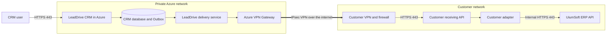
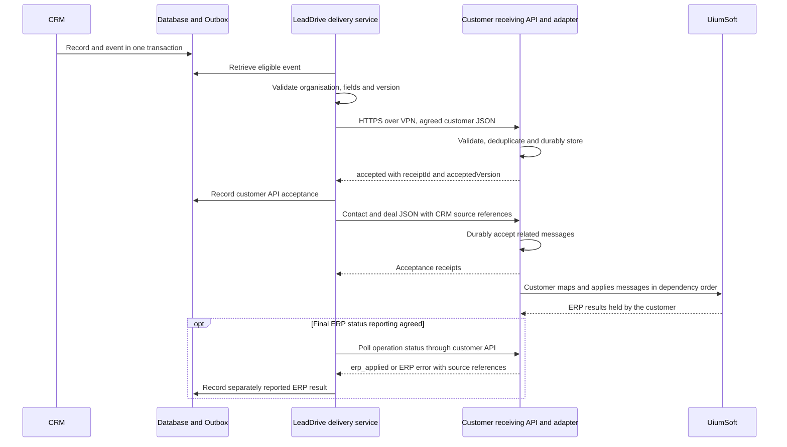

# API Flow and Information Security for the LeadDrive CRM and UiumSoft ERP Integration

Version 1.1 • 13 October 2026 • Design proposal for review by the customer's Information Security and IT teams

**Purpose:** deliver approved customer, contact and deal data from LeadDrive CRM to the customer's receiving API over a secure channel. The customer or its integrator receives that data, maps it to UiumSoft and creates or updates ERP records. LeadDrive owns the agreed JSON payload, secure delivery and delivery audit; the customer owns reception and subsequent ERP processing.

**Starting conditions:** the production CRM is planned to run in Microsoft Azure; the ERP is hosted within the customer's internal network. The Azure infrastructure for this integration has not yet been created, and its IP addresses have not been assigned. The current test server is not the destination or source address of the future production connection.

**Target design:** LeadDrive CRM in Azure → Site-to-Site VPN → customer receiving API → customer-owned adapter → UiumSoft. The dedicated CRM delivery service initiates HTTPS requests to the customer's private API. The ERP API is not exposed to the internet. The main application port is **TCP 443**; the VPN perimeter rules separately cover **UDP 500 and UDP 4500** and, if a mode without UDP encapsulation is selected, ESP IP protocol 50.

Unless explicitly stated otherwise, all controls, components and numerical parameters below are requirements for the proposed connection. The customer must accept ownership of the receiving API and ERP adapter; neither that acceptance nor an operational endpoint or VPN is implied. LeadDrive needs the receiving API contract, not access to or a detailed study of UiumSoft internals. The customer's ERP integrator verifies the installed product, edition, licence and native methods. This document retains the supplied name UiumSoft. IP addresses, domains and URLs are not replaced with assumptions.

## 1 Integration scope

The initial scope is one-way business data delivery: submit customer, approved contact and deal creation/update data to the customer's API and receive a durable acceptance receipt or a rejection. Acceptance means the receiving service has stored the message and taken responsibility for subsequent processing; it does not mean an ERP record already exists. ERP identifiers and final ERP results are optional feedback supplied through the customer API under a separate agreed status contract.

Transferring product lines within a quotation or order, contract details and fulfilment statuses is permitted after the relevant fields and API methods have been agreed. Bulk exports of conversations, files, audio recordings, internal notes or the entire CRM database are outside the initial scope.

The cross-boundary application connection is initiated by the delivery service in Azure. The customer API returns its receipt over the established connection. If final ERP status reporting is agreed, the CRM polls that API over the same private route; it never queries the native ERP directly. Such receipts and status queries do not create a reverse business-data synchronisation requirement. A separate inbound ERP webhook is not required.

This flow covers this integration. CRM connections to email, telephony, messaging, analytics and AI services require a separate inventory if those functions are enabled in the customer's deployment. Integration data is not sent to such services for transformation or analysis.

## 2 Hosting and network route

### 2.1 Components

| Component | Location and purpose |
| --- | --- |
| CRM and its user entry point | Azure; data entry and updates. Users connect over HTTPS to the agreed CRM domain |
| CRM database and Outbox | Private Azure subnet; stores source records, delivery events, customer API receipts and optional reported ERP results |
| CRM delivery service | Dedicated compute service in a private Azure subnet; selects eligible events, constructs agreed JSON and records delivery receipts |
| Azure VPN Gateway | Terminates the encrypted tunnel on the Azure side; uses separate public VPN addresses |
| Customer VPN gateway and firewall | Terminate the tunnel and allow only the approved traffic to the API gateway |
| Customer receiving API and adapter | Customer-owned integration zone; authenticates and validates requests, records them durably, deduplicates and acknowledges reception, then maps and processes them in ERP |
| UiumSoft application API | Customer internal network; used by the customer's adapter, which owns native ERP authorisation, identifiers, business rules and operation results |
| Secret storage and monitoring | Azure Key Vault and agreed monitoring systems; only the specified business requests are sent into the ERP network |

The customer provides or implements the receiving API and its internal adapter. It may use a supported ERP integration module if that module meets the reception contract. LeadDrive implements the sender to that contract; development of the native UiumSoft adapter is outside LeadDrive's scope unless separately contracted. The customer confirms any ERP-side module or licence requirements.

### 2.2 Data transfer diagram



The LeadDrive HTTPS session ends at the customer's receiving API inside the VPN. The customer protects and operates the internal adapter-to-ERP connection, including certificate validation and encryption between separate hosts. This is not one end-to-end TLS session through the receiver. A customer-managed ERP integration module may provide the receiving endpoint itself, but must implement the same agreed reception guarantees; LeadDrive still addresses that contract rather than native ERP internals.

A Site-to-Site VPN carries encrypted traffic **over the public internet**. Private addresses and private API access do not imply a physically dedicated circuit. Azure VPN Gateway supports this topology. [Microsoft Learn — VPN topology and design](https://learn.microsoft.com/en-us/azure/vpn-gateway/design)

### 2.3 Addresses visible to the customer

| Observation point | Source address |
| --- | --- |
| Customer's external VPN perimeter | Public IP of Azure VPN Gateway; with redundancy, all agreed gateway IPs |
| Firewall in front of the private API gateway | Private IP of the integration service or the agreed address after VPN/NVA NAT |
| ERP behind the receiving service | Internal IP and service account of the customer's adapter; these are managed on the customer side |

The public IP of the CRM user entry point, the public VPN IP and the private integration service address serve different purposes. For HTTPS access through the VPN, allow the **private** source actually observed, rather than automatically allowing the CRM website's public IP.

A static private address, or a small explicitly defined pool when scaling, is reserved for the integration service. The parties' subnets must not overlap. If overlap is unavoidable, the supported NAT mode, translated networks and return routes must be agreed separately. Azure VPN NAT for overlapping networks is not an internet NAT gateway. [Microsoft Learn — VPN Gateway NAT](https://learn.microsoft.com/en-us/azure/vpn-gateway/nat-overview)

## 3 Connection and port matrix

Names in the tables are parameters awaiting completion, not real addresses. Each allow rule specifies source, destination, TEST/PROD environment, owner, logging and review date. The default policy is deny.

### 3.1 Customer perimeter and network

| ID | Initiator → destination | Protocol and destination port | Purpose and restriction |
| --- | --- | --- | --- |
| N01 | AZURE_VPN_PUBLIC_IPS ↔ CLIENT_VPN_PUBLIC_IPS | UDP 500 | IKE; specific VPN peers only |
| N02 | The same VPN peers | UDP 4500 | IPsec NAT-T; agreed peers only |
| N03 | The same VPN peers | ESP, IP protocol 50 | Only if native ESP is selected; this is an IP protocol number, not a TCP/UDP port. A separate ESP rule is unnecessary when the agreed mode uses UDP encapsulation |
| N04 | AZURE_INTEGRATION_SOURCE → CLIENT_API_PRIVATE_IP | TCP 443 | Main HTTPS flow inside the VPN; integration API only |
| N05 | CLIENT_API_GATEWAY_IP → ERP_API_PRIVATE_IP | TCP 443 | Customer-owned internal adapter-to-ERP flow; exact adapter source and methods are confirmed by the customer |
| N06 | AZURE_INTEGRATION_SOURCE → CLIENT_AUTH_PRIVATE_IP | TCP 443 | If the customer's OAuth token issuer has a separate address; if hosted on the gateway, N04 applies |
| N07 | AZURE_DNS_FORWARDER → CLIENT_DNS_IPS | UDP/TCP 53 | Only if the API name requires resolution through customer DNS; forward only the necessary zone |

N01–N03 establish the tunnel; N04 carries application traffic. VPN peers may establish and restore the tunnel from either side. Network administrators must confirm NAT-T/ESP requirements and VPN device compatibility before enabling the rules. [Microsoft Learn — VPN devices and IPsec parameters](https://learn.microsoft.com/en-us/azure/vpn-gateway/vpn-gateway-about-vpn-devices), [Microsoft Learn — VPN tunnel troubleshooting](https://learn.microsoft.com/en-us/troubleshoot/azure/vpn-gateway/troubleshoot-vpn-tunnel-cannot-connect)

Responses to N04–N07 use established connection state; no separate permission for new ERP → Azure sessions is created. The operating system selects the source TCP port; the API destination port is 443. For stateless ACLs, configure return port ranges separately for the selected operating system; those ranges do not expose a new service.

The Azure service requires no direct access to native ERP methods, the ERP database or its service ports, SMB 445, SSH 22 or RDP 3389. Port 80 is not used for business requests. N05 belongs to the customer's internal implementation: the customer records the actual adapter source and ERP port and replaces the illustrative rule where needed. Unencrypted HTTP between separate hosts is not an accepted option in this design.

The baseline design uses statically agreed routes. BGP and TCP 179 are not required; if BGP is selected, add a separate rule between the exact BGP peer addresses only. Administrative VPN and support access are handled separately from the data exchange channel.

### 3.2 Connections within Azure and supporting dependencies

| Initiator → destination | Port | Condition |
| --- | --- | --- |
| Users → CRM entry point | TCP 443 | Separate user access policy; WAF/reverse proxy and TLS |
| CRM entry point → application | TCP 443 | Internal TLS proxy for the application; the local application port is not exposed |
| Application and integration → CRM PostgreSQL | TCP 5432 with TLS | Private network and separate database roles only; the ERP does not use this port |
| Integration service → Azure Key Vault | TCP 443 | Preferably a private endpoint; access only to this integration's secrets |
| Integration service → agreed OAuth issuer | TCP 443 | If using a cloud issuer; exact FQDNs and audience must be recorded |
| Components → agreed DNS servers | UDP/TCP 53 | Trusted resolvers only |
| Components → monitoring | TCP 443 | Metrics and sanitised logs; addresses depend on the selected service |
| Components → time source | UDP 123, if separate NTP is needed | Approved source only; platform time synchronisation may be used |
| TLS components → CRL/OCSP, if required by the PKI | TCP 80/443 to exact CA addresses | Certificate revocation checking only, with no business payloads; an internal CA may require a VPN route |

This table describes the integration's dependencies, not all Azure platform management connections. Once VM/App Service/container hosting is selected, the infrastructure team adds required platform endpoints, backups and updates to the egress register. These must not be replaced with permanent unrestricted internet access. The initial design stores the queue as an Outbox in the database; a separate broker and its ports are not required.

## 4 Customer eligibility and event rules

1. A new enquiry is first created in the CRM as a lead. Unverified, spam and unrelated leads are not automatically sent to the ERP.
2. Reaching the agreed qualification stage or creating the first eligible deal sets an `erpSyncEligible` flag. The customer selects the exact stage. This is a proposed integration rule, not the name of an existing CRM field.
3. LeadDrive sends the agreed prospect/customer classification. The customer's integrator maps it to the permitted UiumSoft record type; reception must not automatically create a financial obligation.
4. Customer and selected contact data are sent first. Once the customer API durably accepts the required preceding messages, LeadDrive may send the deal referencing the customer's external CRM ID. LeadDrive does not need an ERP ID to send the deal; the customer adapter resolves ERP identifiers and enforces internal processing dependencies.
5. Subsequent changes to approved fields create new event versions. Changes to internal notes or other excluded fields do not trigger transmission of those data.
6. Closing a deal as won may trigger creation of a **draft** order only under a separately approved rule and when all required order lines are available. A stage change alone does not post a sale, invoice or payment.
7. A closed or lost deal is sent as a status update. Deleting a CRM record does not automatically delete ERP accounting documents; the customer's adapter applies an agreed inactive status or separate procedure.

If the business needs every new lead before qualification, change the criterion in step 2 before launch. For that option, separately verify ERP support for prospective customers and the need to transfer personal data at that early stage.

## 5 Data scope and field ownership

The shared field contract specifies the CRM source, JSON path in the customer receiving API, type, length, required/optional status, allowed values, owner of changes and empty-value rule. LeadDrive implements CRM-to-JSON mapping. The customer's integrator separately owns JSON-to-UiumSoft mapping and native ERP validation. Send an allowlisted set of fields, not the complete CRM object.

| Entity | Data to transfer | Scope |
| --- | --- | --- |
| Counterparty | External CRM ID; individual/legal entity type; name; tax number/VÖEN where necessary; country; agreed legal and/or delivery address; business contact details | Baseline scope; the customer publishes mandatory fields in the receiving contract |
| Contact person | CRM ID; counterparty relationship; name; job title where necessary; business phone and email | Selected persons needed for the deal only |
| Deal | CRM ID; customerExternalId referencing the customer's CRM ID; name; stage; amount and currency; expected close date; owner/department code; change version | Baseline scope; LeadDrive sends agreed source codes, and the customer's adapter maps them to ERP statuses |
| Quotation and order lines | Document and line IDs; ERP product code; quantity; unit; price; discount; agreed tax code; total; currency | Additional scope after confirming the source and formulas |
| Contract details | Number, dates, deal reference, payment and delivery terms from agreed reference lists | Additional scope; contract text and attachments are handled separately |
| Customer API acceptance receipt | Receipt/operation ID, event ID, external CRM ID, accepted version and time, or rejection reason | Mandatory evidence of durable reception; distinct from ERP completion |
| ERP processing result | Reported ERP IDs, final business status, error code and applied version | Optional feedback supplied by the customer API; no native ERP access from LeadDrive |
| Order, shipment and payment statuses | Number, status, dates, agreed amounts/outstanding balance | Separate optional scope through the customer API, outside baseline one-way delivery |
| Products, units, currencies, rates and warehouses | Code, permitted display name and reference attributes | Separate optional scope through the customer API; the customer owns native ERP extraction |

The CRM owns customer relationships and sales stages. The ERP owns accounting codes, posted documents, stock balances, actual shipments and payments. Customer details require an explicit field ownership matrix: once accounting has verified them, the CRM must not overwrite them without an agreed process.

A deal amount must not be treated as the amount of a posted invoice. In the current CRM, a product linked to a deal is insufficient to treat that deal automatically as a complete order with quantities, units and taxes. Select an approved source of order lines, such as an approved quotation, and validate calculations separately.

Do not transfer passwords, tokens, keys, other organisations' data, payment card details, conversation history, call recordings, identity documents, special categories of personal data or arbitrary internal comments. If a specific process genuinely requires such a field, approve it separately with a defined purpose and access scope.

## 6 Processing sequence for one customer and deal



When saving a relevant change, the CRM creates an Outbox entry **in the same database transaction**. If the transaction does not commit, the event is not sent. The entry contains the organisation, entity type, external ID, version, timestamp and data required for processing. The worker reads only events belonging to the customer's organisation.

Before sending, validate required fields, contact formats, string lengths, permitted reference values, numerical ranges, currency and operation permissions. Do not invent tax or contact details to bypass validation.

The customer receiving API checks TLS/mTLS, authentication, organisation binding, permitted methods, body schema, size and rate. It durably records accepted messages before issuing a receipt. The customer's adapter then performs native ERP authorisation, field mapping, identifier resolution, business validation and processing. LeadDrive receives neither ERP administrator credentials nor direct SQL access.

HTTP status alone does not prove completion. A valid agreed receipt with `status: accepted` proves durable customer API reception, including when returned with `202`; LeadDrive stores its receipt/operation ID and accepted version. `200/201` is not automatically an ERP success. Only an explicit agreed `erp_applied` result with the relevant event and applied version confirms ERP completion. If no final-status contract exists, the CRM remains at Accepted by customer API and does not infer an ERP result. A response containing a business error is not recorded as success. The customer's adapter resolves dependencies between accepted customer and deal messages; a failed deal does not trigger deletion of an already created customer.

CRM statuses distinguish Pending, Sending, Accepted by customer API, Delivery rejected and Delivery result unknown. ERP processing confirmed and ERP error reported are shown only when the customer's API explicitly reports them. The sales representative sees a clear reason and a support reference ID, without tokens or technical stack traces.

## 7 Proposed customer receiving API contract

**The following is a proposed JSON reception contract to be agreed with the customer's API team, not a list of native UiumSoft methods.** LeadDrive may provide this format for the customer to implement, or adapt to the documented receiving contract the customer supplies. The customer alone maps accepted messages to native ERP operations and confirms whether its ERP supports the requested entities. LeadDrive does not require native ERP OpenAPI/WSDL to implement the agreed sender.

| Method and illustrative path | Purpose |
| --- | --- |
| `PUT /integration/v1/customers/{externalId}` | Submit customer creation/update data and obtain a durable acceptance receipt |
| `PUT /integration/v1/contacts/{externalId}` | Submit approved contact data with CRM source references |
| `PUT /integration/v1/deals/{externalId}` | Submit deal data referencing customerExternalId; the customer maps it to ERP |
| `PUT /integration/v1/orders/{externalId}` | Optional, separately approved submission of draft order data |
| `GET /integration/v1/operations/{operationId}` | Retrieve reception state and, only if agreed and available, a separately identified final ERP result |
| `GET /integration/v1/operations?eventId=...` | Find a result within the account's organisation when the first response was lost and operationId is unknown |
| `GET /integration/v1/customers/{externalId}` | Check reception/version for the authorised source ID; equivalent receipt lookup is provided for deals and enabled orders. This does not require direct ERP reads |
| `GET /integration/v1/receipts?cursor=...` | Retrieve a bounded page of results for reconciliation |
| `GET /integration/v1/reference-data/{type}?cursor=...` | Optional separate customer API service for permitted reference data; outside baseline delivery |

The customer receiving API's selected OAuth issuer defines the token endpoint; a path such as `/oauth/token` is not attributed to UiumSoft. All destination URLs belong to the agreed receiving contract and are fixed in configuration; payload data cannot select a server. The API must not support arbitrary SQL queries, arbitrary URLs, execution commands or bulk export of unapproved entities.

Main headers: `Content-Type: application/json`, `Authorization: Bearer <access_token>`, `X-Correlation-ID`, `Idempotency-Key`. Token values must not appear in URLs or logs. Organisation identity comes from the authenticated service account; an organisation field in JSON does not grant permission to switch organisations.

The sample data is entirely synthetic. The actual wire contract includes only fields approved in the mapping.

```json
{
  "schemaVersion": "1.0",
  "eventId": "10000000-0000-4000-8000-000000000001",
  "sourceSystem": "LeadDrive",
  "externalId": "crm-customer-demo-001",
  "entityVersion": 3,
  "occurredAt": "2026-10-13T08:00:00Z",
  "customer": {
    "type": "legal_entity",
    "name": "DEMO CUSTOMER",
    "countryCode": "AZ",
    "email": "contact@example.invalid"
  }
}
```

Add mandatory tax or address fields according to the customer's published receiving contract; a missing required field produces a verifiable rejection. After customer data is durably accepted, send a separate deal object with its CRM customer reference:

```json
{
  "schemaVersion": "1.0",
  "eventId": "10000000-0000-4000-8000-000000000002",
  "externalId": "crm-deal-demo-001",
  "entityVersion": 1,
  "occurredAt": "2026-10-13T08:00:01Z",
  "customerExternalId": "crm-customer-demo-001",
  "deal": {
    "name": "DEMO DEAL",
    "stageCode": "QUALIFIED",
    "amount": "1500.00",
    "currency": "AZN",
    "expectedCloseDate": "2026-11-01"
  }
}
```

The codes `QUALIFIED` and `AZN`, and the example structure, are used only with confirmed mapping. Monetary values are decimal strings with agreed precision; event timestamps use ISO 8601 UTC, while calendar dates have no artificial time zone. Tax codes, rounding, units and currency format are fixed in the specification.

Example of a durable customer API acceptance receipt; this is not evidence of an ERP write:

```json
{
  "operationId": "op-demo-002",
  "eventId": "10000000-0000-4000-8000-000000000002",
  "externalId": "crm-deal-demo-001",
  "receiptId": "receipt-demo-002",
  "status": "accepted",
  "acceptedVersion": 1,
  "acceptedAt": "2026-10-13T08:00:02Z"
}
```

If final ERP reporting is included, a separate customer API status response explicitly uses `erp_applied` and supplies `erpId`, `appliedVersion` and `processedAt`, linked to the original event. An ERP rejection remains distinguishable from a delivery rejection. The customer's API defines supported terminal statuses and polling limits. Without that capability, final ERP verification is the customer's responsibility and LeadDrive reports only receipt status.

The contract schema version is managed separately from the entity version and this document's version. Incompatible changes require a new API version, testing and a cutover date. An absent field means leave the value unchanged; `null` means clear the value only where explicitly permitted for that field; an empty string is not a universal clear command.

## 8 Duplicates, event ordering and failures

Delivery follows an **at least once** model: the same event may arrive more than once. Idempotent processing prevents duplicates; a promise of only one network delivery does not.

An entity key includes the integration, organisation, entity type and external CRM ID. LeadDrive keeps `Idempotency-Key` fixed for an event. The customer receiver durably deduplicates: the same key and content returns the original receipt; the same key with different content produces a conflict. LeadDrive records source IDs and receipts. The customer's adapter owns the unique external-ID-to-ERP mapping and prevents duplicate ERP writes, including after its own restart. A gateway access log alone does not prove durable acceptance or reliable ERP processing.

If the first response is lost and operationId is unknown, LeadDrive queries the customer API by eventId, then by external ID and version as specified by the reception contract. An initial missing result does not prove that nothing was accepted or written. Uncertain deliveries are retried only under confirmed receiver idempotency; otherwise they stop for joint reconciliation. An API without durable receipts and safe recovery of reception state is not ready for launch under this design. After confirmed acceptance, the customer owns retries and recovery inside ERP; LeadDrive does not resend accepted work merely because ERP completion is delayed or unreported.

Each entity has a monotonically increasing version; an older version must not overwrite a newer one. LeadDrive orders submissions and waits for customer API acceptance of prerequisite messages. The customer adapter resolves source references and enforces ERP execution order, so a deal cannot be written before the required ERP customer exists. Receipt order and ERP completion order are separate responsibilities.

| Situation | Action |
| --- | --- |
| Invalid data, HTTP 400/422 | Stop the event; have the responsible person correct the fields; send a new version after correction |
| HTTP 401 | Refresh an eligible token once; a repeated rejection pauses the integration and raises an alert |
| HTTP 403 | Do not retry automatically; check permissions and organisation binding |
| HTTP 404 | Check mapping, dependencies and API version; do not blindly create a new entity |
| HTTP 409 | Investigate version, external ID or key conflict; reconcile the result |
| HTTP 429 | Honour `Retry-After`, reduce the rate and retain the event |
| HTTP 5xx, connection loss or timeout | Check reception state through the customer API; retry only with the same key and confirmed receiver idempotency |
| Receipt response lost | Set Delivery result unknown; query the original event instead of creating a new key |
| VPN or customer receiving API unavailable | Keep unaccepted events in LeadDrive's durable queue; limit load and alert |
| ERP unavailable after customer API acceptance | Customer retains and retries accepted work; LeadDrive shows ERP pending/error only if that status is explicitly reported |
| Service restart | Resume unaccepted deliveries from the Outbox and reconcile receipt state; the customer separately recovers its adapter |

Proposed initial limits for agreement with the receiving API owner: up to 1 MiB per message without files; no more than 5 requests/second and 2 concurrent requests per integration; connection timeout up to 5 seconds and total request timeout up to 30 seconds. Retry unaccepted deliveries with a small random jitter after 1, 5, 15 and 60 minutes, then hourly within a 24-hour window. Once the window is exhausted, the event remains in the error queue rather than disappearing. The customer sets separate internal ERP processing limits; receiving API limits are adjusted after acceptance testing.

The proposed delivery target, when the CRM, network and receiving API are available, is durable customer API acceptance within 60 seconds for 95% of ordinary events. This is not an active SLA or a promise about ERP completion. Monitor unaccepted queue age/depth, uncertain receipts and acceptance latency. ERP completion targets and monitoring belong to the customer and are separately agreed if exposed to LeadDrive. If storage fills, raise an alert and apply the agreed limits on accepting/changing data; silently dropping events is prohibited.

## 9 Authentication and permissions

Target profile for the customer receiving API: TLS 1.2 or later, preferably TLS 1.3 where compatible; mutual certificate authentication using mTLS; and OAuth 2.0 Client Credentials for LeadDrive's sender. The customer confirms and implements the supported receiving profile before development. Native UiumSoft authentication is configured only by the customer's adapter and is outside LeadDrive's receiving API credentials.

Create a separate receiving API service identity for each customer and environment. Permit only approved data submissions and receipt/status reads. Proposed scopes are `customers.write`, `contacts.write`, `deals.write`, `sync.status.read`; add `orders.draft.write` and `reference.read` separately when approved. These are receiving API permission names, not native ERP scopes. LeadDrive does not receive the customer's internal ERP service account.

ERP administrator privileges, user and role changes, direct database access, posting payments or accounting documents, reading other organisations and bulk deletion are prohibited. Enforce organisation restrictions for every object and every request, including operation status reads.

Restrict tokens to the integration API audience, permitted scopes and a short lifetime; the proposed maximum is 15 minutes if the issuer supports it. Validate the signature and allowed algorithm, issuer, audience, lifetime and service application binding. An organisation ID header alone is not authentication. HTTPS, authorisation and input validation principles follow [OWASP REST Security](https://cheatsheetseries.owasp.org/cheatsheets/REST_Security_Cheat_Sheet.html).

Before launch, define owners and rotation schedules for certificates, tokens and VPN keys. Proposed certificate expiry alerts are 30, 14 and 7 days in advance, with a controlled overlap during rotation and immediate revocation after compromise. Validate the trusted chain, server name and revocation policy; disabling certificate validation is prohibited.

## 10 Secrets, segmentation and application protection

Store LeadDrive's receiving API keys, client secrets and certificate private keys in Azure Key Vault or an agreed protected store. The Azure service accesses Key Vault using a managed identity with least privilege; the customer receiving API separately validates its own agreed credentials. Native ERP credentials stay in the customer's environment and are used by its adapter, not by LeadDrive. [Microsoft Learn — Secure your Azure Key Vault](https://learn.microsoft.com/en-us/azure/key-vault/general/secure-key-vault)

Secrets must not appear in the browser, Git, documentation, URLs, tickets, screenshots or ordinary logs. Transfer initial secrets through an agreed secure channel. TEST and PROD use different secrets, certificates and service accounts.

Routes and firewalls restrict access to the dedicated integration subnet and specific customer addresses. The VPN does not grant the entire Azure VNet access to the customer's entire network. The CRM does not need customer domain membership or access to domain controllers. Restrict integration service egress to the API, authorisation, DNS and agreed supporting dependencies.

Implement a separate trusted connector for the private API, with allowlisted FQDNs/IPs/port and checks on redirects and DNS. CRM users cannot choose arbitrary destination addresses. General SSRF protection, including restrictions on arbitrary internal addresses and metadata endpoints, must not be disabled for the VPN integration.

The API limits methods, field lengths, JSON size and depth, page sizes and request rates. If SOAP/XML is used, disable external entities and DTDs and set document size and depth limits. Attachments are absent from the baseline flow; adding files requires file type and size limits, malware scanning, retention rules and separate approval.

Administrators use individual accounts, MFA, separated roles and logged access limited in duration. Endpoint, scope, mapping and export rule changes follow change control. Emergency suspension is possible by revoking service access, stopping the worker and blocking N04 without deleting queued events.

## 11 Storage, confidentiality and logging

| Location | Data held | Requirement |
| --- | --- | --- |
| CRM database in Azure | Approved source records, customer API receipts and optional reported ERP links | Encryption at rest and for backups; least-privilege roles; approved Azure region |
| Outbox and error queue | Minimum payload, version and delivery state | The same protections as CRM personal data |
| Customer receiving store and ERP | Durably accepted messages, internal mappings and ERP documents | Customer owns retention, roles, backups and recovery after acceptance |
| Logs | Timestamp, correlation/event ID, entity type, operation, service identity, outcome, error code and duration | No request bodies, tokens, phone numbers/emails or unnecessary personal data |
| Delivery and idempotency registers | LeadDrive: event/source IDs, key and receipt; customer: durable deduplication, accepted version and ERP mapping | Separate responsibilities and organisation isolation; IDs may also be indirect personal data |

Proposed LeadDrive retention periods, subject to agreement: successfully delivered event payloads for 7 days after durable customer API acceptance; failed delivery payloads for up to 30 days; technical audit and idempotency keys for 90 days; backups for 30 days. Customer-side retention must support processing and recovery of accepted messages and is agreed separately. These periods do not replace policies for primary CRM data and ERP accounting records.

By day 25, unresolved delivery errors are escalated: before 30 days expire, the event must be resolved, explicitly cancelled with an audit record or retained under an approved exception. Unresolved tasks must not disappear through automatic deletion. LeadDrive's receipt registry and the customer's permanent source-ID-to-ERP mapping outlive the relevant delivery-key cache as required by the agreed recovery policy. Replaying old events after deduplication expiry requires reconciliation; a 90-day cache alone is insufficient. Customer-side ERP errors after acceptance are escalated to the customer's processing owner.

Protect logs against modification by integration operators and send them to the agreed monitoring/SIEM system. Do not include full payloads in alerts. Diagnostic data capture is allowed only with restricted duration and access, masking and a separate deletion period.

The agreed portable security-log format is **JSONL, UTF-8, one JSON object per line**, optionally compressed as `.jsonl.gz`. A versioned schema defines `schema_version`, stable `event_id`, UTC `event_time`, `observed_at`, receiver-added `ingested_at`, `environment`, `organization_id`, `source`, `category`, `action`, `outcome`, `severity`, `actor`, `target`, `request_id`, `correlation_id` and, where relevant, `integration_event_id`. Unknown contextual fields are omitted or explicitly null; identities and source times must not be invented. A delivery event ID differs from the ID of each individual audit record.

All required security sources are listed in an approved coverage inventory with owner, categories, collection route, retention and a successful test event. LeadDrive supplies logs for its managed CRM authentication, access checks, administration, data access/export, integration, WAF/VPN, Azure Activity/Entra, Key Vault, database/host/deployment and collector-health sources, where applicable and available in the chosen platform. The customer supplies receiving API, adapter, ERP and customer-network logs. Shared correlation IDs link available records; a LeadDrive delivery log does not prove an internal ERP write. Unavailable sources are documented as gaps before acceptance, not silently described as covered.

Logs exclude credentials, bearer tokens, session cookies and full personal/business payloads; only authorised customer data is exported. Store them centrally with restricted roles and an agreed immutable retention policy. Buffer delivery durably, preserve IDs for deduplication and alert on gaps, rejection, delay or collector failure. The proposed audit period remains 90 days, subject to approval; source, delivery-buffer, searchable and archive retention are specified separately. Incident-related deletion can be suspended through an authorised, audited procedure.

Baseline delivery is an authenticated HTTPS export of JSONL files with the schema, source/time coverage, counts, known gaps and a manifest containing SHA-256 file hashes. A hash verifies bytes against a trusted manifest; it does not establish event authenticity or completeness. The customer's SIEM is not yet known. Continuous delivery to a customer collector is optional and needs a separate endpoint, authentication and source/destination rule, normally HTTPS TCP 443. It does not use the ERP API implicitly. The customer parser and end-to-end searchability must be verified; socket acceptance alone is insufficient.

Before transferring real data, record the Azure region, backup and monitoring regions, subscription owner, parties involved in processing, transfer purpose, support access and requirements for cross-border processing. Selecting Azure alone does not establish where all data will reside or compliance with particular legislation/certifications. The responsible parties confirm contractual requirements before launch.

## 12 Reconciliation, recovery and incidents

At least daily, LeadDrive reconciles source events and versions against the customer API's durable receipts; after recovery it reconciles reception state before retrying uncertain work. The customer separately reconciles accepted messages against actual ERP records and resolves internal discrepancies. Joint ERP-result reconciliation is included only where the customer's status interface is agreed. Compare counts and individual differences, not just HTTP statuses, and preserve organisation isolation.

A committed CRM transaction creates a durable event, but does not guarantee RPO=0 if its database or region is lost. RPO, RTO, redundancy and backups are agreed for both the LeadDrive sender and the customer's receiving/processing stores. Before acceptance, test restoration and receipt recovery on our side; the customer tests recovery of accepted messages and absence of duplicate ERP writes. These are complementary acceptance results, not a claim that LeadDrive controls the customer's ERP.

During an incident, the responsible owner stops affected delivery/processing, revokes relevant access, restricts the network, preserves audit records and notifies both parties' Information Security contacts. LeadDrive identifies source events and receipts; the customer traces those IDs into its adapter and ERP. Each supplies authorised JSONL evidence for its own scope. Resume only after correcting the cause and reconciling uncertain results. Notification deadlines and round-the-clock support are agreed separately.

Code changes can be rolled back, but ERP records already created do not disappear when the CRM is rolled back. Correct business data through standard ERP correction procedures with an audit trail, not by deleting tables or reloading the entire database.

## 13 Test environment and production rollout

TEST has separate endpoints, ERP organisation/company, service accounts, secrets, certificates, logs and network rules. Access from TEST to PROD ERP is blocked. Acceptance uses synthetic or approved anonymised records. The current test server is not automatically added to the production allowlist.

Launch sequence:

1. The customer commits to owning the receiver and provides its API contract, constraints and test endpoint. The parties approve the JSON mapping and export eligibility rule. The customer's integrator separately obtains native ERP documentation and a test ERP.
2. Define the Azure region, owners, address spaces, static addresses, private API FQDN and VPN/TLS profile.
3. LeadDrive implements the agreed JSON sender, durable Outbox, source IDs, receipt handling and its security logs. The customer implements durable reception, deduplication, ERP mapping and processing, its access controls and logs.
4. Run sender/receiver, network and security tests on TEST. The customer separately demonstrates ERP processing; jointly verify any agreed final-status interface and JSONL incident export.
5. Sign off the actual connection matrix, permitted data scope, acceptance results and operating procedure.
6. Enable a limited pilot. LeadDrive confirms source IPs, payloads, receipts and its monitoring; the customer confirms correct ERP records and its processing logs. Keep acceptance and ERP completion distinct in the pilot report.
7. After reconciling the pilot, enable the main flow. Run historical loading separately in bounded batches, with checkpoints, duplicate controls and agreed load limits.

For separately approved historical loading, LeadDrive records the source snapshot time and changes during export; the customer preserves version ordering and owns matching to existing ERP records. Its approved business keys govern deduplication; a matching name or phone number alone does not authorise automatic merging of legal entities.

## 14 Information Security and IT acceptance criteria

| Check | Expected result |
| --- | --- |
| Public receiving API reachability | The customer receiving API cannot be reached from the internet; only the agreed VPN route provides access |
| Network source | Logs show the approved private/NAT source; unapproved addresses are blocked |
| Least privilege | LeadDrive's account can only submit agreed data and read receipts/statuses; native ERP privileges belong to the customer's adapter |
| Other organisation/entity | Substituting an ID in a body, URL or status request neither discloses nor changes unauthorised data |
| TLS and authorisation | Expired/untrusted certificates, incorrect audiences and revoked access are rejected |
| Permitted fields | The receiving API payload matches the approved JSON mapping; extra fields are absent |
| Replay and concurrent delivery | Receiver returns a stable receipt and rejects a changed body under the same key; the customer separately proves no duplicate ERP writes |
| Lost receipt and internal adapter failure | LeadDrive recovers reception state without duplicate submission; the customer recovers accepted ERP work |
| Incorrect ordering and older version | Sender orders accepted prerequisites; customer resolves ERP dependencies and rejects stale versions |
| 202, 200 and reported ERP result | Accepted by customer API is not displayed as ERP completed; only explicit erp_applied confirms completion |
| VPN/API outage, ERP outage and restart | Unaccepted work stays with LeadDrive; accepted work remains durable with the customer and is not blindly resent |
| 429, limits and oversized body | Load is limited and unacceptable bodies are rejected in a controlled manner |
| Logs and secrets | JSONL parses correctly, required source events and correlation IDs are present, no other-tenant data, tokens or full personal payloads are exported |
| Rotation and emergency suspension | Old access is revoked; delivery stops and resumes in a controlled manner |
| Recovery and reconciliation | Sender-to-receiver receipt reconciliation and customer-owned ERP reconciliation succeed after restoration |
| Incident evidence | Customer can read the JSONL package, verify its manifest, identify known gaps and distinguish delivery from ERP processing |

For each check, retain the date, environment, application version, sanitised event/correlation IDs, actual result and responsible person. These checks are an acceptance plan; this document does not confirm that they have been performed.

## 15 Responsibilities

| Area | Responsible party |
| --- | --- |
| Qualification rules, receiving JSON contract and field ownership | Customer business/API owner together with LeadDrive |
| CRM-to-JSON mapping, Outbox, sender and delivery receipts | LeadDrive |
| Azure subscription, region, VNet, VPN and infrastructure monitoring | Designated Azure team; subscription ownership must be recorded before launch |
| Firewall, VPN and DNS in the customer's network | Customer IT and Information Security teams |
| Receiving API, durable acceptance, source-to-ERP mapping, processing and native ERP access/licence | Customer API team and UiumSoft integrator |
| LeadDrive security logs and JSONL export | LeadDrive and the owner of its Azure environment |
| Receiving API, adapter, ERP and customer-network security logs | Customer and its integrator |
| PKI, certificate and credential issuance/rotation/revocation | Designated owners on each side |
| Access and personal data approval | Customer Information Security team and authorised representatives |
| Delivery errors and receipt reconciliation | LeadDrive with the customer API owner |
| ERP processing errors, business corrections and optional final-status reporting | Customer's ERP integrator and relevant data owner |

## 16 Connection record to complete before launch

`TBD` means to be assigned/confirmed before launch. After Azure is created, provide its IPs in a separate update to this record; production firewall authorisations must contain no TBD values.

| Parameter | Current value | Provided by |
| --- | --- | --- |
| Customer, legal entity and ERP company ID | TBD | Customer |
| Customer receiving API owner and acceptance of responsibility | TBD; required before launch | Customer |
| Receiving API documentation, JSON schema, methods, auth and test endpoint | TBD | Customer API owner |
| Durable receipt, replay recovery and optional final ERP status contract | TBD | Customer API owner |
| UiumSoft edition/licence and native API documentation | Customer-internal implementation input; not a prerequisite for LeadDrive to study | Customer / ERP integrator |
| Azure tenant/subscription and owner | TBD | Azure team |
| Azure region, DR/backup/log regions | TBD | Azure team and Information Security |
| Azure VPN public IPs, including redundant peers | TBD after creation | Azure team |
| Customer VPN public IPs | TBD | Customer IT |
| Azure VNet and integration subnet | TBD | Azure team |
| Private source IPs/pool and post-NAT address | TBD | Both network teams |
| Customer networks, API private IP/FQDN and TLS SNI | TBD | Customer IT |
| Customer adapter → ERP IP/port | Customer-internal connection; target TCP 443, actual endpoint/port TBD | Customer ERP administrator |
| Private DNS and conditional forwarding rules | TBD | Both network teams |
| IKEv2/IPsec suites, DH/PFS, lifetime, DPD, NAT-T/ESP | TBD based on compatibility and Information Security policy | Both network teams |
| OAuth issuer/token endpoint/audience/scopes | TBD | Authorisation owner |
| CA, mTLS, revocation, certificate names and validity | TBD | PKI / Information Security |
| Export eligibility rule and required fields | Proposed in sections 4–5; approval required | Business and ERP integrator |
| API limits, volumes, SLO, RPO/RTO and retention periods | Proposed; approval required | Operations and business |
| Support contacts, escalation and notification deadline | TBD | Both parties |
| JSONL source inventory, retention, receiver/export access and incident contacts | JSONL agreed as base format; detailed settings TBD | Both Information Security teams |
| Acceptance date, change request and launch date | TBD | Project managers and Information Security |

After this record is completed, issue the final address matrix with actual source/destination IPs and FQDNs. IP changes or additional redundant nodes require notification and change control; do not replace exact sources with a broad allowlist of cloud address ranges.

## 17 Short answers for the Information Security team

| Question | Answer under the target design |
| --- | --- |
| Where will requests originate? | A dedicated integration service in Azure; exact private source IPs and public VPN IPs will be assigned and supplied before launch |
| Where will the data arrive? | LeadDrive delivers to the customer's private receiving API; the customer's adapter maps and loads it into UiumSoft |
| What must be opened on the firewall? | HTTPS TCP 443 from the exact private/NAT source to the API; separate perimeter VPN rules for 500/4500 and, if selected, ESP 50 |
| Must the ERP be exposed to the internet? | No. VPN peers are public; the ERP API remains private |
| Must the ERP connect to the CRM? | No. The receiving API returns receipts; optional final ERP status is polled through that API |
| Is database or ERP administrator access required? | LeadDrive needs only a restricted customer receiving API identity; native ERP access is managed by the customer's adapter owner |
| What data is transferred? | Approved customer details, selected contacts and deals; additional documents only under approved mapping |
| Are conversations and call recordings included? | Not in the baseline scope |
| How are duplicates prevented? | LeadDrive preserves event IDs and versions; the customer receiver deduplicates durably, and its adapter owns unique ERP mapping and internal retries |
| What happens when the ERP is unavailable? | Accepted messages remain with the customer's processing service; unaccepted deliveries remain with LeadDrive. Internal ERP recovery belongs to the customer |
| Does an HTTP success prove an ERP write? | No. Durable accepted receipt proves reception; only an explicit agreed erp_applied result proves reported ERP completion |
| Must LeadDrive study native UiumSoft internals? | No. LeadDrive needs the customer receiving API contract; the customer's integrator owns ERP internals |
| Which security logs are delivered? | JSONL from all agreed sources in LeadDrive's managed scope; the customer provides its receiving API, adapter, ERP and network logs |
| Where are keys stored? | In a protected secret store; the Azure service has least-privilege access, and secrets are not passed to CRM users |
| Can the test server write to production ERP? | Prohibited by the design; TEST and PROD have separate addresses and credentials |
| Can exchange be stopped? | Yes: stop the sender, revoke access and/or block N04; queued events are retained. The customer separately controls processing of already accepted messages |
| What remains before production exchange can be authorised? | Customer ownership and receiving API contract, completed connection record, controls, security-log inventory and successful acceptance |

## 18 Alternative if Site-to-Site VPN is prohibited

If customer policy prohibits a VPN, a separate design can use a customer-operated connector **inside the customer's network**. It initiates outbound HTTPS TCP 443 to a protected queue API in Azure, retrieves only that customer's events and durably acknowledges reception. The customer then maps and loads them into ERP, reporting final ERP results separately if agreed. An inbound API connection from Azure into the customer's network is then unnecessary.

This separate pull mode requires an agreed Azure queue API, a customer-operated connector, secret management and a separate connection matrix. It does not transfer native ERP adaptation to LeadDrive, is not enabled automatically on VPN failure and does not expose ERP to the internet. The primary design remains CRM-initiated push over VPN to the customer's receiving API.
