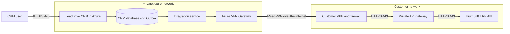
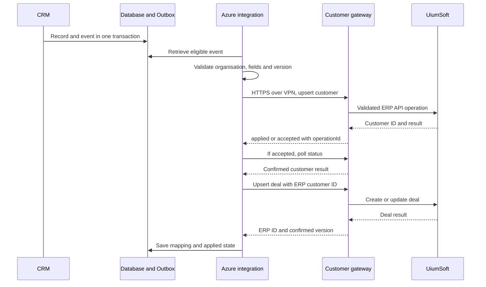

# API Flow and Information Security for the LeadDrive CRM and UiumSoft ERP Integration

Version 1.0 • 13 October 2026 • Design proposal for review by the customer's Information Security and IT teams

**Purpose:** transfer customer records, contacts and related deals from LeadDrive CRM to UiumSoft ERP over a secure channel, with controls over access, data scope and processing results.

**Starting conditions:** the production CRM is planned to run in Microsoft Azure; the ERP is hosted within the customer's internal network. The Azure infrastructure for this integration has not yet been created, and its IP addresses have not been assigned. The current test server is not the destination or source address of the future production connection.

**Target design:** a dedicated CRM integration service initiates HTTPS requests to the customer's private API gateway through a Site-to-Site VPN. The ERP API is not exposed to the internet. The main application port is **TCP 443**; the VPN perimeter rules separately cover **UDP 500 and UDP 4500** and, if a mode without UDP encapsulation is selected, ESP IP protocol 50.

Unless explicitly stated otherwise, all controls, components and numerical parameters below are requirements for the proposed connection. This document does not confirm an operational UiumSoft adapter or VPN. The customer must confirm the exact product name, edition, version, API licence and methods available in the installed ERP; this document retains the name UiumSoft supplied by the customer. IP addresses, domains and URLs are not replaced with assumptions.

## 1 Integration scope

The initial scope includes creating or updating a customer, approved contact persons and a deal, and receiving the technical processing result: accepted, applied or rejected, the ERP identifier and any reason for failure.

Transferring product lines within a quotation or order, contract details and fulfilment statuses is permitted after the relevant fields and API methods have been agreed. Bulk exports of conversations, files, audio recordings, internal notes or the entire CRM database are outside the initial scope.

The design has one initiator of application connections: the integration service in Azure. The ERP response returns over the established connection. If the ERP processes a request asynchronously, the CRM polls its status over the same private route. A separate inbound webhook from the ERP to the CRM is not required.

This flow covers this integration. CRM connections to email, telephony, messaging, analytics and AI services require a separate inventory if those functions are enabled in the customer's deployment. Integration data is not sent to such services for transformation or analysis.

## 2 Hosting and network route

### 2.1 Components

| Component | Location and purpose |
| --- | --- |
| CRM and its user entry point | Azure; data entry and updates. Users connect over HTTPS to the agreed CRM domain |
| CRM database and Outbox | Private Azure subnet; stores records, delivery events and results |
| CRM integration service | Dedicated compute service in a private Azure subnet; selects eligible events, constructs requests and maps identifiers |
| Azure VPN Gateway | Terminates the encrypted tunnel on the Azure side; uses separate public VPN addresses |
| Customer VPN gateway and firewall | Terminate the tunnel and allow only the approved traffic to the API gateway |
| Customer private API gateway | Dedicated integration zone in the customer's network; certificate and permission checks, request limits, operation log and ERP adaptation where required |
| UiumSoft application API | Customer internal network; performs operations through the ERP's standard business logic |
| Secret storage and monitoring | Azure Key Vault and agreed monitoring systems; only the specified business requests are sent into the ERP network |

The API gateway is a proposed component managed by the customer or its integrator. It may be combined with a supported ERP integration module if that module provides the required checks. Any additional module or licence must be confirmed before development.

### 2.2 Data transfer diagram



The application HTTPS session runs from the integration service to the API gateway inside the VPN. TLS terminates at the gateway; a second TLS session, with certificate validation, connects the gateway to the ERP. Encryption therefore protects both legs, but this is not a single end-to-end TLS session through the gateway. For a direct ERP connection without a separate gateway, the ERP or its integration module must perform all gateway checks.

A Site-to-Site VPN carries encrypted traffic **over the public internet**. Private addresses and private API access do not imply a physically dedicated circuit. Azure VPN Gateway supports this topology. [Microsoft Learn — VPN topology and design](https://learn.microsoft.com/en-us/azure/vpn-gateway/design)

### 2.3 Addresses visible to the customer

| Observation point | Source address |
| --- | --- |
| Customer's external VPN perimeter | Public IP of Azure VPN Gateway; with redundancy, all agreed gateway IPs |
| Firewall in front of the private API gateway | Private IP of the integration service or the agreed address after VPN/NVA NAT |
| ERP behind the API gateway | Internal IP of the API gateway; its service account additionally identifies the integration |

The public IP of the CRM user entry point, the public VPN IP and the private integration service address serve different purposes. For HTTPS access through the VPN, allow the **private** source actually observed, rather than automatically allowing the CRM website's public IP.

A static private address, or a small explicitly defined pool when scaling, is reserved for the integration service. The parties' subnets must not overlap. If overlap is unavoidable, the supported NAT mode, translated networks and return routes must be agreed separately. Azure VPN NAT for overlapping networks is not an internet NAT gateway. [Microsoft Learn — VPN Gateway NAT](https://learn.microsoft.com/en-us/azure/vpn-gateway/nat-overview)

## 3 Connection and port matrix

Names in the tables are parameters awaiting completion, not real addresses. Each allow rule specifies source, destination, TEST/PROD environment, owner, logging and review date. The default policy is deny.

### 3.1 Customer perimeter and network

| ID | Initiator → destination | Protocol and destination port | Purpose and restriction |
| --- | --- | --- | --- |
| N01 | AZURE_VPN_PUBLIC_IPS ↔ CLIENT_VPN_PUBLIC_IPS | UDP 500 | IKE; specific VPN peers only |
| N02 | The same VPN peers | UDP 4500 | IPsec NAT-T; agreed peers only |
| N03 | The same VPN peers | ESP, IP protocol 50 | Only if native ESP is selected; this is an IP protocol number, not a TCP/UDP port. A separate ESP rule is unnecessary when the agreed mode uses UDP encapsulation |
| N04 | AZURE_INTEGRATION_SOURCE → CLIENT_API_PRIVATE_IP | TCP 443 | Main HTTPS flow inside the VPN; integration API only |
| N05 | CLIENT_API_GATEWAY_IP → ERP_API_PRIVATE_IP | TCP 443 | Internal ERP call; agreed methods only |
| N06 | AZURE_INTEGRATION_SOURCE → CLIENT_AUTH_PRIVATE_IP | TCP 443 | If the customer's OAuth token issuer has a separate address; if hosted on the gateway, N04 applies |
| N07 | AZURE_DNS_FORWARDER → CLIENT_DNS_IPS | UDP/TCP 53 | Only if the API name requires resolution through customer DNS; forward only the necessary zone |

N01–N03 establish the tunnel; N04 carries application traffic. VPN peers may establish and restore the tunnel from either side. Network administrators must confirm NAT-T/ESP requirements and VPN device compatibility before enabling the rules. [Microsoft Learn — VPN devices and IPsec parameters](https://learn.microsoft.com/en-us/azure/vpn-gateway/vpn-gateway-about-vpn-devices), [Microsoft Learn — VPN tunnel troubleshooting](https://learn.microsoft.com/en-us/troubleshoot/azure/vpn-gateway/troubleshoot-vpn-tunnel-cannot-connect)

Responses to N04–N07 use established connection state; no separate permission for new ERP → Azure sessions is created. The operating system selects the source TCP port; the API destination port is 443. For stateless ACLs, configure return port ranges separately for the selected operating system; those ranges do not expose a new service.

The Azure service does not require direct access to the ERP database or its service ports, SMB 445, SSH 22 or RDP 3389. Port 80 is not used for business requests. If the standard ERP API listens on another port, replace N05 with an exact verified rule; unencrypted HTTP between separate hosts is not an accepted option in this design.

The baseline design uses statically agreed routes. BGP and TCP 179 are not required; if BGP is selected, add a separate rule between the exact BGP peer addresses only. Administrative VPN and support access are handled separately from the data exchange channel.

### 3.2 Connections within Azure and supporting dependencies

| Initiator → destination | Port | Condition |
| --- | --- | --- |
| Users → CRM entry point | TCP 443 | Separate user access policy; WAF/reverse proxy and TLS |
| CRM entry point → application | TCP 443 | Internal TLS proxy for the application; the local application port is not exposed |
| Application and integration → CRM PostgreSQL | TCP 5432 with TLS | Private network and separate database roles only; the ERP does not use this port |
| Integration service → Azure Key Vault | TCP 443 | Preferably a private endpoint; access only to this integration's secrets |
| Integration service → agreed OAuth issuer | TCP 443 | If using a cloud issuer; exact FQDNs and audience must be recorded |
| Components → agreed DNS servers | UDP/TCP 53 | Trusted resolvers only |
| Components → monitoring | TCP 443 | Metrics and sanitised logs; addresses depend on the selected service |
| Components → time source | UDP 123, if separate NTP is needed | Approved source only; platform time synchronisation may be used |
| TLS components → CRL/OCSP, if required by the PKI | TCP 80/443 to exact CA addresses | Certificate revocation checking only, with no business payloads; an internal CA may require a VPN route |

This table describes the integration's dependencies, not all Azure platform management connections. Once VM/App Service/container hosting is selected, the infrastructure team adds required platform endpoints, backups and updates to the egress register. These must not be replaced with permanent unrestricted internet access. The initial design stores the queue as an Outbox in the database; a separate broker and its ports are not required.

## 4 Customer eligibility and event rules

1. A new enquiry is first created in the CRM as a lead. Unverified, spam and unrelated leads are not automatically sent to the ERP.
2. Reaching the agreed qualification stage or creating the first eligible deal sets an `erpSyncEligible` flag. The customer selects the exact stage. This is a proposed integration rule, not the name of an existing CRM field.
3. A qualified prospect is created as a prospective counterparty if the ERP supports that type. Otherwise, the customer approves the permitted master-data record type; creating a record must not automatically create a financial obligation.
4. The counterparty and selected contact persons are sent first. Once their ERP identifiers are confirmed, the deal is sent with a reference to the counterparty.
5. Subsequent changes to approved fields create new event versions. Changes to internal notes or other excluded fields do not trigger transmission of those data.
6. Closing a deal as won may trigger creation of a **draft** order only under a separately approved rule and when all required order lines are available. A stage change alone does not post a sale, invoice or payment.
7. A closed or lost deal is sent as a status update. Deleting a CRM record does not automatically delete ERP accounting documents; use an inactive status or a separately agreed procedure.

If the business needs every new lead before qualification, change the criterion in step 2 before launch. For that option, separately verify ERP support for prospective customers and the need to transfer personal data at that early stage.

## 5 Data scope and field ownership

For each field, the final mapping specifies the CRM source, ERP API path, type, length, required/optional status, reference list, owner of changes and empty-value rule. Send an allowlisted set of fields, not the complete CRM object.

| Entity | Data to transfer | Scope |
| --- | --- | --- |
| Counterparty | External CRM ID; individual/legal entity type; name; tax number/VÖEN where necessary; country; agreed legal and/or delivery address; business contact details | Baseline scope; the ERP determines mandatory details |
| Contact person | CRM ID; counterparty relationship; name; job title where necessary; business phone and email | Selected persons needed for the deal only |
| Deal | CRM ID; counterparty reference; name; stage; amount and currency; expected close date; owner/department code; change version | Baseline scope; map the CRM stage to a specific ERP status |
| Quotation and order lines | Document and line IDs; ERP product code; quantity; unit; price; discount; agreed tax code; total; currency | Additional scope after confirming the source and formulas |
| Contract details | Number, dates, deal reference, payment and delivery terms from agreed reference lists | Additional scope; contract text and attachments are handled separately |
| ERP processing result | Operation, customer and deal/order IDs; business status; error code; version | Mandatory technical response from ERP → CRM |
| Order, shipment and payment statuses | Number, status, dates, agreed amounts/outstanding balance | Optional CRM reads from the ERP over the same route |
| Products, units, currencies, rates and warehouses | Code, permitted display name and reference attributes | Optional ERP → CRM reads for correct mapping |

The CRM owns customer relationships and sales stages. The ERP owns accounting codes, posted documents, stock balances, actual shipments and payments. Customer details require an explicit field ownership matrix: once accounting has verified them, the CRM must not overwrite them without an agreed process.

A deal amount must not be treated as the amount of a posted invoice. In the current CRM, a product linked to a deal is insufficient to treat that deal automatically as a complete order with quantities, units and taxes. Select an approved source of order lines, such as an approved quotation, and validate calculations separately.

Do not transfer passwords, tokens, keys, other organisations' data, payment card details, conversation history, call recordings, identity documents, special categories of personal data or arbitrary internal comments. If a specific process genuinely requires such a field, approve it separately with a defined purpose and access scope.

## 6 Processing sequence for one customer and deal



When saving a relevant change, the CRM creates an Outbox entry **in the same database transaction**. If the transaction does not commit, the event is not sent. The entry contains the organisation, entity type, external ID, version, timestamp and data required for processing. The worker reads only events belonging to the customer's organisation.

Before sending, validate required fields, contact formats, string lengths, permitted reference values, numerical ranges, currency and operation permissions. Do not invent tax or contact details to bypass validation.

On the customer side, the API gateway checks TLS/mTLS, authentication, the service account's binding to the ERP organisation, permitted methods, body schema, size and rate. It then calls the standard ERP API. Direct SQL access from Azure is not used.

`200/201` means business success only when accompanied by a valid acknowledgement body. `202` means accepted for processing: the CRM stores `operationId` and polls until a terminal result. HTTP 200 carrying a business error, as can occur in some APIs/SOAP services, is treated as an error. The deal waits for confirmation of its counterparty; a failed deal operation does not roll back an already created customer by deleting it.

CRM statuses are Pending, Processing, Transferred, Correction required and Result being verified. The sales representative sees a clear reason and a support reference ID, without tokens or technical stack traces.

## 7 Proposed API contract

**The following is a proposed contract for the integration gateway, not a list of confirmed UiumSoft methods.** Once OpenAPI/WSDL or documentation for the installed ERP is available, the integrator maps these operations to its standard REST/SOAP methods. If the ERP does not support a required entity, record that limitation before implementation.

| Method and illustrative path | Purpose |
| --- | --- |
| `PUT /integration/v1/customers/{externalId}` | Create or update a counterparty in the organisation assigned to the service account |
| `PUT /integration/v1/contacts/{externalId}` | Create or update an approved contact person |
| `PUT /integration/v1/deals/{externalId}` | Create or update a deal or its agreed ERP equivalent |
| `PUT /integration/v1/orders/{externalId}` | Optionally create/update an eligible draft order |
| `GET /integration/v1/operations/{operationId}` | Retrieve the terminal result of an asynchronous operation |
| `GET /integration/v1/operations?eventId=...` | Find a result within the account's organisation when the first response was lost and operationId is unknown |
| `GET /integration/v1/customers/{externalId}` | Check the existence and version of an authorised counterparty; equivalent restricted lookup is provided for deals and enabled orders |
| `GET /integration/v1/receipts?cursor=...` | Retrieve a bounded page of results for reconciliation |
| `GET /integration/v1/reference-data/{type}?cursor=...` | Optionally read permitted reference data |

The selected OAuth issuer defines the token endpoint; a path such as `/oauth/token` is not attributed to UiumSoft in advance. All URLs are fixed in configuration; customer data cannot select the destination server. The API must not support arbitrary SQL queries, arbitrary URLs, execution commands or bulk export of unapproved entities.

Main headers: `Content-Type: application/json`, `Authorization: Bearer <access_token>`, `X-Correlation-ID`, `Idempotency-Key`. Token values must not appear in URLs or logs. Organisation identity comes from the authenticated service account; an organisation field in JSON does not grant permission to switch organisations.

The sample data is entirely synthetic. The actual wire contract includes only fields approved in the mapping.

```json
{
  "schemaVersion": "1.0",
  "eventId": "10000000-0000-4000-8000-000000000001",
  "sourceSystem": "LeadDrive",
  "externalId": "crm-customer-demo-001",
  "entityVersion": 3,
  "occurredAt": "2026-10-13T08:00:00Z",
  "customer": {
    "type": "legal_entity",
    "name": "DEMO CUSTOMER",
    "countryCode": "AZ",
    "email": "contact@example.invalid"
  }
}
```

Add any mandatory tax or address fields to this example according to ERP rules; a missing required field must produce a verifiable error. After the customer is confirmed, send a separate deal object:

```json
{
  "schemaVersion": "1.0",
  "eventId": "10000000-0000-4000-8000-000000000002",
  "externalId": "crm-deal-demo-001",
  "entityVersion": 1,
  "occurredAt": "2026-10-13T08:00:01Z",
  "customerErpId": "ERP-CUSTOMER-DEMO-001",
  "deal": {
    "name": "DEMO DEAL",
    "stageCode": "QUALIFIED",
    "amount": "1500.00",
    "currency": "AZN",
    "expectedCloseDate": "2026-11-01"
  }
}
```

The codes `QUALIFIED` and `AZN`, and the example structure, are used only with confirmed mapping. Monetary values are decimal strings with agreed precision; event timestamps use ISO 8601 UTC, while calendar dates have no artificial time zone. Tax codes, rounding, units and currency format are fixed in the specification.

Example of a terminal acknowledgement:

```json
{
  "operationId": "op-demo-002",
  "eventId": "10000000-0000-4000-8000-000000000002",
  "externalId": "crm-deal-demo-001",
  "erpId": "ERP-DEAL-DEMO-001",
  "status": "applied",
  "appliedVersion": 1,
  "processedAt": "2026-10-13T08:00:02Z"
}
```

The contract schema version is managed separately from the entity version. Incompatible changes require a new API version, testing and a cutover date. An absent field means leave the value unchanged; `null` means clear the value only where explicitly permitted for that field; an empty string is not a universal clear command.

## 8 Duplicates, event ordering and failures

Delivery follows an **at least once** model: the same event may arrive more than once. Idempotent processing prevents duplicates; a promise of only one network delivery does not.

An entity key includes the integration, organisation, entity type and external CRM ID. `Idempotency-Key` is fixed for an event and does not change on retry. Repeating the same key with the same content returns the previous result; the same key with different content produces a conflict. The ERP or its adapter must enforce a unique link between the external ID and the ERP object. A gateway log alone is insufficient if the ERP performed the operation but the gateway crashed before recording the result.

If the standard API does not provide idempotency, the adapter must recover the result by the unique external ID. If operationId is unknown because the first response was lost, search by eventId, then check the entity by external ID. A missing result on the first lookup does not prove that the ERP wrote nothing: the operation may still be running. If neither uniqueness nor reliable result verification can be ensured, uncertain operations stop for manual reconciliation. Automatic creation retries are not permitted in that mode.

Each entity has a monotonically increasing version; an older version must not overwrite a newer one. Operations for the same entity run sequentially. The customer–deal dependency is respected: do not create a deal before its counterparty is confirmed.

| Situation | Action |
| --- | --- |
| Invalid data, HTTP 400/422 | Stop the event; have the responsible person correct the fields; send a new version after correction |
| HTTP 401 | Refresh an eligible token once; a repeated rejection pauses the integration and raises an alert |
| HTTP 403 | Do not retry automatically; check permissions and organisation binding |
| HTTP 404 | Check mapping, dependencies and API version; do not blindly create a new entity |
| HTTP 409 | Investigate version, external ID or key conflict; reconcile the result |
| HTTP 429 | Honour `Retry-After`, reduce the rate and retain the event |
| HTTP 5xx, connection loss or timeout | Check operationId/external ID; retry only with the same key and confirmed idempotency |
| Response lost after the ERP write | Set Result being verified; query the result instead of creating a new key |
| VPN or ERP unavailable | Accumulate events in durable storage; limit load and raise an alert |
| Service restart | Resume from the Outbox; reconcile incomplete operations before continuing |

Proposed initial limits for agreement: up to 1 MiB per message without files; no more than 5 requests/second and 2 concurrent requests per integration; connection timeout up to 5 seconds and total request timeout up to 30 seconds. Retry with a small random jitter after 1, 5, 15 and 60 minutes, then hourly within a 24-hour window. Once the window is exhausted, the event remains in the error queue rather than disappearing. Adjust these parameters to ERP limits and acceptance results.

The target delivery time when systems are available is no more than 60 seconds for 95% of ordinary events. This is a proposed target, not an active SLA. Monitor the age of the oldest event, queue depth, number of uncertain results and ERP acknowledgement time. If storage fills, raise an alert and apply the agreed limits on accepting/changing data; silently dropping events is prohibited.

## 9 Authentication and permissions

Target profile: TLS 1.2 or later, preferably TLS 1.3 where compatible; mutual certificate authentication using mTLS at the API gateway; and OAuth 2.0 Client Credentials for the service application. If the installed stack does not support both mechanisms, the customer must approve a supported profile or enforcement at the integration gateway before development. OAuth/mTLS support in UiumSoft is not assumed.

Create a separate service account for each customer and environment. Allow only approved operations on customers, contacts, deals, statuses and, if necessary, draft orders. Proposed scopes are `customers.write`, `contacts.write`, `deals.write`, `sync.status.read`; add `orders.draft.write` and `reference.read` separately when approved. These are target gateway permission names, not a claim about native ERP scopes.

ERP administrator privileges, user and role changes, direct database access, posting payments or accounting documents, reading other organisations and bulk deletion are prohibited. Enforce organisation restrictions for every object and every request, including operation status reads.

Restrict tokens to the integration API audience, permitted scopes and a short lifetime; the proposed maximum is 15 minutes if the issuer supports it. Validate the signature and allowed algorithm, issuer, audience, lifetime and service application binding. An organisation ID header alone is not authentication. HTTPS, authorisation and input validation principles follow [OWASP REST Security](https://cheatsheetseries.owasp.org/cheatsheets/REST_Security_Cheat_Sheet.html).

Before launch, define owners and rotation schedules for certificates, tokens and VPN keys. Proposed certificate expiry alerts are 30, 14 and 7 days in advance, with a controlled overlap during rotation and immediate revocation after compromise. Validate the trusted chain, server name and revocation policy; disabling certificate validation is prohibited.

## 10 Secrets, segmentation and application protection

Store keys, client secrets and certificate private keys in Azure Key Vault or an agreed customer secret store. The Azure service accesses Key Vault using a managed identity with least privilege; this does not mean the ERP automatically accepts that identity. Where needed, retrieve ERP credentials from the secret store and use them only in the server process. [Microsoft Learn — Secure your Azure Key Vault](https://learn.microsoft.com/en-us/azure/key-vault/general/secure-key-vault)

Secrets must not appear in the browser, Git, documentation, URLs, tickets, screenshots or ordinary logs. Transfer initial secrets through an agreed secure channel. TEST and PROD use different secrets, certificates and service accounts.

Routes and firewalls restrict access to the dedicated integration subnet and specific customer addresses. The VPN does not grant the entire Azure VNet access to the customer's entire network. The CRM does not need customer domain membership or access to domain controllers. Restrict integration service egress to the API, authorisation, DNS and agreed supporting dependencies.

Implement a separate trusted connector for the private API, with allowlisted FQDNs/IPs/port and checks on redirects and DNS. CRM users cannot choose arbitrary destination addresses. General SSRF protection, including restrictions on arbitrary internal addresses and metadata endpoints, must not be disabled for the VPN integration.

The API limits methods, field lengths, JSON size and depth, page sizes and request rates. If SOAP/XML is used, disable external entities and DTDs and set document size and depth limits. Attachments are absent from the baseline flow; adding files requires file type and size limits, malware scanning, retention rules and separate approval.

Administrators use individual accounts, MFA, separated roles and logged access limited in duration. Endpoint, scope, mapping and export rule changes follow change control. Emergency suspension is possible by revoking service access, stopping the worker and blocking N04 without deleting queued events.

## 11 Storage, confidentiality and logging

| Location | Data held | Requirement |
| --- | --- | --- |
| CRM database in Azure | Approved customer records, deals and ERP links | Encryption at rest and for backups; least-privilege roles; approved Azure region |
| Outbox and error queue | Minimum payload, version and delivery state | The same protections as CRM personal data |
| Customer ERP | Accepted details and documents | Customer retention policies, roles and backups |
| Logs | Timestamp, correlation/event ID, entity type, operation, service identity, outcome, error code and duration | No request bodies, tokens, phone numbers/emails or unnecessary personal data |
| Idempotency register | Key, content digest, ERP ID, version and result | Organisation isolation and protection against modification; IDs may also be indirect personal data |

Proposed retention periods for the integration environment, subject to agreement: successful event payloads for 7 days after acknowledgement; failed event payloads for up to 30 days; technical audit and idempotency keys for 90 days; backups for 30 days. These periods do not replace retention policies for primary CRM data and ERP accounting records.

By day 25, unresolved errors are escalated to the owner: before 30 days expire, the event must be processed, explicitly cancelled with an audit record, or retained longer under an approved exception. Automatically deleting an unresolved error and losing the task is prohibited. The permanent unique mapping from external ID to ERP entity outlives the key for an individual delivery; replaying old events after the deduplication period requires prior reconciliation. Duplicate prevention cannot be promised solely on the basis of a 90-day cache.

Protect logs against modification by integration operators and send them to the agreed monitoring/SIEM system. Do not include full payloads in alerts. Diagnostic data capture is allowed only with restricted duration and access, masking and a separate deletion period.

Before transferring real data, record the Azure region, backup and monitoring regions, subscription owner, parties involved in processing, transfer purpose, support access and requirements for cross-border processing. Selecting Azure alone does not establish where all data will reside or compliance with particular legislation/certifications. The responsible parties confirm contractual requirements before launch.

## 12 Reconciliation, recovery and incidents

At least daily, reconcile authorised external IDs, latest versions and results; after a large-scale recovery, perform a separate reconciliation before resuming retries. Compare counts and individual discrepancies, not just a total amount or HTTP statuses. The reconciliation interface must not expose other parties' ERP data.

A committed CRM transaction creates a durable event, but that alone does not guarantee RPO=0 if the database or region is lost. RPO, RTO, service/VPN/database redundancy and backup frequency are selected under the agreement. Before production acceptance, restore a backup and verify that replaying operations does not create ERP duplicates.

During an incident, the responsible person stops delivery, revokes affected keys, restricts network access, preserves sanitised audit records and notifies both parties' Information Security contacts under the agreed procedure. Then identify affected event IDs and ERP records. Resume only after correcting the cause and reconciling uncertain results. Notification deadlines and round-the-clock support are agreed separately; this proposal does not establish them.

Code changes can be rolled back, but ERP records already created do not disappear when the CRM is rolled back. Correct business data through standard ERP correction procedures with an audit trail, not by deleting tables or reloading the entire database.

## 13 Test environment and production rollout

TEST has separate endpoints, ERP organisation/company, service accounts, secrets, certificates, logs and network rules. Access from TEST to PROD ERP is blocked. Acceptance uses synthetic or approved anonymised records. The current test server is not automatically added to the production allowlist.

Launch sequence:

1. The customer provides documentation for the installed API, its constraints and a test ERP; the parties approve the mapping and export eligibility rule.
2. Define the Azure region, owners, address spaces, static addresses, private API FQDN and VPN/TLS profile.
3. Implement the connector, durable Outbox, identifier handling and required gateway functions; configure permissions and logging.
4. Run the functional, network and negative tests in section 14 on TEST.
5. Sign off the actual connection matrix, permitted data scope, acceptance results and operating procedure.
6. Enable a limited pilot set in production. Confirm actual source IPs, document correctness and monitoring.
7. After reconciling the pilot, enable the main flow. Run historical loading separately in bounded batches, with checkpoints, duplicate controls and agreed load limits.

For historical loading, record the snapshot time and account for changes made during export, so an old snapshot cannot overwrite a newer version. Deduplicate existing ERP customers using approved business keys; a matching name or phone number alone does not authorise automatic merging of legal entities.

## 14 Information Security and IT acceptance criteria

| Check | Expected result |
| --- | --- |
| Public ERP API reachability | The API cannot be reached from the internet; only the agreed VPN route provides access |
| Network source | Logs show the approved private/NAT source; unapproved addresses are blocked |
| Least privilege | The service account can perform permitted actions but cannot administer the ERP or post documents |
| Other organisation/entity | Substituting an ID in a body, URL or status request neither discloses nor changes unauthorised data |
| TLS and authorisation | Expired/untrusted certificates, incorrect audiences and revoked access are rejected |
| Permitted fields | The ERP payload matches the approved mapping; extra fields are absent |
| Replay and concurrent delivery | One ERP entity and a stable result; the same key with a different body is rejected |
| Lost response and gateway failure after an ERP write | The result is recovered without duplicate creation |
| Incorrect ordering and older version | The deal waits for the customer; an older version does not overwrite a newer one |
| 202 and a business error in 200 | The CRM waits for a terminal result and does not show false success |
| VPN/ERP outage and restart | Events are retained and the queue resumes without gaps or duplicates |
| 429, limits and oversized body | Load is limited and unacceptable bodies are rejected in a controlled manner |
| Logs and secrets | Logs and alerts contain neither tokens nor full personal data payloads |
| Rotation and emergency suspension | Old access is revoked; delivery stops and resumes in a controlled manner |
| Recovery and reconciliation | CRM and ERP results are consistent after backup restoration |

For each check, retain the date, environment, application version, sanitised event/correlation IDs, actual result and responsible person. These checks are an acceptance plan; this document does not confirm that they have been performed.

## 15 Responsibilities

| Area | Responsible party |
| --- | --- |
| Qualification rules, data scope and field ownership | Customer business owner together with LeadDrive |
| Connector, Outbox, CRM mapping and delivery statuses | LeadDrive |
| Azure subscription, region, VNet, VPN and infrastructure monitoring | Designated Azure team; subscription ownership must be recorded before launch |
| Firewall, VPN and DNS in the customer's network | Customer IT and Information Security teams |
| UiumSoft API, licence, gateway/adapter and ERP service role | Customer ERP administrator and UiumSoft integrator |
| PKI, certificate and credential issuance/rotation/revocation | Designated owners on each side |
| Access and personal data approval | Customer Information Security team and authorised representatives |
| Error reconciliation and business data changes | Integration owner and the relevant data owner |

## 16 Connection record to complete before launch

`TBD` means to be assigned/confirmed before launch. After Azure is created, provide its IPs in a separate update to this record; production firewall authorisations must contain no TBD values.

| Parameter | Current value | Provided by |
| --- | --- | --- |
| Customer, legal entity and ERP company ID | TBD | Customer |
| UiumSoft product, edition, version and API licence | TBD | Customer / ERP integrator |
| OpenAPI/WSDL documentation and available operations | TBD | ERP integrator |
| Azure tenant/subscription and owner | TBD | Azure team |
| Azure region, DR/backup/log regions | TBD | Azure team and Information Security |
| Azure VPN public IPs, including redundant peers | TBD after creation | Azure team |
| Customer VPN public IPs | TBD | Customer IT |
| Azure VNet and integration subnet | TBD | Azure team |
| Private source IPs/pool and post-NAT address | TBD | Both network teams |
| Customer networks, API private IP/FQDN and TLS SNI | TBD | Customer IT |
| Gateway → ERP IP/port | Target TCP 443; address TBD | ERP administrator |
| Private DNS and conditional forwarding rules | TBD | Both network teams |
| IKEv2/IPsec suites, DH/PFS, lifetime, DPD, NAT-T/ESP | TBD based on compatibility and Information Security policy | Both network teams |
| OAuth issuer/token endpoint/audience/scopes | TBD | Authorisation owner |
| CA, mTLS, revocation, certificate names and validity | TBD | PKI / Information Security |
| Export eligibility rule and required fields | Proposed in sections 4–5; approval required | Business and ERP integrator |
| API limits, volumes, SLO, RPO/RTO and retention periods | Proposed; approval required | Operations and business |
| Support contacts, escalation and notification deadline | TBD | Both parties |
| Acceptance date, change request and launch date | TBD | Project managers and Information Security |

After this record is completed, issue the final address matrix with actual source/destination IPs and FQDNs. IP changes or additional redundant nodes require notification and change control; do not replace exact sources with a broad allowlist of cloud address ranges.

## 17 Short answers for the Information Security team

| Question | Answer under the target design |
| --- | --- |
| Where will requests originate? | A dedicated integration service in Azure; exact private source IPs and public VPN IPs will be assigned and supplied before launch |
| Where will the data arrive? | The customer's private API gateway, then UiumSoft inside the customer's network through its standard API |
| What must be opened on the firewall? | HTTPS TCP 443 from the exact private/NAT source to the API; separate perimeter VPN rules for 500/4500 and, if selected, ESP 50 |
| Must the ERP be exposed to the internet? | No. VPN peers are public; the ERP API remains private |
| Must the ERP connect to the CRM? | Not for the baseline flow. Results are returned in responses; the CRM polls asynchronous statuses |
| Is database or ERP administrator access required? | No. Only a restricted application API service account |
| What data is transferred? | Approved customer details, selected contacts and deals; additional documents only under approved mapping |
| Are conversations and call recordings included? | Not in the baseline scope |
| How are duplicates prevented? | A unique external ID, permanent mapping, event key, version control and reconciliation of uncertain results |
| What happens when the ERP is unavailable? | Durable queuing, bounded safe retries, alerts and error resolution |
| Where are keys stored? | In a protected secret store; the Azure service has least-privilege access, and secrets are not passed to CRM users |
| Can the test server write to production ERP? | Prohibited by the design; TEST and PROD have separate addresses and credentials |
| Can exchange be stopped? | Yes: stop the worker, revoke access and/or block N04; queued events are retained |
| What remains before production exchange can be authorised? | ERP documentation, a completed connection record, implementation of agreed controls and successful acceptance |

## 18 Alternative if Site-to-Site VPN is prohibited

If customer policy prohibits a VPN, a separate design can use a connector installed **inside the customer's network**. It initiates outbound HTTPS TCP 443 to a protected queue API in Azure, retrieves only that customer's events, calls the ERP locally and acknowledges results back to Azure. An inbound API connection from Azure into the customer's network is then unnecessary.

This is a different pull mode requiring development of the queue API, installation and operation of the connector, management of its secrets and a separate connection matrix. It is not enabled automatically when the VPN fails and does not expose the ERP to the internet. The primary option in this design is a VPN with CRM-initiated push.
