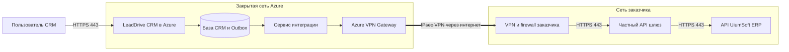
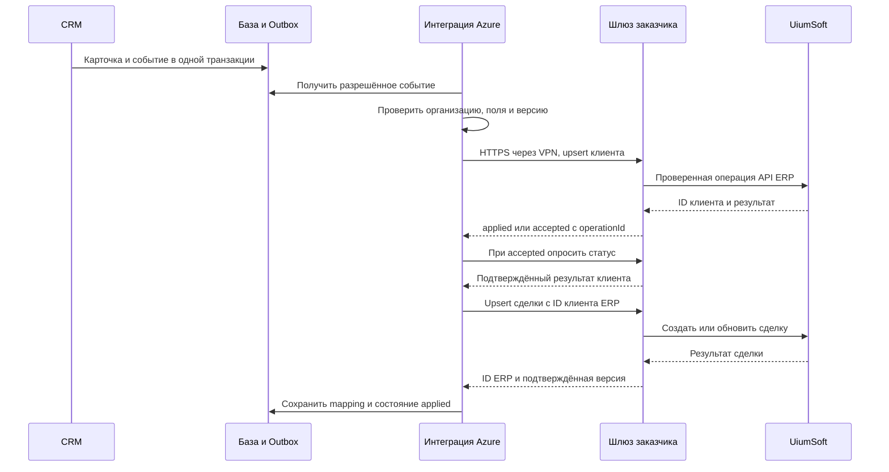

# API flow и информационная безопасность интеграции LeadDrive CRM и UiumSoft ERP

Версия 1.0 • 13 октября 2026 года • Проект для согласования с ИБ и ИТ заказчика

**Назначение:** передавать из LeadDrive CRM в ERP UiumSoft карточки клиентов, контакты и связанные сделки по защищённому каналу с контролем доступа, состава данных и результата обработки.

**Исходные условия:** рабочая CRM планируется в Microsoft Azure; ERP размещена во внутренней сети заказчика. Azure-инфраструктура для этой интеграции ещё не создана, её IP-адреса не назначены. Текущий тестовый сервер не является адресом будущего рабочего подключения.

**Целевая схема:** отдельный сервис интеграции CRM инициирует HTTPS-запросы на частный API-шлюз заказчика через Site-to-Site VPN. API ERP не публикуется в интернете. Основной прикладной порт — **TCP 443**; для VPN на периметре отдельно согласуются **UDP 500 и UDP 4500** и, при выбранном режиме без UDP-инкапсуляции, IP-протокол ESP 50.

Все меры, компоненты и числовые параметры ниже являются требованиями к проектируемому подключению, если прямо не указано иное. Готовый адаптер UiumSoft и действующий VPN этим документом не подтверждаются. Точное название продукта, редакция, версия, лицензия API и методы установленной ERP подлежат подтверждению заказчиком; здесь сохранено переданное заказчиком название UiumSoft. Числовые IP, домены и URL не подменяются предположениями.

## 1 Границы интеграции

В первоначальный объём входят создание или обновление клиента, согласованных контактных лиц и сделки, а также получение технического результата: принято, обработано или отклонено, идентификатор ERP и причина ошибки.

Передача товаров в составе коммерческого предложения или заказа, договорных реквизитов и получение статусов исполнения допускаются после согласования соответствующих полей и методов API. Массовая выгрузка переписки, файлов, аудиозаписей, внутренних заметок и базы CRM целиком в начальный объём не входит.

В проекте предусмотрен один инициатор прикладных соединений — сервис интеграции в Azure. Ответ ERP возвращается по уже установленному соединению. Если ERP обрабатывает запрос асинхронно, CRM сама опрашивает статус по тому же закрытому маршруту. Отдельный входящий webhook из ERP в CRM не требуется.

Поток охватывает эту интеграцию. Подключения CRM к почте, телефонии, мессенджерам, аналитике и AI-сервисам требуют отдельной инвентаризации, если эти функции будут включены в клиентской инсталляции. Данные интеграции не направляются в такие сервисы для преобразования или анализа.

## 2 Размещение и сетевой маршрут

### 2.1 Компоненты

| Компонент | Размещение и назначение |
| --- | --- |
| CRM и её пользовательский вход | Azure; ввод и изменение данных. Пользователи подключаются по HTTPS к согласованному домену CRM |
| База CRM и журнал отправки Outbox | Закрытая подсеть Azure; хранение карточек, событий отправки и результатов |
| Сервис интеграции CRM | Отдельная вычислительная служба в закрытой подсети Azure; выбирает разрешённые события, формирует запрос и сопоставляет идентификаторы |
| Azure VPN Gateway | Завершает шифрованный туннель со стороны Azure; отдельные публичные адреса для VPN |
| VPN-шлюз и межсетевой экран заказчика | Завершают туннель и пропускают только разрешённый поток к API-шлюзу |
| Частный API-шлюз заказчика | Выделенная интеграционная зона сети; проверка сертификата и полномочий, ограничения запросов, журнал операций и адаптация к ERP при необходимости |
| Прикладной API UiumSoft | Внутренняя сеть заказчика; выполняет операции через штатную бизнес-логику ERP |
| Хранилище секретов и мониторинг | Azure Key Vault и согласованные системы мониторинга; в сеть ERP передаются только предусмотренные деловые запросы |

API-шлюз — проектный компонент под управлением заказчика или его интегратора. Его можно совместить с поддерживаемым интеграционным модулем ERP, если тот обеспечивает требуемые проверки. Если нужны дополнительный модуль или лицензия, это подтверждается до разработки.

### 2.2 Схема передачи



Прикладной HTTPS-сеанс проходит от сервиса интеграции до API-шлюза внутри VPN. На шлюзе TLS завершается; до ERP устанавливается второй TLS-сеанс с проверкой сертификата. Таким образом, шифрование обеспечивается на обоих участках, но это не один сквозной TLS-сеанс через шлюз. Для прямого подключения к ERP без отдельного шлюза все его проверки должны выполняться ERP или её интеграционным модулем.

Site-to-Site VPN передаёт зашифрованный трафик **через публичный интернет**; частные адреса и закрытый доступ к API не означают физически выделенный канал. Такая топология поддерживается Azure VPN Gateway. [Microsoft Learn — VPN topology and design](https://learn.microsoft.com/en-us/azure/vpn-gateway/design)

### 2.3 Какие адреса увидит заказчик

| Точка наблюдения | Адрес источника |
| --- | --- |
| Внешний периметр VPN заказчика | Публичный IP Azure VPN Gateway; при резервировании — все согласованные IP шлюзов |
| Firewall перед частным API-шлюзом | Частный IP сервиса интеграции или согласованный адрес после VPN/NVA NAT |
| ERP за API-шлюзом | Внутренний IP API-шлюза; идентичность интеграции дополнительно определяется его служебной учётной записью |

Публичный IP пользовательского входа CRM, публичный IP VPN и внутренний адрес сервиса интеграции выполняют разные функции. Для HTTPS-доступа через VPN разрешается фактически наблюдаемый **внутренний** источник, а не автоматически публичный IP веб-сайта CRM.

Для сервиса интеграции резервируется статический частный адрес либо небольшой явно определённый пул при масштабировании. Подсети сторон не должны пересекаться. При неизбежном пересечении отдельно согласуются поддерживаемый режим NAT, преобразованные сети и обратные маршруты; Azure VPN NAT для пересекающихся сетей не является интернет-шлюзом NAT. [Microsoft Learn — VPN Gateway NAT](https://learn.microsoft.com/en-us/azure/vpn-gateway/nat-overview)

## 3 Матрица соединений и портов

Обозначения в таблицах — незаполненные параметры, а не реальные адреса. Для всех разрешений задаются источник, назначение, среда TEST/PROD, владелец, журналирование и дата пересмотра. Политика по умолчанию — запрет.

### 3.1 Периметр и сеть заказчика

| ID | Инициатор → назначение | Протокол и порт назначения | Назначение и ограничение |
| --- | --- | --- | --- |
| N01 | AZURE_VPN_PUBLIC_IPS ↔ CLIENT_VPN_PUBLIC_IPS | UDP 500 | IKE; только конкретные VPN-пиры |
| N02 | Те же VPN-пиры | UDP 4500 | IPsec NAT-T; только согласованные пиры |
| N03 | Те же VPN-пиры | ESP, IP protocol 50 | Только если выбран native ESP; это номер IP-протокола, не TCP/UDP-порт. При согласованном UDP-инкапсулированном режиме отдельно не требуется |
| N04 | AZURE_INTEGRATION_SOURCE → CLIENT_API_PRIVATE_IP | TCP 443 | Основной поток HTTPS внутри VPN; только API интеграции |
| N05 | CLIENT_API_GATEWAY_IP → ERP_API_PRIVATE_IP | TCP 443 | Внутренний вызов ERP; только согласованные методы |
| N06 | AZURE_INTEGRATION_SOURCE → CLIENT_AUTH_PRIVATE_IP | TCP 443 | Если сервер выдачи OAuth-токенов заказчика имеет отдельный адрес; если совмещён со шлюзом — N04 |
| N07 | AZURE_DNS_FORWARDER → CLIENT_DNS_IPS | UDP/TCP 53 | Только если для имени API необходимо разрешение через DNS заказчика; пересылается лишь нужная зона |

N01–N03 обеспечивают туннель, N04 — прикладной обмен. Для VPN-пиров допускается установка и восстановление туннеля с обеих сторон. Набор NAT-T/ESP и совместимость VPN-устройства фиксируются сетевыми администраторами до включения правил. [Microsoft Learn — VPN devices and IPsec parameters](https://learn.microsoft.com/en-us/azure/vpn-gateway/vpn-gateway-about-vpn-devices), [Microsoft Learn — VPN tunnel troubleshooting](https://learn.microsoft.com/en-us/troubleshoot/azure/vpn-gateway/troubleshoot-vpn-tunnel-cannot-connect)

Ответы на N04–N07 проходят по состоянию установленного соединения; отдельное разрешение новых сеансов ERP → Azure не создаётся. Исходный TCP-порт выбирает ОС, порт назначения API — 443. Для stateless ACL отдельно задаются ответные диапазоны портов по выбранной ОС; они не означают публикацию нового сервиса.

Прямой доступ сервиса Azure к БД ERP и её служебным портам, SMB 445, SSH 22 и RDP 3389 не требуется. Порт 80 для деловых запросов не используется. Если штатный API ERP слушает иной порт, N05 заменяется точным правилом после проверки; HTTP в открытом виде между разными узлами не является принятым вариантом этой схемы.

Базовый проект использует статически согласованные маршруты. BGP и его TCP 179 не нужны; при выборе BGP добавляется отдельное правило только между точными адресами BGP-пиров. Административный VPN и доступ поддержки оформляются отдельно от канала обмена данными.

### 3.2 Соединения внутри Azure и служебные зависимости

| Инициатор → назначение | Порт | Условие |
| --- | --- | --- |
| Пользователи → вход CRM | TCP 443 | Отдельная политика доступа пользователей; WAF/reverse proxy и TLS |
| Вход CRM → приложение | TCP 443 | Внутренний TLS-прокси приложения; локальный порт приложения не публикуется |
| Приложение и интеграция → PostgreSQL CRM | TCP 5432 с TLS | Только частная сеть и раздельные роли БД; ERP этот порт не использует |
| Сервис интеграции → Azure Key Vault | TCP 443 | Предпочтительно private endpoint; доступ к секретам только своей интеграции |
| Сервис интеграции → согласованный OAuth issuer | TCP 443 | При использовании облачного issuer; точные FQDN и audience фиксируются |
| Компоненты → согласованные DNS | UDP/TCP 53 | Только доверенные резолверы |
| Компоненты → мониторинг | TCP 443 | Метрики и очищенные журналы; адреса зависят от выбранного сервиса |
| Компоненты → источник времени | UDP 123, если нужен отдельный NTP | Только утверждённый источник; возможен механизм синхронизации платформы |
| TLS-компоненты → CRL/OCSP, если требует PKI | TCP 80/443 по точным адресам CA | Только проверка отзыва сертификатов, без деловых payload; при внутреннем CA возможен маршрут через VPN |

Эта таблица описывает зависимости интеграции, а не полный список управляющих соединений всей платформы Azure. После выбора VM/App Service/контейнерного сервиса инфраструктурная команда добавляет необходимые платформенные endpoints, резервное копирование и обновления в реестр egress. Их нельзя заменять постоянным разрешением доступа ко всему интернету. Очередь начального проекта хранится в БД как Outbox; отдельный брокер и его порты не требуются.

## 4 Правила отбора клиентов и событий

1. Новое обращение сначала создаётся в CRM как лид. Непроверенные, спамные и не относящиеся к заказчику лиды в ERP автоматически не отправляются.
2. При достижении согласованной стадии квалификации либо создании первой подходящей сделки устанавливается признак `erpSyncEligible`. Точная стадия выбирается заказчиком. Это проектное правило интеграции, а не название уже существующего поля CRM.
3. Для квалифицированного потенциального клиента создаётся карточка типа «потенциальный контрагент», если ERP поддерживает такой тип. Иначе заказчик утверждает допустимый тип справочника; создание карточки не должно автоматически означать финансовое обязательство.
4. Отправляются контрагент и выбранные контактные лица. После подтверждения их ERP-идентификаторов отправляется сделка со ссылкой на контрагента.
5. Последующие изменения согласованных полей создают новые версии событий. Изменения внутренних заметок и иных исключённых полей не запускают отправку этих данных.
6. Закрытие сделки как успешной может инициировать создание **черновика** заказа только по отдельному утверждённому правилу и при наличии обязательных строк заказа. Само изменение стадии не проводит реализацию, счёт или платёж.
7. Закрытая или проигранная сделка передаётся как изменение статуса. Удаление карточки CRM не удаляет автоматически учётные документы ERP; применяется статус неактивности или отдельная согласованная процедура.

Если бизнесу нужен каждый новый лид ещё до квалификации, критерий пункта 2 меняется до запуска. Для такого варианта отдельно проверяются поддержка потенциальных клиентов в ERP и необходимость передачи персональных данных на ранней стадии.

## 5 Состав данных и владельцы полей

Для каждого поля в финальном mapping указываются источник CRM, путь в API ERP, тип, длина, обязательность, справочник, владелец изменений и правило пустого значения. Отправляется разрешённый набор полей, а не объект CRM целиком.

| Сущность | Данные к передаче | Режим |
| --- | --- | --- |
| Контрагент | Внешний ID CRM; тип физическое/юридическое лицо; наименование; налоговый номер/VÖEN при необходимости; страна; согласованный юридический и/или адрес доставки; рабочие контакты | Базовый объём; требования к реквизитам определяет ERP |
| Контактное лицо | ID CRM; связь с контрагентом; имя; должность при необходимости; рабочие телефон и email | Только выбранные лица, необходимые для сделки |
| Сделка | ID CRM; ссылка на контрагента; название; стадия; сумма и валюта; ожидаемая дата закрытия; код ответственного/подразделения; версия изменения | Базовый объём; стадия CRM сопоставляется с конкретным статусом ERP |
| Коммерческое предложение и строки заказа | ID документа и строки; код товара ERP; количество; единица; цена; скидка; согласованный налоговый код; итог; валюта | Дополнительный объём после подтверждения источника и формул |
| Договорные реквизиты | Номер, даты, ссылка на сделку, условия оплаты и поставки из согласованных справочников | Дополнительный объём; текст договора и вложения отдельно |
| Результат обработки ERP | ID операции, клиента, сделки/заказа; бизнес-статус; код ошибки; версия | Обязательный технический ответ ERP → CRM |
| Статусы заказа, отгрузки и оплаты | Номер, статус, даты, согласованные суммы/остаток | Дополнительное чтение CRM из ERP по тому же маршруту |
| Номенклатура, единицы, валюты, ставки и склады | Код, разрешённое отображаемое имя и признаки справочника | Опциональное чтение ERP → CRM для корректного mapping |

CRM владеет отношениями с клиентом и стадиями продаж. ERP владеет учётными кодами, проведёнными документами, остатками, фактическими отгрузками и оплатами. Для реквизитов клиента задаётся явная матрица владения: после проверки реквизитов бухгалтерией CRM не перезаписывает их без согласованного процесса.

Нельзя отождествлять сумму сделки с суммой проведённого счёта. В текущей CRM связи «товар в сделке» недостаточно, чтобы автоматически считать документ полным заказом с количеством, единицами и налогами. Для заказа выбирается подтверждённый источник строк — например, утверждённое коммерческое предложение — и отдельно проверяются расчёты.

Не передаются пароли, токены, ключи, данные других организаций, платёжные карточные реквизиты, история переписки, записи звонков, документы личности, специальные категории персональных данных и произвольные внутренние комментарии. Если отдельный процесс действительно требует такого поля, оно проходит самостоятельное согласование с указанием цели и доступа.

## 6 Последовательность обработки одного клиента и сделки



При сохранении значимого изменения CRM создаёт запись Outbox **в той же транзакции БД**. Если транзакция не завершилась, событие не отправляется. Запись содержит организацию, тип объекта, внешний ID, версию, время и необходимые для обработки данные. Обработчик читает только события организации заказчика.

До отправки проверяются обязательные поля, формат контактов, длины строк, допустимые значения справочников, числовые диапазоны, валюта и права операции. Налоговые и контактные реквизиты не дополняются вымышленными значениями для обхода валидации.

На стороне заказчика API-шлюз проверяет TLS/mTLS, аутентификацию, связь служебной учётной записи с организацией ERP, разрешённые методы, схему тела, размер и частоту. Затем вызывает штатный API ERP. Прямой SQL-доступ из Azure не используется.

`200/201` означает успешную бизнес-операцию только при валидном теле подтверждения. `202` означает принятие в обработку: CRM сохраняет `operationId` и запрашивает статус до конечного результата. HTTP 200 с бизнес-ошибкой, что возможно в некоторых API/SOAP, трактуется как ошибка. Изменение сделки ждёт подтверждения контрагента; сбой сделки не откатывает уже созданного клиента удалением.

Состояния в CRM: «Ожидает», «В обработке», «Передано», «Требует исправления», «Результат уточняется». Менеджеру показывается понятная причина и ID обращения в поддержку, без токенов и технических трассировок.

## 7 Проектный контракт API

**Ниже предложен контракт для интеграционного шлюза; это не перечень подтверждённых методов UiumSoft.** После получения OpenAPI/WSDL или документации установленной ERP интегратор сопоставляет операции с её штатными REST/SOAP-методами. Если ERP не поддерживает требуемую сущность, это фиксируется как ограничение до реализации.

| Метод и условный путь | Назначение |
| --- | --- |
| `PUT /integration/v1/customers/{externalId}` | Создать или обновить контрагента в организации, закреплённой за учётной записью |
| `PUT /integration/v1/contacts/{externalId}` | Создать или обновить согласованное контактное лицо |
| `PUT /integration/v1/deals/{externalId}` | Создать или обновить сделку либо её согласованный аналог ERP |
| `PUT /integration/v1/orders/{externalId}` | Опционально создать/обновить допустимый черновик заказа |
| `GET /integration/v1/operations/{operationId}` | Узнать конечный результат асинхронной операции |
| `GET /integration/v1/operations?eventId=...` | Найти результат в пределах своей организации, если первый ответ потерян и operationId неизвестен |
| `GET /integration/v1/customers/{externalId}` | Проверить наличие и версию своего контрагента; аналогичный ограниченный поиск предусмотрен для сделок и включённых заказов |
| `GET /integration/v1/receipts?cursor=...` | Получить ограниченную страницу результатов для сверки |
| `GET /integration/v1/reference-data/{type}?cursor=...` | Опционально читать разрешённые справочники |

Адрес token endpoint назначает выбранный OAuth issuer; путь `/oauth/token` заранее не приписывается UiumSoft. Все URL фиксируются в конфигурации; данные клиента не могут выбирать сервер назначения. В API не допускаются произвольные SQL-запросы, произвольные URL, команды выполнения или массовый экспорт несогласованных сущностей.

Основные заголовки: `Content-Type: application/json`, `Authorization: Bearer <access_token>`, `X-Correlation-ID`, `Idempotency-Key`. Значения токенов не попадают в URL и журналы. Идентичность организации берётся из проверенной служебной учётной записи; поле организации в JSON не даёт права переключать организацию.

Пример данных полностью синтетический. На реальном wire-контракте отправляются только поля, согласованные в mapping.

```json
{
  "schemaVersion": "1.0",
  "eventId": "10000000-0000-4000-8000-000000000001",
  "sourceSystem": "LeadDrive",
  "externalId": "crm-customer-demo-001",
  "entityVersion": 3,
  "occurredAt": "2026-10-13T08:00:00Z",
  "customer": {
    "type": "legal_entity",
    "name": "DEMO CUSTOMER",
    "countryCode": "AZ",
    "email": "contact@example.invalid"
  }
}
```

Для этого примера обязательные налоговые или адресные поля добавляются по правилам ERP; отсутствие обязательного поля вызывает проверяемую ошибку. После подтверждения клиента отправляется отдельный объект сделки:

```json
{
  "schemaVersion": "1.0",
  "eventId": "10000000-0000-4000-8000-000000000002",
  "externalId": "crm-deal-demo-001",
  "entityVersion": 1,
  "occurredAt": "2026-10-13T08:00:01Z",
  "customerErpId": "ERP-CUSTOMER-DEMO-001",
  "deal": {
    "name": "DEMO DEAL",
    "stageCode": "QUALIFIED",
    "amount": "1500.00",
    "currency": "AZN",
    "expectedCloseDate": "2026-11-01"
  }
}
```

Коды `QUALIFIED`, `AZN` и структура примера используются только при подтверждённом mapping. Денежные значения передаются десятичными строками с согласованной точностью; даты событий — ISO 8601 UTC, календарные даты без искусственного часового пояса. Налоговые коды, округление, единицы и формат валют фиксируются в спецификации.

Пример конечного подтверждения:

```json
{
  "operationId": "op-demo-002",
  "eventId": "10000000-0000-4000-8000-000000000002",
  "externalId": "crm-deal-demo-001",
  "erpId": "ERP-DEAL-DEMO-001",
  "status": "applied",
  "appliedVersion": 1,
  "processedAt": "2026-10-13T08:00:02Z"
}
```

Версия схемы контрактов управляется отдельно от версии объекта. Несовместимые изменения требуют новой версии API, тестирования и даты переключения. Поле отсутствует — оставить значение без изменения; `null` — очистить только если это явно разрешено для поля; пустая строка не является универсальной командой очистки.

## 8 Дубли, порядок событий и сбои

Модель доставки — **at least once**: одно событие может прийти повторно. Отсутствие дублей обеспечивается идемпотентной обработкой, а не обещанием единственной сетевой отправки.

Ключ объекта включает интеграцию, организацию, тип сущности и внешний ID CRM. `Idempotency-Key` фиксируется для события и не меняется при повторе. Повтор с тем же ключом и тем же содержимым возвращает прежний результат; тот же ключ с другим содержимым вызывает конфликт. На стороне ERP или её адаптера требуется уникальная связь внешнего ID с объектом ERP. Запись только в журнале шлюза недостаточна, если ERP выполнила действие, а шлюз упал до сохранения результата.

Если штатный API не обеспечивает идемпотентность, адаптер должен восстанавливать результат по уникальному внешнему ID. Если operationId неизвестен из-за потери первого ответа, используется поиск по eventId, затем проверка объекта по внешнему ID. Отсутствие результата при первой проверке не доказывает, что ERP ничего не записала: операция могла ещё выполняться. Если нельзя ни обеспечить уникальность, ни надёжно проверить результат, неопределённые операции останавливаются для ручной сверки. Автоматический повтор создания в таком режиме не допускается.

Каждый объект имеет монотонную версию; старая версия не перезаписывает новую. Операции одного объекта выполняются последовательно. Для контрагента и сделки учитывается зависимость: сделка не создаётся до подтверждения контрагента.

| Ситуация | Действие |
| --- | --- |
| Некорректные данные, HTTP 400/422 | Остановить событие; дать ответственному исправить поля; новую версию отправить после исправления |
| HTTP 401 | Один раз обновить допустимый токен; повторный отказ приостанавливает интеграцию и вызывает уведомление |
| HTTP 403 | Не повторять автоматически; проверить права и соответствие организации |
| HTTP 404 | Проверить mapping, зависимость и версию API; не создавать новый объект вслепую |
| HTTP 409 | Разобрать конфликт версии, внешнего ID или ключа; сверить результат |
| HTTP 429 | Учитывать `Retry-After`, уменьшить частоту и сохранить событие |
| HTTP 5xx, обрыв связи или таймаут | Проверить operationId/внешний ID; повторить только с тем же ключом при подтверждённой идемпотентности |
| Ответ потерян после записи в ERP | Статус «Результат уточняется»; запросить результат, а не создавать новый ключ |
| VPN или ERP недоступны | Накапливать события в устойчивом хранилище; ограничить нагрузку и поднять уведомление |
| Перезапуск сервиса | Возобновить из Outbox; незавершённые операции сверить перед продолжением |

Предлагаемые начальные пределы для согласования: до 1 МиБ на сообщение без файлов; максимум 5 запросов/сек и 2 одновременно на интеграцию; соединение до 5 секунд, полный запрос до 30 секунд. Повторы с небольшим случайным разбросом: через 1, 5, 15 и 60 минут, затем ежечасно в пределах 24 часов. После исчерпания окна событие остаётся в очереди разбора ошибок, а не исчезает. Параметры уточняются по ограничениям ERP и результатам приёмки.

Целевое время доставки при доступных системах — до 60 секунд для 95% обычных событий. Это проектный показатель, не действующий SLA. Контролируются возраст старейшего события, глубина очереди, число неизвестных результатов и время подтверждения ERP. При заполнении хранилища включаются тревога и согласованное ограничение приёма/изменений; молча отбрасывать события нельзя.

## 9 Аутентификация и полномочия

Целевой профиль: TLS 1.2 или выше, предпочтительно TLS 1.3 при совместимости; взаимная проверка сертификатов mTLS на API-шлюзе и OAuth 2.0 Client Credentials для служебного приложения. Если установленный стек не поддерживает оба механизма, заказчик согласует поддерживаемый профиль либо размещение проверок на интеграционном шлюзе до разработки. Наличие OAuth/mTLS у UiumSoft заранее не предполагается.

Служебная учётная запись создаётся отдельно для заказчика и среды. Ей разрешены только согласованные операции над клиентами, контактами, сделками, статусами и при необходимости черновиками заказов. Проектные scopes: `customers.write`, `contacts.write`, `deals.write`, `sync.status.read`; дополнительные `orders.draft.write` и `reference.read` включаются отдельно. Это целевые наименования прав шлюза, а не утверждение о штатных scopes ERP.

Запрещены права администратора ERP, изменение пользователей и ролей, прямой доступ к БД, проведение платежей и бухгалтерских документов, чтение других организаций и массовое удаление. Ограничение организации проверяется на каждом объекте и каждом запросе, включая чтение статуса операции.

Токены ограничиваются audience интеграционного API, разрешёнными scopes и коротким сроком действия; предлагаемый максимум — 15 минут, если поддерживается issuer. Проверяются подпись и допустимый алгоритм, issuer, audience, срок и привязка к служебному приложению. Один заголовок с ID организации не считается аутентификацией. Принципы HTTPS, проверки полномочий и входных данных соответствуют рекомендациям [OWASP REST Security](https://cheatsheetseries.owasp.org/cheatsheets/REST_Security_Cheat_Sheet.html).

До запуска оформляются владельцы и сроки ротации сертификатов, токенов и VPN-ключей. Предлагается уведомление об истечении сертификата за 30, 14 и 7 дней, контролируемый период перекрытия при смене и немедленный отзыв при компрометации. Проверяются доверенная цепочка, имя сервера и политика отзыва; отключение проверки сертификата не допускается.

## 10 Секреты, сегментация и защита приложений

Ключи, клиентские секреты и закрытые ключи сертификатов хранятся в Azure Key Vault либо согласованном хранилище заказчика. Сервис Azure обращается к Key Vault через managed identity с минимальными правами; это не означает, что ERP автоматически принимает эту identity. Секреты ERP при необходимости извлекаются из хранилища и применяются только в серверном процессе. [Microsoft Learn — Secure your Azure Key Vault](https://learn.microsoft.com/en-us/azure/key-vault/general/secure-key-vault)

Секреты отсутствуют в браузере, Git, документации, URL, тикетах, скриншотах и обычных логах. Передача первоначальных секретов выполняется через защищённый согласованный канал. TEST и PROD используют разные секреты, сертификаты и учётные записи.

Маршруты и firewall ограничивают доступ выделенной подсетью интеграции и конкретными адресами заказчика. VPN не даёт всему Azure VNet доступ ко всей сети клиента. Не нужны членство CRM в домене заказчика и доступ к контроллерам домена. Исходящие соединения интеграционного сервиса ограничиваются API, авторизацией, DNS и согласованными служебными зависимостями.

Для частного API реализуется отдельный доверенный коннектор с разрешёнными FQDN/IP/портом и проверкой перенаправлений и DNS. Пользователь CRM не может указать произвольный адрес назначения. Общая защита от SSRF, включая запрет доступа к произвольным внутренним адресам и metadata endpoint, не отключается ради VPN-интеграции.

API ограничивает методы, длины полей, размер и глубину JSON, объём страниц и частоту. Если применяется SOAP/XML, отключаются внешние сущности и DTD, задаются размеры и глубина документа. Вложения в базовом потоке отсутствуют; добавление файлов требует ограничения типов и размера, антивирусной проверки, правил хранения и самостоятельного согласования.

Администраторы используют персональные учётные записи, MFA, разграниченные роли и журналируемый ограниченный по времени доступ. Изменения endpoint, scopes, mapping и правил выгрузки проходят контроль изменений. Аварийное отключение возможно отзывом служебного доступа, остановкой обработчика и блокировкой N04 без удаления накопленных событий.

## 11 Хранение, конфиденциальность и журналирование

| Место | Какие данные находятся | Требование |
| --- | --- | --- |
| База CRM в Azure | Разрешённые карточки, сделки и связи с ERP | Шифрование хранения и резервных копий; минимальные роли; утверждённый Azure region |
| Outbox и очередь ошибок | Минимальный payload, версия и состояние доставки | Такие же меры защиты, как для персональных данных CRM |
| ERP заказчика | Принятые реквизиты и документы | Политики хранения, роли и резервное копирование заказчика |
| Журналы | Время, correlation/event ID, тип объекта, операция, служебная identity, исход, код ошибки и длительность | Без тел запросов, токенов, телефонов/email и иных лишних персональных данных |
| Реестр идемпотентности | Ключ, digest содержимого, ID ERP, версия и результат | Изоляция организаций и защита от изменения; IDs также могут быть косвенными персональными данными |

Предлагаемые сроки интеграционного контура для согласования: payload успешных событий — 7 дней после подтверждения; payload ошибок — до 30 дней; технический аудит и ключи идемпотентности — 90 дней; резервные копии — 30 дней. Эти сроки не заменяют политику хранения основных данных CRM и учётных документов ERP.

К 25-му дню неразрешённая ошибка эскалируется владельцу: до истечения 30 дней событие должно быть обработано, явно отменено с аудитом либо срок продлён по утверждённому исключению. Автоматическое удаление неразобранной ошибки с потерей задачи недопустимо. Постоянная уникальная связь внешнего ID с объектом ERP сохраняется дольше ключа конкретной доставки; повтор старых событий после срока дедупликации выполняется только после сверки. Нельзя обещать защиту от дублей исключительно за счёт 90-дневного кэша.

Логи защищаются от изменения операторами интеграции и передаются в согласованный мониторинг/SIEM. Полный payload не включается в уведомления. Диагностический захват данных возможен только ограниченно по времени и доступу, с маскированием и отдельным сроком удаления.

До передачи реальных данных фиксируются регион Azure, регионы резервных копий и мониторинга, владелец подписки, стороны обработки, цель передачи, доступ поддержки и требования к трансграничной обработке. По самому факту выбора Azure нельзя заключить, где окажутся все данные, или заявить соответствие конкретному законодательству/сертификации. Договорные требования подтверждаются ответственными сторонами до запуска.

## 12 Сверка, резервирование и инциденты

Не реже одного раза в сутки выполняется сверка разрешённых внешних ID, последних версий и результатов; при массовом восстановлении — отдельная сверка до возобновления повторов. Сравниваются количества и конкретные расхождения, а не только общая сумма или HTTP-статусы. Реестр сверки не должен открывать доступ к чужим данным ERP.

Подтверждённая транзакция CRM создаёт устойчивое событие, но это само по себе не гарантирует RPO=0 при потере БД или региона. RPO, RTO, резервирование сервиса/VPN/БД и частота резервных копий выбираются по договору. До рабочей приёмки проводят восстановление резервной копии и проверяют, что повторная обработка не создаёт дубли в ERP.

При инциденте ответственный останавливает отправку, отзывает затронутые ключи, ограничивает сетевой доступ, сохраняет очищенный аудит и уведомляет контакты ИБ сторон по согласованному регламенту. Затем определяются затронутые event ID и записи ERP. Возобновление выполняется после устранения причины и сверки неопределённых результатов. Сроки уведомления и круглосуточность поддержки закрепляются отдельно; этим проектом они не объявляются установленными.

Изменение кода можно откатить, однако уже созданные ERP-записи не исчезают при откате CRM. Исправление бизнес-данных проводится штатной корректировкой ERP с аудитом, а не удалением таблиц или общей перезагрузкой базы.

## 13 Тестовая среда и ввод в работу

TEST имеет отдельные endpoints, организацию/компанию ERP, учётные записи, секреты, сертификаты, журнал и сетевые правила. Из TEST закрыт доступ к PROD ERP. Для приёмки используются синтетические либо согласованно обезличенные записи. Текущий тестовый сервер не включается в рабочий allowlist автоматически.

Порядок запуска:

1. Заказчик предоставляет документацию установленного API, ограничения и тестовую ERP; стороны утверждают mapping и критерий выгрузки.
2. Назначаются Azure region, владельцы, адресные пространства, статические адреса, частный FQDN API и профиль VPN/TLS.
3. Реализуются коннектор, устойчивый Outbox, обработка идентификаторов и необходимые функции шлюза; настраиваются права и журналирование.
4. На TEST выполняются функциональные, сетевые и негативные проверки из раздела 14.
5. Подписываются фактическая матрица соединений, разрешённый состав данных, результаты приёмки и регламент эксплуатации.
6. В рабочей среде включается ограниченная пилотная выборка. Подтверждаются реальные source IP, корректность документов и мониторинг.
7. После сверки пилота разрешается основной поток. Историческая загрузка запускается отдельно, ограниченными пакетами с checkpoint, контролем дублей и согласованной нагрузкой.

При исторической загрузке фиксируется момент снимка и учитываются изменения, произошедшие во время выгрузки, чтобы старый снимок не перезаписал новую версию. Дедупликация существующих ERP-клиентов проводится по утверждённым бизнес-ключам; одно совпадение имени или телефона не разрешает автоматическое объединение юридических лиц.

## 14 Критерии приёмки ИБ и ИТ

| Проверка | Ожидаемый результат |
| --- | --- |
| Публичная доступность API ERP | Из интернета API не доступен; доступен только согласованный VPN-маршрут |
| Сетевой источник | В логах виден утверждённый частный/NAT источник; неподтверждённый адрес блокируется |
| Минимальные права | Служебная запись выполняет разрешённые действия и не может администрировать/проводить документы |
| Чужая организация/объект | Подмена ID в теле, URL или запросе статуса не раскрывает и не меняет чужие данные |
| TLS и авторизация | Просроченный/недоверенный сертификат, неправильный audience и отозванный доступ отклоняются |
| Разрешённые поля | Полученный ERP payload совпадает с утверждённым mapping; лишние поля отсутствуют |
| Повтор и конкурентная отправка | Один объект ERP, стабильный результат; одинаковый ключ с иным телом отклоняется |
| Потерянный ответ и сбой шлюза после записи ERP | Результат восстанавливается без повторного создания |
| Неправильный порядок и старая версия | Сделка ждёт клиента; старая версия не перезаписывает новую |
| 202 и бизнес-ошибка в 200 | CRM ждёт конечного результата и не показывает ложный успех |
| Отказ VPN/ERP и перезапуск | События сохраняются, очередь возобновляется без пропусков и дублей |
| 429, пределы и большое тело | Нагрузка ограничивается; неприемлемое тело отклоняется контролируемо |
| Логи и секреты | В журналах и уведомлениях отсутствуют токены и полный персональный payload |
| Ротация и аварийная остановка | Старый доступ отзывается; отправка управляемо прекращается и возобновляется |
| Восстановление и сверка | Результаты CRM и ERP согласованы после восстановления из резервной копии |

Для каждой проверки сохраняются дата, среда, версия приложения, обезличенные event/correlation ID, фактический результат и ответственный. Проверки перечислены как план приёмки; их выполнение этим документом не подтверждается.

## 15 Ответственность сторон

| Область | Ответственный |
| --- | --- |
| Правила квалификации, состав данных, владельцы полей | Бизнес-владелец заказчика совместно с LeadDrive |
| Коннектор, Outbox, mapping CRM, статусы отправки | LeadDrive |
| Azure subscription, регион, VNet, VPN и инфраструктурный мониторинг | Назначенная Azure-команда; принадлежность подписки фиксируется до запуска |
| Firewall, VPN и DNS в сети заказчика | ИТ и ИБ заказчика |
| API UiumSoft, лицензия, шлюз/адаптер и служебная роль ERP | ERP-администратор заказчика и интегратор UiumSoft |
| PKI, выпуск/ротация/отзыв сертификатов и доступов | Назначенные владельцы каждой стороны |
| Утверждение доступа и персональных данных | ИБ и уполномоченные лица заказчика |
| Сверка ошибок и изменение бизнес-данных | Ответственный за интеграцию и владелец соответствующих данных |

## 16 Паспорт подключения для заполнения перед запуском

`TBD` означает «назначается/подтверждается до запуска». IP после создания Azure предоставляются отдельным обновлением паспорта; в рабочем разрешении firewall не должно оставаться TBD.

| Параметр | Значение сейчас | Кто предоставляет |
| --- | --- | --- |
| Клиент, юридическое лицо и ERP company ID | TBD | Заказчик |
| Продукт, редакция и версия UiumSoft, API-лицензия | TBD | Заказчик / интегратор ERP |
| Документация OpenAPI/WSDL и доступные операции | TBD | Интегратор ERP |
| Azure tenant/subscription и владелец | TBD | Azure-команда |
| Azure region, DR/backup/log regions | TBD | Azure-команда и ИБ |
| Публичные IP Azure VPN, включая резервные | TBD после создания | Azure-команда |
| Публичные IP VPN заказчика | TBD | ИТ заказчика |
| Azure VNet и интеграционная подсеть | TBD | Azure-команда |
| Частные source IP/pool и адрес после NAT | TBD | Обе сетевые команды |
| Сети заказчика, private IP/FQDN API, TLS SNI | TBD | ИТ заказчика |
| IP/порт участка шлюз → ERP | Целевой TCP 443; адрес TBD | ERP-администратор |
| Private DNS и условные forwarding rules | TBD | Обе сетевые команды |
| IKEv2/IPsec: suites, DH/PFS, lifetime, DPD, NAT-T/ESP | TBD по совместимости и политике ИБ | Обе сетевые команды |
| OAuth issuer/token endpoint/audience/scopes | TBD | Владелец авторизации |
| CA, mTLS, отзыв, имена и сроки сертификатов | TBD | PKI / ИБ |
| Критерий выгрузки и обязательные поля | Предложены в разделах 4–5; утвердить | Бизнес и ERP-интегратор |
| Ограничения API, объёмы, SLO, RPO/RTO, сроки хранения | Предложены; утвердить | Эксплуатация и бизнес |
| Контакты поддержки, эскалация и срок уведомления | TBD | Обе стороны |
| Дата приёмки, change request и дата запуска | TBD | Руководители проекта и ИБ |

После заполнения паспорта выпускается окончательная адресная матрица с реальными source/destination IP и FQDN. Изменение IP или добавление резервного узла проходит уведомление и контроль изменений; широкий allowlist облачных диапазонов вместо точных источников не применяется.

## 17 Краткие ответы для службы ИБ

| Вопрос | Ответ по целевому проекту |
| --- | --- |
| Откуда поступят запросы? | Из выделенного сервиса интеграции в Azure; точные частные source IP и публичные VPN IP будут назначены и переданы до запуска |
| Куда придут данные? | На частный API-шлюз заказчика, затем через штатный API в UiumSoft внутри сети заказчика |
| Что открыть на firewall? | HTTPS TCP 443 от точного частного/NAT источника к API; на периметре отдельно правила VPN 500/4500 и при выбранном режиме ESP 50 |
| Нужно открыть ERP в интернет? | Нет. Публичны VPN-пиры; API ERP остаётся частным |
| ERP должна подключаться к CRM? | Для базового потока нет. Результаты возвращаются в ответах, асинхронные статусы опрашивает CRM |
| Нужен доступ к БД или администратору ERP? | Нет. Только ограниченная служебная учётная запись прикладного API |
| Какие данные передаются? | Согласованные реквизиты клиента, выбранные контакты и сделки; дополнительные документы — только по утверждённому mapping |
| Будут ли переписка и записи звонков? | В базовом объёме — нет |
| Как исключаются дубли? | Уникальный внешний ID, постоянный mapping, ключ события, контроль версии и сверка неопределённых результатов |
| Что при недоступности ERP? | Устойчивая очередь, ограниченные безопасные повторы, уведомления и разбор ошибок |
| Где хранятся ключи? | В защищённом хранилище; у Azure-сервиса минимальные права доступа, секреты не передаются пользователям CRM |
| Может тестовый сервер писать в рабочую ERP? | По проекту запрещено; TEST и PROD изолированы адресами и доступами |
| Можно остановить обмен? | Да: остановить обработчик, отозвать доступ и/или закрыть N04; накопленные события сохраняются |
| Что остаётся до разрешения рабочего обмена? | Документация ERP, заполненный паспорт адресов, реализация согласованных контролей и успешная приёмка |

## 18 Вариант при запрете Site-to-Site VPN

Если политика заказчика запрещает VPN, возможен отдельный проект с установленным **в сети заказчика** коннектором. Он инициирует исходящий HTTPS TCP 443 к защищённому API очереди в Azure, получает только события своего заказчика, вызывает ERP локально и подтверждает результат обратно в Azure. Входящее API-соединение из Azure в сеть клиента тогда не требуется.

Это иной режим pull, требующий разработки API очереди, установки и сопровождения коннектора, управления его секретами и отдельной матрицы разрешений. Он не включается автоматически при сбое VPN и не означает публикацию ERP в интернете. Основной вариант текущего проекта — VPN и инициируемый CRM push.
